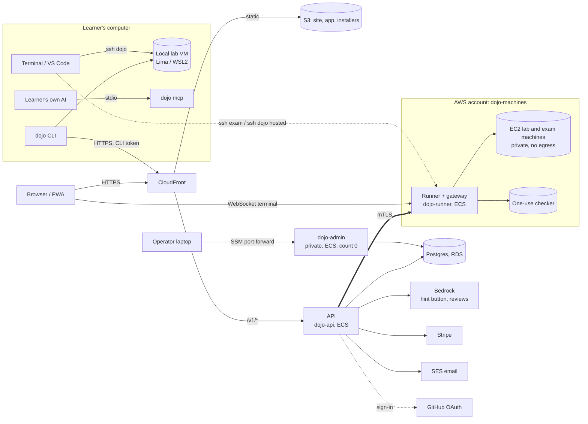
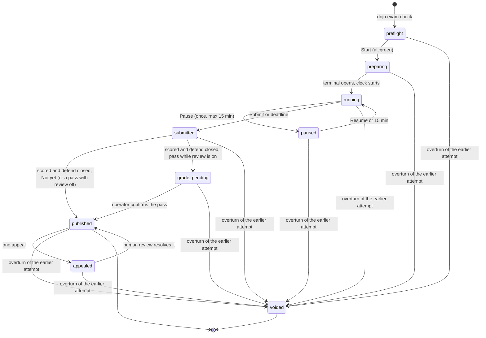

# Technical design: Dojo v1

Status: draft for review, rewritten 2026-11-20 for the paths, roles and work-day exam model.
It replaces the belt and kata design of 2026-11-19. Updated the same day with the project's answers to
the open questions (exam grading and appeals, onboarding, waitlist, share link, caps, domain,
accounts). Updated 2026-11-21 for the operator service (section 3.7, ADR 0002).

Sources of truth: the project brief of 2026-11-20, the design canvas v104 (its Map lists every
screen, codes below are the Map's) and the design ledger, both kept outside this repo. Where this document needs something none of them decides, it says
NEEDS-DECISION. Section 6 lists every place where the canvas and the brief disagree and says which
side wins; the canvas is fixed in a parallel round.

## 0. Scope and shape

Category: fast-money. Free to learn, with limits; money only where we pay for machines (Supporter
and hour packs). Done-line: a first learner finishes Foundations and Support L1 and passes the
Support L1 work-day exam on a hosted machine by 2027-03-31.

In v1 (from the brief): the `dojo` CLI with one verb set; local labs by default; hosted EC2
machines for the role exam and for laptops that cannot run labs, with a browser terminal; the web
(public pages, onboarding with "pick your path", Today, Path, ticket page with written hints and
the AI hint button, Practice, the role exam, "Ready for: Support L1", track record, emails, PWA);
Free, Supporter and hour packs through Stripe; usage analytics (EU, consent) and CLI telemetry
with opt-out.

Out of v1 (binding non-goals): Systems L2, Junior DevOps, SOC L1, Dev fundamentals, Backend,
Frontend (paths are drawn, not built); a Data path; chat with the AI on the site; peer review;
public portfolio and community pages; a Teams plan; per-learner ticket variants for practice; belt
marks beyond what Foundations and Support L1 need; any promise of a job or salary. Where a
non-goal touches a screen, this document designs at most a seam (a column or a flag) and says so.

The CLI and the local labs exist in this repo (`cmd/dojo`, `internal/lab`, `internal/kata`,
`internal/doctor`, `internal/sshconfig`, `internal/state`; the mentor files and `dojo mcp` are in
flight in PRs 6d and 6e). This document covers the CLI changes v1 needs and everything around it.



Pieces, one repo (public now; it will likely become one private monorepo, section 1.6):

| Piece | Where | What it does |
|---|---|---|
| Site | `web/` | Public pages (static Astro). |
| App | `app/` | The signed-in app: one React SPA, its own Vite build, served at `/app`. |
| API | `cmd/dojo-api`, `internal/server/...` | Sign-in, progress, hints, billing, exams, emails. Writes the database as `dojo_api`; operator writes go through the operator service (section 3.7). |
| Operator service | `cmd/dojo-admin`, `internal/admin/...` | Review queue, learner lookup, flags, every operator action audited. Private, never on the public origin (section 3.7, ADR 0002). |
| Runner | `cmd/dojo-runner`, `internal/runner/...` | Starts, pools, checks and destroys machines; SSH gateway; browser terminal. Runs in the machines account. |
| CLI | `cmd/dojo` (exists) | Labs, checks, hints, `dojo login`, `dojo exam`, `dojo mcp`. |
| Infra | `infra/` | OpenTofu for both accounts. |

## 1. Stack and services

### 1.1 Choices and why

Each row says why for this project. Nothing is here because another Kiban project uses it.

| Layer | Choice | Why this and not the alternative |
|---|---|---|
| API | Go, `net/http` routing, `pgx` + `sqlc`, `goose` | The CLI is Go, so the ticket format, the check protocol and the lab code are shared, not rewritten. `sqlc` keeps SQL visible and typed; the schema is relational and small, an ORM adds nothing. |
| Database | Postgres on RDS (`db.t4g.micro`, single AZ, daily backups, 30-day retention) | Constraints do real work here: one open exam per learner, unique usernames, a role pass needs a passed exam. RDS, not Aurora: Aurora is blocked on a Free-plan account and costs more than we need. One task fans live updates out with `LISTEN/NOTIFY`, so no cache or broker is needed. |
| Public pages | Astro, static output, Tailwind 4, shadcn/ui tokens | The distribution plan rests on search ("prácticas ASIR/SMR"), so public pages must be real HTML with no JavaScript needed to read them. |
| Signed-in app | One React SPA, its own Vite build in `app/` served by Caddy at `/app` with an index.html fallback (it shares only the design tokens with Astro, no mounting), React Router, TanStack Query, xterm.js | The app keeps state across screens: the command palette (K1), the inbox bell (N1), the live check mirror and the exam clock must survive navigation. Per-page islands would reload them on every move. No SEO is needed behind sign-in. |
| Live updates | Server-sent events (`GET /v1/stream`) from the API, `LISTEN/NOTIFY` between tasks | The web mirrors what the CLI reports (O3 "this page updates while you run it", L3 check results, H1 progress). One-way push is all that is needed; SSE passes CloudFront and the ALB without extra setup. Fallback: polling every 10 s. |
| Browser terminal | xterm.js, WebSocket to the runner, the runner opens SSH to the machine | Brief and design decision 2026-11-20. The runner holds the only route to the private machines. |
| Hosting, web and API | CloudFront in front of S3 (static) and an ALB (`/v1/*`, WebSocket); API on ECS Fargate (ARM) | All-in on AWS (decided 2026-11-20). Fargate: no host to patch. Not Lambda or App Runner: the API holds SSE and long-lived connections. One origin for site and API: no CORS, `SameSite` cookies just work, and the domain choice no longer constrains the design. The ALB accepts only CloudFront (managed prefix list plus a secret header). This choice does not depend on the parked one-shared-platform decision: everything here is Dojo's own account and is easy to move. |
| Region | `eu-south-2` (Spain) for both accounts, if Bedrock (and SES) are available there | Learners are in Spain; prices from the research (2026-11-19) match between the two regions for `t3.small`. Availability of the Bedrock model and SES in `eu-south-2` is not verified: M0b checks it. Fallback, decided now: Bedrock (and SES if needed) in `eu-west-1`, or the EU cross-region inference profile, with everything else staying in `eu-south-2`. |
| Hosted machines | EC2 `t3.small` from a Packer AMI, private subnet, no public IP, no egress, no instance profile, IMDS off, separate account | Per-machine isolation, per-second billing, security groups enforced outside the guest. Measured cost about EUR 0.025 per hosted hour. Fly Machines, E2B and Hetzner were compared and lost on systemd, egress control or checker access (ledger 2026-11-20). See ADR 0001. |
| Warm pool | A pool of running spare instances kept by the runner (1, 3, 10 at 100, 1,000, 10,000 active learners) | Cuts the 30 to 90 s start to a few seconds. About EUR 15 per spare instance per month; the pricing research says to cut it first if conversion stays low. Not the Auto Scaling warm pool: it keeps stopped instances and we do not use an Auto Scaling group. |
| Sign-in | GitHub OAuth App: web flow and device flow | Every learner needs GitHub anyway (repo, SSH key, signed commits). No passwords. |
| Payments | Stripe: Checkout, Customer Portal, webhooks | Chosen 2026-11-20. Monthly and yearly Supporter prices, one-off hour packs. Tax handling (Stripe Tax, a merchant of record or a gestor) and the GDPR review for 14 to 17 year olds are decided before the first charge (M8), not before building starts (section 7). |
| Email | Amazon SES over SMTP, from `carmen@` and `hello@` the domain | Same cloud, cents per thousand. SMTP gives one code path in production and in compose (Mailpit speaks it). Bounces and complaints come back through SNS to an API endpoint. Needs SES production access before launch. |
| Push | Web Push with VAPID keys sent by the API | No third-party push service. |
| AI hint button and reviews | Amazon Bedrock, a Haiku-class Claude model, called through an adapter | All-in on AWS (decided 2026-11-20), pays per token, and the provider does not train on inputs (verify in AWS service terms before launch). Cost estimate in the pricing research: about EUR 0.04 per learner a month. Exact model id and region verified in M7. |
| Web analytics | PostHog Cloud EU, loaded only after consent | Confirmed 2026-11-20: EU hosting, consent first. A signed-out visitor's choice lives in a first-party cookie and fills `learners.analytics_consent` at sign-in only while it is null; a choice already on the account wins. The cookie is `dojo_analytics_consent`, value `granted` or `denied` (anything else reads as unknown, which means no tracking), host-only, `Path=/`, `Max-Age` one year, `SameSite=Lax`, `Secure` on https, set by us and never by a third party. No table and no new API route: the choice is a cookie plus the existing `learners.analytics_consent`. A signed-in learner sets it through the existing `PATCH /v1/me` `analytics_consent` field, and the sign-in callback copies the cookie onto the account while it is null, with a conditional `UPDATE ... WHERE analytics_consent IS NULL` so a concurrent PATCH is never overwritten; a failed copy is logged and never fails the sign-in. |
| CLI telemetry | Our own `POST /v1/telemetry`, a table in our database, kept 12 months | The CLI must not talk to a third party. Opt-out with `dojo telemetry off`; events carry command names, results and timings, never files or output. Anonymous events are accepted, rate limited per IP; authenticated ones per learner. The nightly job deletes rows older than 12 months (`prune_telemetry()`, section 3.3). |
| Infrastructure as code | OpenTofu in `infra/`, state in S3, GitHub OIDC for CI | Portable HCL with no long-lived AWS keys. |
| Domain and accounts | `dojo.kyoten.dev`, kept a config value (`PUBLIC_ORIGIN`); an AWS Organization with an app account and a machines account, created in M0b | Decided 2026-11-20. Dojo may get its own domain later, so no code, cookie name or email template hardcodes the host. `kyoten.dev` is not registered yet (ledger): NEEDS-DECISION to buy it; until then M0b runs on the CloudFront default domain. |
| Environments | `pre` from M0b, `pro` created only at launch | Halves fixed cost until there are learners (the research estimates about USD 55 to 60 per environment). `pre` and `pro` are separate stacks (VPC, database, ECS) in the app account; the machines account holds the machine networks of both. Names are `pre` and `pro`, never "prod". |

### 1.2 Engineering bars (from the first commit)

- **Supply chain (web):** pnpm, exact versions, `save-exact=true`, committed lockfile,
  `--frozen-lockfile` in CI, `pnpm audit` and OSV failing on high or critical, install scripts off,
  every dependency justified in its PR, an SBOM per release.
- **Layers (API):** handlers thin; logic in `internal/server/service/<domain>`; database access in
  `internal/server/repo`; every external system (GitHub, Stripe, SES, Bedrock, the runner,
  PostHog) behind an adapter with one interface.
- **Tenant column from day one:** every learner-owned row carries `org_id`. v1 has one org,
  `public`. Teams are parked; the column costs nothing and avoids a migration of every table.
- **Webhooks:** none leave us in v1. Inbound ones are verified: Stripe by its signature header, SNS
  by its signing certificate. If we ever send one it carries HMAC-SHA256.
- **Tests:** `test` is unit; `test:integration` runs against the real stack from
  `docker compose` (section 1.7), never mocks. Isolation is not testable on a container backend:
  an end-to-end exam on real EC2 with escape attempts (a planted symlink, a removed firewall rule,
  a job left running in a pause) is a gate before `pro`.
- **Workflows** follow the repo rules: one file per component and purpose (`Web: Tests`,
  `API: Tests`, `Infra: Plan`), Harden Runner, SHA-pinned actions, required checks never
  path-filtered (steps skip inside the job using our own `git diff`).

### 1.3 Hosted machines

The runner talks to a `Backend` interface (`Create`, `Assign`, `Exec`, `Stop`, `DetachDisk`,
`CheckDisk`, `Destroy`), the same idea as the local `lab.Backend`. Implementations: `ec2` and a
container backend for compose.

- **Network:** each machine has a private IP, a security group with no egress and ingress only
  from the runner's group, no instance profile, IMDS disabled, and a hard lifetime cap (the
  deadline plus one hour for exams, the session cap for labs) so a stuck machine cannot bill
  forever. Per-ticket egress allowlists are a seam, not built: v1 machines have no internet.
- **Control channel:** the runner SSHes in with its own key (public half baked into the AMI).
  There is no SSM and no instance role, so nothing on the machine can call AWS.
- **Assign:** a warm machine is taken from the pool, tagged to the learner, the ticket's
  `setup.sh` runs over SSH ("breaking the server on purpose", H1), and the learner's public key is
  authorized for that machine only. With an empty pool the runner launches a new instance (30 to
  90 s) and H1 says so.
- **Gateway:** the runner runs a small Go SSH server on a public endpoint. `dojo ssh` and
  `dojo exam` connect with the learner's own key, which is accepted only for that learner's open
  machine, then proxy to the private IP. The browser terminal does the same from a WebSocket to the
  runner (a `term.` hostname in `pre` and `pro`, the `/term` path on Caddy locally),
  authenticated by a one-minute ticket the API mints from the session. The CLI writes an
  `ssh exam` and `ssh dojo` host entry as it does today. Public endpoint type (NLB or a single
  Elastic IP on a Fargate task) is chosen in M5b on cost.
- **Metering:** a `hosted_sessions` row opens when the terminal first opens and closes when the
  machine ends. Free hosted lab sessions are capped at 90 minutes and stop after 15 minutes idle
  (decided 2026-11-20). The role exam is never metered: it does not draw on hosted hours, on any
  plan, and its session is recorded as `counted_as = exam` for cost tracking only.
- **Supporter hosted hours (fair use).** Supporter lab hours are not unlimited: a soft cap of
  60 hours a month (about 2 hours a day) after which the app asks for an hour pack (pricing research wording), and a hard stop at 100 hours a month (numbers from the
  pricing research). Both live in `system_flags` (`supporter_soft_cap_h`, `supporter_hard_cap_h`)
  and are served with the quota by `/v1/me`, so `dojo status --quota` and E4 read them from
  `hosted_sessions` totals without a second source. The exam is never counted against them.
- **Machine ceilings.** `system_flags.max_concurrent_machines` caps every running machine, and
  `system_flags.max_free_lab_machines` caps the share free learners can hold (the free-pool
  ceiling). When a ceiling is hit, a new lab start is queued, not refused: H1 and `dojo start`
  say "All hosted machines are busy. You are number N in line; we will start yours as soon as one
  frees up." Exam machines are never queued behind labs: each exam slot is reserved outside the
  free-lab ceiling, so an exam that passed preflight never loses its slot.
- **Abuse limits.** Sign-in and machine starts are rate-limited by IP (and by learner on starts)
  at the API, so farmed accounts cannot drain the free pool. The exam has its own spend alarm: an
  AWS Budget on the machines account at EUR 100 a month for exam machines, emailing us at 80 and
  100 percent.
- **Exam checks run outside the guest** (ADR 0001): stop the machine gracefully, force it off
  after 30 seconds, attach its root volume to a one-use checker with no network (the runner reads
  results over the checker's SSH, which needs no outbound), mount read-only with `noload,nodev,
  nosuid,noexec`, and run the checks against that tree. File content is treated as hostile data:
  no symlink follows out of the mount (`openat2` with `RESOLVE_IN_ROOT`), nothing from the disk is
  executed. A crafted filesystem attacks the checker's kernel and could in principle forge its
  output; v1 accepts that for a step on our own path rather than a third-party credential, and the
  checker is destroyed after every use. Whether to read with userspace tools instead of a kernel
  mount is decided in the M6b spike. Consequence for content: Support L1 exam tickets are written
  as file-state checks (configs, enabled units, permissions, rotation rules).

### 1.4 AI hint button and reviews

One adapter, one endpoint family, two uses.

- **Hint (`POST /v1/hints/ai`, also `dojo hint`):** needs an active ticket id. The server loads the
  ticket brief and the written hints the learner already opened, plus the last check output (cut at
  16 KB), and calls Bedrock. It sends nothing else. Rules, all server side, none in the prompt:
  3 per ticket on Free and 10 on Supporter; each hint is unlocked by a failed check since the
  previous one; each one is more specific than the last and never the command; a hint is refused on
  an exam machine and in role exams; input capped at 6,000 tokens and output at 400; one request
  per 20 seconds. The reply is checked before it is shown: any code block, or a match against the
  ticket's `hint_guard` patterns (derived from the private solution and kept in the API-only
  `catalog_secrets` table, section 3.3; the CLI never has them), rejects it and the learner gets the next written hint instead.
- **Spend control (decided 2026-11-20):** every call records its tokens in `ai_hints`. A hidden
  daily cap of 20 AI hints per learner (never shown in the UI; hitting it reads as "no more hints
  today, try the written hints, back tomorrow") and a monthly Bedrock spend cap of EUR 50. The
  app estimates spend from recorded tokens and, at the cap, writes the current month to
  `system_flags.ai_cap_month` through `trip_ai_cap()` (section 3.7). AI hints are off while
  `ai_enabled` is false (the operator's switch) or `ai_cap_month` is the current month, so the cap
  lifts by itself when the month turns; an AWS Budget alarm at 80 percent and 100 percent of EUR 50 emails us and is the backstop
  if the estimate drifts. When AI is off, the button on L3 is disabled with the text "AI hints are
  paused for now. The written hints still work", `dojo hint` says the same, nothing is charged
  to the learner, and writing-task and exam rubric reviews keep their own reserve: the reserve is
  a separate flag (`ai_reviews_enabled`) that only the operator turns off, so a hint spike can
  never block an exam grade.
- **Review (writing tasks, simulated feedback rounds; story moments use fixed reactions and no AI,
  decided 2026-11-27, contracts in section 3.10):** the same adapter returns a
  rubric review as strict JSON (a list of named boolean criteria with a quoted line as evidence).
  Feedback only: it never decides a role. The exam is the exception, section 2.7, where the same
  booleans feed the pass rule and a person checks each pass while volume is low.
- **Privacy:** terminal output of learners aged 14 to 17 goes to a processor. Legal review is open
  (section 7).

### 1.5 Environments, delivery, operations

| Environment | What | How |
|---|---|---|
| local | The whole product, `docker compose up` (section 1.7) | Docker and Docker Compose only |
| `pre` | Real GitHub OAuth app, Stripe test mode, SES sandbox, real Bedrock, a small machine pool of its own | Deploy on merge to `main` |
| `pro` | Same shape in its own stack in the app account, real Stripe, warm pool sized to the active learners | Deploy on a release tag, created at launch |

- API and runner are container images on ECR (pushed over GitHub OIDC); migrations run as a
  one-off ECS task before each deploy; the site and app are synced to S3 and invalidated.
- Logs are JSON to CloudWatch with a request id that the 500 page (X2) shows. Metrics and alarms:
  request errors, machines running, exam start latency and failure rate (alarm over 2%, a kill
  trigger in the pricing research), hosted spend against revenue, Bedrock spend, SES bounces.
- Maintenance (X3) is a `system_flags` value the API serves; the CLI keeps working on local labs
  and queues events.
- Backups: RDS daily, 30 days. The privacy page says deleted accounts leave backups within 30 days.

### 1.6 Distribution, and the switch to a private repo

The repo is public now and will likely become one private monorepo (CLI, web, API). Nothing may
depend on its being public:

- The installer (`curl -fsSL <domain>/install | sh`) and the binaries are served from our own S3
  and CloudFront (`/dl/<version>/dojo-<os>-<arch>` plus a checksum manifest signed with a key the
  script knows). The release workflow builds with GoReleaser and uploads over OIDC; GitHub Releases
  is not used. There is no Homebrew tap in v1.
- The API tells the CLI the minimum version it supports (`min_cli_version`); `dojo doctor` and
  `dojo exam check` report an outdated CLI.
- Ticket bundles (`ticket.yaml`, `setup.sh`, `check.sh`, an optional `files/` directory, no
  solutions) are built from the private catalog repo (`kibanyadev/dojo-katas`) into S3 and fetched
  by `dojo start` through the API with the CLI token, with a `catalog_version` (format in section
  3.8). A ticket can be fixed without a CLI release. Solutions, wrong-fix tests, the exam pool and
  exam checks stay in the private repo and on the runner, never in a bundle. The hint guard
  patterns travel the other way: from M7 the deploy job reads them from the private catalog repo
  and writes them to `catalog_secrets` (API-only, section 3.3) in the same step that loads
  `catalog_items`; they are not in S3 and no endpoint serves them. Until M7 nothing reads them, so
  the table does not exist and the deploy job loads `catalog_items` only.
- **`check.sh` ships.** It is in every bundle and on hosted labs, so a practice ticket's expected
  end state is readable by the learner and by their AI. That is an accepted limit of practice,
  which is self-reported anyway (section 3.2). Exams never ship checks.
- **Going private.** On the free GitHub org plan, private repos lose rulesets and get capped
  Actions minutes. The move to a private monorepo therefore goes together with GitHub Team.
- "Report a broken ticket" and "I'm stuck: get help" post to our API (section 3.3,
  `ticket_reports`) instead of opening a GitHub issue, so they keep working when the repo closes.
- The learner's own practice repo (`<login>/dojo`) is theirs and unaffected.

### 1.7 Local stack

Every piece must run locally with Docker and Docker Compose, and one `docker compose up` brings up
the whole product. The AWS deployment stays the target, but nothing is built against AWS first:
every milestone is built and tested on the local stack, and deploying to `pre` is a separate step.
Each external service sits behind an adapter (section 1.2); production and local differ only in
configuration and the adapter implementation chosen, never in the code that calls it.

| Piece | Production | Local stand-in | Not covered locally |
|---|---|---|---|
| Edge (site, `/v1/*`, WebSocket) | CloudFront, S3, ALB | Caddy in front of the web build and the API on `http://localhost:8080`, same single origin and path routing | CDN caching, TLS, the ALB-only-from-CloudFront rule |
| Web and app | S3 static | Vite dev server for `make dev`, or the built static files served by Caddy | none |
| API | ECS Fargate | The same container image | Fargate limits |
| Operator service | ECS Fargate in a private subnet, desired count 0, reached by SSM port-forward | The same image as a compose service published only on `127.0.0.1:8090`, not behind Caddy, with its own fake-GitHub OAuth client | SSM, IAM and MFA, scaling to 0 |
| Database | RDS Postgres | Postgres in a container, same major version, migrations run by a one-off service | RDS backups, failover |
| Installer, binaries, ticket bundles | S3 over CloudFront | RustFS in the `s3` compose service (S3 API, so the same `internal/storage` adapter and presigned URLs), private bucket `dojo-catalog` created by the one-off `s3-init`. MinIO was the first choice, but its community repo is archived and its images are no longer published. Presigned URLs carry `DOJO_S3_PUBLIC_ENDPOINT` (`http://localhost:9000`, the loopback port the CLI reaches), while the API connects as `s3:9000`. `Put` stages under `staging/`, verifies size and sha256, then copies to the final key and never overwrites (`ErrExists`); production expires `staging/` with a lifecycle rule and `SweepStaging` covers the stand-in. Confirm presigned URLs on a real bucket before pre: minio-go signs for the dualstack S3 host | CloudFront signing |
| Email (E1 to E8) | SES over SMTP | Mailpit (SMTP in, web inbox to read) | Deliverability, DKIM, SNS bounce delivery (tests post a signed bounce payload to the endpoint) |
| Payments | Stripe | `stripe-mock` (Stripe's own mock API) for Checkout and Portal calls. Webhooks are sent by a small test helper that signs them with a local signing secret, so the handler verifies signatures exactly as in production. The Stripe CLI forwarder is not used: it needs a Stripe account and the network | Real Stripe behaviour, Tax, 3-D Secure |
| AI hints and reviews | Bedrock | The same adapter pointed at a deterministic stand-in (fixed replies keyed on the ticket and the hint number, used by every test). An optional compose profile points it at Ollama with a small local model to try real wording | Real model quality, quotas, Bedrock spend |
| Web analytics | PostHog Cloud EU | A browser-side analytics adapter (PostHog runs in the browser) whose local sink logs each event to the browser console, so nothing leaves the machine. The SPA module `app/src/lib/measure/` (not `analytics/`: ad blockers block `/analytics/events` paths in dev, which blanks the app) has one interface (`page`, `track`, `identify`, `reset`, `setConsent`, `setAccountConsent`) over a sink picked by `VITE_ANALYTICS_SINK` (`console` or `noop`; unset means `console` in dev builds, `noop` in production builds). Nothing reaches a sink until consent is granted; `track` takes only events declared in `events.ts`, each with an allowlist of prop keys and value kinds (anything undeclared is dropped), page views send the route pattern (never the raw URL) and none for unmatched routes, and the learner is known only through `identify(id)`. The PostHog sink plugs in later behind the same interface | PostHog itself |
| CLI telemetry | Our endpoint | The same endpoint and table | none |
| Sign-in | GitHub OAuth App (web flow, device flow, check-token and revoke endpoints) | A small fake GitHub in the repo that implements those endpoints (a generic OIDC stand-in such as dex does not implement GitHub's device flow or token check). The API reads the GitHub base URL from config. Device flow is enabled per client (`FAKE_GITHUB_DEVICE_CLIENTS`, default the web client); tests approve a code with `POST /login/device` (`user_code`, `login`, `decision`) | GitHub's real consent screen, rate limits |
| Hosted machines | EC2 in the machines account | The runner with a container backend: each machine is a systemd-capable container on an internal Docker network with no route out, started through the Docker socket (a development-only privilege, never in `pre` or `pro`). The warm pool, assignment, SSH gateway, browser-terminal WebSocket, pause and metering all run. The check flow is scoped to "exercises the same runner code path": a container rootfs is not a detachable volume, so the local machine keeps the state to be checked on a named Docker volume (not its rootfs), and the checker is a second container that mounts that volume read-only. systemd inside Docker Desktop is fragile; the M6b spike proves the local design (or the claim stays at this scope) | Real isolation (security groups, IMDS, no instance role), EBS detach and attach, kernel-mount attacks, real start times. The EC2 exam with escape attempts is the gate for this |
| API-to-runner mTLS | Private CA certificates, client cert on the API, server cert on the runner | The same mTLS code path: a one-off compose service generates a throwaway CA and the two certificates into a shared volume at start; the API and runner load them like in `pre` | Real certificate issuance and rotation |
| Machine image | Packer AMI | A Dockerfile per image | Packer |
| Push | Browser vendors' endpoints | A local push endpoint stub | Real delivery |
| Infrastructure | OpenTofu | none | All of it, checked by `Infra: Plan` in CI |

- One `compose.yaml` starts all of it; profiles keep the heavy parts optional (the Ollama model,
  the browser end-to-end tests). `make dev` is `docker compose up` plus the web dev server.
- Secrets in local are fixed test values in `.env.example`. The public origin is a config value
  (`PUBLIC_ORIGIN`), `http://localhost:8080` locally (`http://localhost:4321` under `make dev`, via `compose.dev.yaml`).
- `test:integration` runs against this stack and never mocks a service we have a stand-in for. The
  fake GitHub and the deterministic AI stand-in are ours; each gets one smoke test against the
  real service in `pre`.

## 2. App flow

### 2.1 Where the learner moves

```
public (P1-P4, P6, LG1) -> O0 pick path -> O1 sign in -> O2 install -> O3 doctor -> O4 key+repo
  -> O5 first ticket -> Today (L1) <-> Path (R1) <-> Practice (R6)
Today -> Ticket (L3) -> writing task (L9) / quiz (L11) / story moment (L4) -> next ticket
Path -> all tickets of the role done -> L6 rules + preflight -> H1 preparing -> R3/H2 work day
  -> submit -> defend (feedback) -> result (a pass waits for a person first): R4 role passed -> R5 record
     or L6 not yet -> practice -> retry (an appeal is possible once, after the result)
```

The app nav is Today, Path, Practice, plus the inbox bell (N1), the command palette (K1, desktop)
and the avatar menu (Settings S1-S4). Exam screens drop the nav for the on-call header: role, four
parts as a status strip, "no hints, no AI", the shift clock, Pause and Leave.

A signed-out visit to an app route redirects to sign-in and returns. A signed-in learner with no
role progress lands on O0 (no path) or the first unfinished onboarding step. O0 arrives in M3;
before it, a learner with no `chosen_path_id` is treated as being on the only available path, so
Today and Path work without a pick.

### 2.2 Screens

Routes are a proposal; the Map's codes are the contract. "State" lists the first-run, empty and
error cases the page must draw. Status is the Map's. The signed-in pages (the L, R, N and K rows)
are SPA routes served under `/app`: L3 is `/app/t/support-l1/perms-03`, and `dojo hint` prints that URL.

| Code | Route | Primary action | States |
|---|---|---|---|
| P1 Home | `/` | Pick your path (to O0); install line | Static. Board: SuAuroraLanding on the canvas Public page. The install line shows `curl -fsSL <host>/install \| sh` with a "Coming soon" label and no copy control until the installer is served in M0b. |
| P2 How it works | `/how-it-works` | Start Support L1 (to O0) | Static. The FAQ section is written in M9 from the questions real learners ask (M2 demo and first learners), then drawn on the board; no page of its own. |
| P3 Paths and roles | `/paths` | Pick your path | Static. Four paths drawn; only Systems and DevOps is open, the others say "coming soon" (section 2.3). |
| P4 The story | `/story` | Pick your path | Static. |
| P6 Pricing | `/pricing` | Become a supporter (to sign-in, then Stripe Checkout); Buy hours | Monthly and yearly toggle. Signed-in learners see their own plan. Teams: "Contact us" mailto only. |
| LG1 Privacy, terms, conduct | `/privacy`, `/terms`, `/conduct` | none | Names the hint button, usage stats and what survives account deletion. Legal text written and reviewed before launch (NEEDS-DECISION for the reviewer). Ships in M2 as a draft with `noindex`, and stays that way until the M9 legal review. |
| O0 Pick your path | `/start` | Continue: stores the chosen path in a short-lived cookie, applied at first sign-in | Reachable signed out. Security, Backend and Frontend show "coming soon" with "Tell me when" (the waitlist, section 2.3). |
| O1 Sign in | `/app/signin` (in the SPA) | Continue with GitHub (web flow, section 3.1) | Asks for age (14 or older) and terms on first sign-in. Error: GitHub refused or the state check failed, retry. |
| O2 Install | `/start/install` | Copy the install command per OS (Windows with WSL, macOS, Linux), then `dojo login` | Waits for `login` via SSE ("Waiting for dojo login on your computer"). Shows the usage-stats notice and `dojo telemetry off`. Error: code expired, show a new one. Contracts in section 3.9. |
| O3 Doctor | `/start/doctor` | Continue (enabled when no line fails; amber lines do not block) | Waiting, 2 to fix, all good, blocked. Blocked: "Use a hosted lab" turns on `learners.hosted_default` and goes on. "I'm stuck: get help" opens the report form. |
| O4 SSH key and repo | `/start/key` | Continue when the checklist is green | Steps the learner follows, each with the command to copy; `dojo doctor` verifies them and the page turns each line green (section 2.4). Failing lines show the fix. |
| O5 First ticket | `/start/first` | Copy `dojo start <id>` for the path's first ticket (`first_ticket` of `GET /v1/onboarding`) | Updates when the lab is ready, then when the ticket passes (a signed commit). |
| L1 Today | `/today` | Continue the ticket / Start the next one | First run (after O5): "day one done", next ticket, role progress. Empty never occurs after onboarding. Maintenance and offline show a banner. |
| R1 Your path | `/path` | Start or continue the role; Test out of Support L1 | Systems L2 and Junior DevOps show as locked "coming later" with no test-out card. Foundations passed; belt on the side. |
| L3 Ticket | `/t/*id` (for example `/t/support-l1/perms-03`; served at `/app/t/support-l1/perms-03`) | Copy `dojo start <id>`; Show hint; Ask Carmen (AI hint) | States below. |
| L9 Writing task | `/w/*id` (for example `/w/support-l1/write-01`) | Ask for review; Save draft | Draft saved as you type; review shows criteria and one fix. Done when submitted (feedback only). Review pending, paused, capped and failed states (section 3.10). |
| L11 Quiz | `/quiz/*id` | Check answer, Next | Never blocks. Done screen offers the missed question again. |
| L4 Story moment | `/story/*id`, also the feedback round | Choose a reply (story); write a reply and ask for review (feedback) | A story shows who wrote (`from`) and, for the chosen reply, its authored verdict badge and reaction, with no AI and no trust state (decided 2026-11-27, section 3.10); Today shows the next moment. In v1. |
| R6 Practice | `/practice` | Copy `dojo start <id>` (for example `practice/disk-full`) | Filter chips by kind, role, tag and difficulty; a scenario you have passed shows "passed". Never blocks the path. |
| N1 Inbox | bell dropdown, `/inbox` on phone | Open the item | Empty: "Nothing new". Mark all read. |
| K1 Command palette | `Cmd+K`, everywhere in the app on desktop | Run the highlighted action | Continue ticket, next hint, copy `dojo check`, search tickets and lessons. No docs search in v1. |
| L6 Exam rules and preflight | `/exam/:role` | Start the exam | Rules; preflight checklist (CLI version, SSH reachable, no other lab, three free hours); disabled reason shown for each unmet rule (section 2.7). Leave says what happens to the clock and the work. |
| H1 Preparing your machine | `/exam/:role/machine`, also shown for hosted labs | none (waits) | Four steps with real progress from the runner, CLI mirror. Error: no capacity or start failed, retry; the clock has not started. |
| R3/H2 The work day | `/exam/:role/day` | Submit the exam (after a confirm step) | Queue of four parts, answer boxes that autosave ("Saved 10:42"), browser terminal or `dojo exam`. Clock states: extra time applied, paused, warnings, clock hidden (section 2.7). Phone: "open this on a computer", the clock has not started. |
| L6 Defend | `/exam/:role/defend` | Send answers | Three questions, 30 minutes, draft saved, skip allowed. Feedback only, never scored. |
| L6 Submitted, checking a pass | `/exam/:role/result` | none (waits) | Canvas v109 L6 Submitted. While scoring and defend run it says "Submitted. Checking your work."; once defend closes, a Not yet goes straight to L6 Not yet, and a pass waiting for review shows "Submitted. Checking your pass." (telling the learner it scored as a pass before E2 is deliberate: the wait already says so). Shows the submitted time and the one-appeal rule. `dojo status` shows the same. |
| L6 Not yet / R4 Role passed | `/exam/:role/result`, `/roles/:role/passed` | Practice (not yet); See your track record (passed); Appeal | Not yet shows the five scored items, what did not hold and one retry date. Appeal is offered once per attempt, with a reason box (canvas v104 L6 Appeal and L6 Appeal decided, section 2.7). |
| R5 Track record | `/record` | Share (opt-in switch, copy link, regenerate or revoke) | Empty before the first role. Private by default; the learner turns sharing on and chooses which practice items show. Foundations and Support L1 entries read "Verified by Dojo" only when the pass is server-side (exam); tickets and practice read "Practice". |
| Public record | `/r/:token` | none | Only when the learner opted in; the token is long, random and unguessable, and the learner can revoke it or regenerate it (the old link then dies). Shows verified work and the items they chose, nothing else, `noindex`, not listed. There is no per-name record URL and no username namespace. This is not a public portfolio. |
| L7 / L8 Belt mark, belt | `/celebrate/:id` | Next ticket | Shown once, then in the inbox. L8 only when the four white marks are done. |
| A1 Review queue | `dojo-admin` `/review` (never on the public origin) | Confirm a pass; Override a part with a note; Resolve an appeal | Operator only, served by the operator service (section 3.7); canvas v108 A1 (desktop only). Section 2.7. |
| A2 Learner lookup | `dojo-admin` `/learners` | Give hours or Supporter, take a gift back; void an attempt; suspend or unsuspend; delete (GDPR) | Operator only, section 3.7; canvas v108 A2 and the delete confirm (desktop only). |
| A3 System switches | `dojo-admin` `/flags` | Change a flag (confirm and reason) | Operator only, section 3.7; canvas v108 A3 and the switch confirm (desktop only). |
| Accessibility statement | `/accessibility` | none | New, from the a11y review; linked from the footer. |
| S1 Account | `/settings/account` | Save; Switch path; Test out; Delete account | Username and language of explanations save through `PATCH /v1/me` (section 3.1); the rest of the list is path, plan, hour packs, extra time, usage stats, danger zone. |
| S2 Machines | `/settings/machines` | Revoke a CLI token | Lists CLI devices (OS, version, last seen; `GET /v1/me/devices`) and the SSH key (a later milestone); revoking calls `DELETE /v1/me/devices/{id}` (3.1). |
| S3 Notifications | `/settings/notifications` | Toggle | Per-kind push and email; quiet 22:00 to 08:00 local. No streak emails ever. |
| S4 Your AI | `/settings/ai` | Copy MCP config; Test the connection | Per-tool tabs. |
| E1-E8 | emails | see 2.9 | |
| W1-W5 | PWA | see 2.10 | |
| X1-X3 | `/404`, `/500`, `/maintenance` | Go to Today; Try again | 500 shows the request id. |

**Ticket page (L3) states:** starting (progress while the lab boots), in progress, lab did not
start (for example not enough disk: offers `dojo doctor` and a hosted lab), lab expired (after
7 days without a report from the CLI, work is in the repo, run `dojo start` again), failed check (last
output mirrored), passed (time, hints, the commit from M3 on), revisit (a passed ticket; all written hints
open; `dojo start <id>` again restarts the same ticket, with no new variant and no change to
progress). The states come from `ticket_progress.state` and `lab_state` (section 3.8).

### 2.3 Paths in v1

O0 shows the four paths. v1 builds only Systems and DevOps: Foundations and Support L1, with
Systems L2 and Junior DevOps drawn as locked "coming later". Security, Backend and Frontend are
"coming soon": picking one does not start anything. The learner can leave their email address on
file (their sign-in email) with "Tell me when", which adds a row to `path_waitlist`; signed out,
the choice is kept in the cookie and the row is written after sign-in. A learner who wants to
start meanwhile picks Systems and DevOps, whose Foundations every path shares. The waitlist counts
are the signal for which path to build next.

### 2.4 First run (O0 to O5), with the CLI

1. **O0:** pick a path.
2. **O1:** sign in with GitHub, confirm age 14 or older and the terms. First sign-in creates the
   learner and sends E1.
3. **O2:** `curl ... | sh` installs the CLI, `dojo login` runs the device flow. The page turns
   green when the API sees the login.
4. **O3:** `dojo doctor` checks memory, disk, git, git identity and a VM manager (Lima, or WSL2 on
   Windows), prints a fix line per problem, and reports each result to the page. A laptop that
   cannot run labs sets the hosted lab default and skips to O4.
5. **O4:** the learner follows the steps on the page: create an SSH key, add it to GitHub for
   signing (and again for authentication when the practice repo is cloned over SSH, which is the
   default clone; a learner who clones over HTTPS skips that), turn on commit signing
   (`gpg.format ssh`), create the public practice repo `<login>/dojo` with an `AGENTS.md` and a
   ruleset on `main`, and turn on 2FA and secret scanning. Every step shows the command or
   the GitHub link to copy. We never receive write access to their GitHub, which keeps O1's
   promise ("no access to your code"). `dojo doctor` verifies each step from the laptop (the key
   exists and is on the account, signing is configured, the repo exists and is public, the
   ruleset is on, AGENTS.md is present) and reports the result, so the page turns green line by
   line. 2FA and secret scanning cannot be read without a token, so the page asks the learner to
   confirm them (section 3.9). There is no `dojo setup git` command. The `ssh dojo` host entry is written by
   `dojo start`.
6. **O5:** `dojo start <first ticket>` boots the first lab; `dojo check` passes it as a
   signed commit; Today opens.

### 2.5 CLI commands

One verb set for tickets, practice and exams. Labs run on the laptop by default; a hosted machine
only for the role exam and for laptops that cannot run labs.

| Command | What it does | States and errors |
|---|---|---|
| `dojo doctor` | Checks the computer can run labs and, for O4, the SSH key, signing, practice repo and ruleset; a fix to copy per problem; reports results to the API as one `doctor.run` event (section 3.9). | Offline works, results queue. Outdated CLI is reported. |
| `dojo login` | GitHub device flow (section 3.1), stores the CLI token in the OS keychain or `DOJO_HOME` (file `token`, 0600; the keychain is a later card). `--force` logs in again. Address, GitHub host and client id come from flags or `DOJO_API_URL`, `DOJO_GITHUB_URL`, `DOJO_GITHUB_CLIENT_ID`; the API address and client id have no built-in default until the domain exists. | Code expired (`expired_token` or `token_expired`): retry. Denied on GitHub: retry. No account yet: sign up on the website first. Already logged in: says who. |
| `dojo logout` | `DELETE /v1/auth/cli`, then deletes the token file (also on `401`, the token was already dead). | API unreachable: the file stays, the command fails and points to `--local`, which only forgets the token on this computer. |
| `dojo start <id>` | Fetches the ticket bundle from the API with the CLI token, so the first start of a ticket needs `dojo login`; a bundle already cached on this computer starts logged out or offline, and its events queue and send after the next login (section 3.8; a ticket already started or passed restarts the same ticket, `--again` is not a variant), starts the lab (a hosted machine, `--hosted` or a laptop that cannot, arrives in M5a: until then both print that hosted labs are coming soon), runs the ticket's `setup.sh`, writes `AGENTS.md` and `CLAUDE.md` (`@AGENTS.md`) into the lab and repo (PR 6d), reports `ticket.started`, then `lab.started` or `lab.failed`. `DOJO_KATAS=<dir>` stays as a local development override: it reads the catalog from that directory, skips the API and sends no ticket events. | Not logged in and no cached bundle: says `dojo login`. Not enough disk or memory: says how much and offers a hosted lab. Offline: starts from a cached bundle if present (the first fetch needs the network once), else says so. Out of hosted hours: on Free, names the pack and Supporter options; a Supporter at the 100 h hard stop is told the fair-use limit is reached and the date it resets. |
| `dojo ssh` | Opens a root shell on the lab (local, or through the gateway for a hosted one). | No lab running: says `dojo start <id>`. |
| `dojo check` | Reboots the lab so only persistent fixes pass, runs the checks, keeps the last output (PR 6d), reports pass or fail and the output as a `check.run` event, and from M3 on a pass writes a signed commit into the local clone of the practice repo and pushes it (the repo is set up in O4, so M2 reports the pass without a commit and `passed_commit` stays empty; contract in section 3.9). `--repo PATH` picks and remembers the clone. | `--quick` skips the reboot. Offline: result saved and sent later. |
| `dojo stop` | Stops the lab, frees memory, reports `lab.stopped`. Hosted: ends the machine and the session. | Work stays in the repo. |
| `dojo status` | What is running and the current ticket id; `--quota` shows hosted hours (E4). | Nothing running: says so. |
| `dojo exam` | `check` runs preflight; bare `exam` connects to the hosted exam machine over SSH; `submit` ends the exam. | Refuses with the missing rule (section 2.7). No AI, no hints on this machine. |
| `dojo hint` | The AI hint for the current ticket (section 1.4), from M7. Until then it prints the L3 URL of the current ticket, where the written hints are. Written hints stay on the web. | Needs a failed check; shows hints left; offline or capped says so. |
| `dojo mcp` | MCP server over stdio for the learner's own AI: current ticket, last check, hints opened; never a solution (PR 6e, hand-rolled JSON-RPC; tools in section 3.9). | Does not run while an exam is open (a courtesy). |
| `dojo telemetry [on\|off\|status]` | Local switch for CLI usage stats (file `telemetry.json` in `DOJO_HOME`; on by default); mirrored to the account's `usage_stats` through `PATCH /v1/me` when logged in. `off` also drops the queue. The first command prints the notice on stderr ("Dojo shares usage stats ... When you are logged in they are tied to your account ... Turn it off any time with: dojo telemetry off") and neither it nor any earlier command sends; sending starts with the next one. The dispatcher records the command name, a result (`ok`, `failed`, `error`, `canceled`) and `duration_ms`, never arguments; `mcp` and `telemetry` are not recorded. Events queue in `telemetry-queue.json` (0600, atomic writes, at most 100) and flush in batches of at most 20 within 2 s at the end of a command: `204` or `400` drop the batch, `429` and other failures keep it and hold sending (Retry-After or one minute, at most an hour), a `401` on the bearer drops the batch and holds sending, never resending it anonymously (the account may have usage stats off) and never logging the learner out. `DOJO_TELEMETRY=off` or `DO_NOT_TRACK=1` always wins, and the environment can only turn it off. At `dojo login` (and when already logged in) the CLI reads `usage_stats` from `/v1/me`: an account that is off turns the local switch off. | API unreachable on `off`: the local switch stays off and the command says the account setting was not changed. |

The CLI was `list`, `hint` (written), `shell`, `clean` and `ssh-config`; v1 renames `shell` to
`ssh`, `clean` to `stop`, drops `list` (the web lists tickets), repoints `hint`, folds `ssh-config`
into `start` (`dojo start [--key PATH] <id>` writes the `ssh dojo` entry and remembers the key; a key
that cannot be used stops `start` before the lab is touched, a lab that refuses it only warns) and
`doctor` (which names the fix), and adds `login`, `exam`, `mcp`, `telemetry`. Each is its own small
PR. M2.4a landed `ssh`, `stop`, `start --key` and the removals, with no deprecated aliases (no users
yet): `shell`, `clean`, `ssh-config` and `list` answer "unknown command" with a hint to the new verb,
and are never recorded in usage stats. Until the catalog comes from the API (M2.4b), `start` reads
the local kata tree and the web is where a learner finds the ids.

### 2.6 Hints

- **Written hints** (one to three per ticket, in the catalog): shown on the web only after the
  learner opens them (`hint.opened` event, section 3.8). Hint 3 needs hint 2. It is a nudge, not a
  lock: they ship in the bundle, which is fine for practice.
- **AI hint:** the button on L3 ("Ask Carmen") opens after a failed check and works as in 1.4,
  with the same limits from `dojo hint`. It shows hints left and the answer in place. No chat.
- Hints are counted for the learner, never gate anything.

### 2.7 Role exam: the work day

One rule, for this document and the canvas. The work day has **four parts**: a ticket from Javi
(the printer), a vague brief from Lucía, an incident, and a handoff. It is scored on **five
items**: (1) the fixes, checked on the machine, (2) the ticket reply, (3) the response to the brief
(the questions asked), (4) the incident update, (5) the handoff. Pass is **4 of 5**. Three hours,
one pause of up to 15 minutes, extra time 1.5x if the learner turned it on, retry 7 days after the
result is published. No hints, man pages and docs allowed. The learner's own AI is never allowed
during the exam, and neither is ours.



- **What is written where.** The fixes happen on the machine. The reply, the questions on the
  brief, the incident update and the handoff are written in answer boxes on the page and autosave
  to `exam_artifacts` ("Saved 10:42"); the page shows the autosave state.
- **Who can start.** The API refuses unless the learner passed every ticket of the role (or is
  testing out of Support L1), has no open attempt (open = preflight, preparing, running, paused, submitted or grade_pending; published, appealed and voided are not open), and `retry_after` and any tombstone for their
  GitHub id are past. L6 names which rule is missing. **Test out** (Support L1 only) skips the
  "passed every ticket" rule and nothing else: `POST /v1/exams/support-l1/attempts` with
  `{"test_out": true}` (stored as `exam_attempts.test_out`), the same preflight, the same exam,
  the same 4 of 5 pass rule. The API ignores the flag for any other role. Support L1 is free on every plan. Roles
  marked `advanced` need Supporter (a seam for later roles, nothing in v1).
- **Clock on the server.** `deadline = started_at + 3h x time_factor`; resume moves it by the time
  actually paused. A sweeper (one task at a time, Postgres advisory lock) runs every 15 seconds:
  it resumes pauses past 15 minutes, never ends a paused exam, submits at the deadline and sets
  `defend_closed_at` once defend has been open 30 minutes.
  Whatever is autosaved at the deadline is what is graded, and the page says so.
- **Exam screen states** (all components of the on-call header): extra time applied ("Extra time
  on, 4:30"), running, paused with "Pause used" and a Resume button, warnings at 30, 10 and 5
  minutes as a text banner (never colour or sound alone), expired (autosaved answers submitted),
  clock hidden on request (the warnings stay), saved or saving, a submit confirmation that lists
  the parts done and not started, and a Leave dialog that says what happens to the clock and the
  work (the clock keeps running; leaving does not pause it). Pause is one control with one name.
- **Pause** kills open SSH sessions and forwards, refuses new ones and stops the clock. A job left
  running is accepted: checks read the final state.
- **Access.** Preparing uses a warm machine when one exists. Exams are free and equal on every
  plan: no plan is served first. The clock starts when the terminal opens. The learner reaches the machine through the gateway with
  their own key, or the browser terminal.
- **Scoring.** On submit the machine is checked on the checker (section 1.3), item 1 passing only
  if every fix holds. Items 2 to 5 are scored by the Bedrock reviewer, which returns booleans
  against a fixed rubric per item with a quoted line as evidence; an item passes when its required
  booleans are true, computed by code, not by the model. The reviewer reads the learner's free
  text, so prompt injection could try to flip the booleans; the operator check on every pass (below)
  covers it. `pass_review_required` is not switched off until a prompt-injection eval set
  passes against the rubric reviewer. The result so far is stored as
  `provisional_result`. The learner sees a one-line `learner_summary` per item and never check
  output or the rubric.
- **Pass review (while volume is low).** Decided 2026-11-21: only a pass waits for a person.
  Prompt injection only helps a learner pass, so a scored Not yet is published as soon as scoring
  ends (E3 at once) and the learner can still appeal it. A scored pass sits in `grade_pending` and
  appears in the review queue (A1 in the operator service, section 3.7): oldest first, showing the
  learner's answers, each rubric boolean with its evidence, the machine results and the learner
  summary. The operator confirms, or overrides an item with a note; the override is recorded and
  wins, so a pass can become a Not yet. Publishing sets `result`, `retry_after` (publication plus
  7 days) and `published_at`, writes the role pass on a pass and sends E2 or E3. The requirement is
  a flag (`system_flags.pass_review_required`) so it can be switched off when volume justifies it;
  with it off, a pass is published automatically too. While a pass waits the learner sees
  "Submitted. Checking your pass." on L6 and in `dojo status`, and gets no result email until
  publication. The target turnaround shown to the learner is NEEDS-DECISION (the canvas says
  "usually within one working day").
- **Appeal.** After publication the learner can appeal once per attempt, with a short reason, within
  7 days. A person reads the answers and the grade, and either upholds it or overturns an item;
  an overturn can turn a not yet into a pass (then the role pass is written, `retry_after` is
  cleared and a corrected E2 is sent); an overturn also voids any open second attempt, so the
  learner never holds a pass and a live retry together: an open, published or appealed second attempt moves to `voided`, its result (if any) is dropped, and its machine, if still running, is destroyed through `teardown_jobs`. The appeal does not pause the retry wait. The decision and
  who made it are stored in `exam_appeals`. Appeals appear in the same review queue.
- **Defend.** After submit the learner answers three "why" questions written from a text diff of
  their changes against the broken baseline (read, never run), within 30 minutes, skippable. It is
  feedback only and is never scored. It runs while scoring finishes, and publication waits until
  defend closes (answered, skipped or 30 minutes), so a Not yet never lands in the middle of it. It stays in v1.
- **One retry date.** `retry_after` is the only date, set at publication; L6 Not yet, E3 and
  `dojo status` all show it.
- **After scoring:** the machine and the checker are destroyed; the root volume is kept as
  evidence until the appeal window ends (7 days after publication), then deleted.
- **Delete during an exam:** it counts as a `not_yet` for the retry wait (the tombstone), queues
  the teardown, and the attempt row is deleted with the rest.

### 2.8 Hosted lab (a laptop that cannot run labs)

`learners.hosted_default` (set from O3 or `--hosted`) makes `dojo start` ask the API for a hosted
machine. The same H1 progress screen appears in the web and the CLI; the ticket page shows the
browser terminal next to the ticket ("hosted machine, no internet"); `dojo ssh` works through the
gateway; `dojo check` runs `check.sh` on the machine over SSH and the result is self-reported like
a local one. Free is 10 hours a month; at 80 percent and at 100 percent the learner gets E4 and
sees "Buy 10 hours" and "Become a supporter". Packs are used last, after the monthly allowance.
Sessions stop at the 90 minute cap or after 15 minutes idle. Supporters have fair use: a soft cap
of 60 hours a month and a hard stop at 100 (section 1.3). When the machine ceilings are hit,
starts wait in a queue with a clear message (section 1.3). The role exam machine is never drawn
from these hours. On a phone there is no terminal.

### 2.9 Billing and emails

- **Supporter:** Checkout (EUR 9 a month or EUR 90 a year, founding price kept for life by staying
  on the founding Stripe price while subscribed), then E5. Cancel in the Customer Portal; E6 says
  what stays. Packs are one-off Checkout sessions (10 h for EUR 3, 25 h for EUR 6, valid 12 months).
  Webhooks are idempotent by Stripe event id and are the only writer of billing tables.
- **Emails:** E1 welcome (names the path), E2 role passed, E3 not yet, E4 hours low, E5 supporter
  welcome, E6 supporter ends, E7 weekly summary (Sundays), E8 account deleted (the last email,
  sent once). Product news is off by default. No streak or "you have not practiced" email.
  Every email is queued in `email_outbox` (section 3.3), whose `(kind, ref)` key makes it go once;
  bounces suppress an address.

### 2.10 Phone and offline

W1 install sheet, W2 notification ask, W3 push content, W4 offline page, W5 Today on the phone. The
service worker caches the app shell, the current ticket and its opened written hints. Writes made
offline are not queued by the web; the CLI keeps working against the local lab and queues its own
events. The exam and the browser terminal are desktop only.

### 2.11 System states

Maintenance (X3): the site shows it, local labs keep working, `dojo check` saves and syncs later.
500 (X2): request id shown. 404 (X1). Signed-in pages show a banner when the API is unreachable.

## 3. Data and auth

### 3.1 Sign-in

- **Web:** OAuth authorization-code flow run by the API (`/v1/auth/github/start` and
  `/callback`), with PKCE and a `state` bound to the browser by a short-lived cookie. Scopes:
  `read:user user:email` (the email is needed for E1 to E8; GitHub emails can be private, and
  `/user/emails` needs `user:email`). The callback upserts the learner by numeric `github_id`,
  revokes the GitHub token it received (`DELETE /applications/{client_id}/token`, never
  `.../grant`), and sets the session cookie `dojo_session`: a random 256-bit id stored hashed,
  `HttpOnly`, `SameSite=Lax`, 30-day sliding expiry, and `Secure` whenever `PUBLIC_ORIGIN` is
  `https` (Safari drops `Secure` cookies on `http://localhost`, so the local stack goes without).
  In `pre` and `pro` the API refuses to start unless `PUBLIC_ORIGIN` is `https`, so a wrong origin
  can never ship cookies without `Secure`. The environment is the required `DOJO_ENV` variable
  (`local`, `pre` or `pro`). The cookie value is 32 random bytes in unpadded base64url (43
  characters); the API stores and looks up the sha256 of that string, and a value of any other
  length never reaches the database. The sliding expiry is written at most once a minute per session.
  GitHub may return no usable email; `learners.email` is then empty until GitHub returns one.
  GitHub is the only source of the email for now: every sign-in (web or CLI) replaces the stored
  email with a non-empty GitHub one and keeps it when GitHub returns none. There is no learner
  email setting yet; when one arrives (M9), a learner-set email stops being overwritten (decided
  2026-11-23, issue 69).
- **Sign-out:** `POST /v1/auth/logout` (no body, `Content-Type: application/json` and `X-Dojo-Csrf`)
  needs a cookie session that the session middleware resolved; it sets `revoked_at` on that session,
  clears `dojo_session` with the attributes it was set with and answers `204`. No cookie principal
  (anonymous, an unknown or already revoked cookie, or a bearer call) is `401`; a missing CSRF header
  is `403`. A suspended learner can still sign out. A bearer call is not a cookie session: it gets `401`
  here and signs out through `DELETE /v1/auth/cli` (below).
- **Age and terms:** O1 asks for both before "Continue with GitHub". `start` takes them in a
  POST body (never query parameters, so a link from elsewhere cannot tick them) and carries them in
  the short-lived state cookie, which is signed by the API and bound to the OAuth `state`, as O0
  carries the path. The callback records `age_confirmed_at`, `terms_accepted_at` and `terms_version`
  from the server's own clock and the required `TERMS_VERSION` config (the API refuses to start
  without a valid one; `unrecorded` is reserved); the cookie only says the boxes were ticked.
  They are needed only to create a learner:
  when an unknown GitHub account comes back without them (for example from a sign-in started on
  P6), the callback stores nothing and sends the browser back to O1 to confirm. So no GitHub data
  is kept before the 14-or-older confirmation, and no session exists for a half-created account.
  A returning learner signs in without ticking them again.
- **Rate limit:** every `/v1/auth/*` route, and anonymous `POST /v1/telemetry` (60 a minute), is limited per
  client IP; authenticated `POST /v1/telemetry` is limited per learner (120 a minute, shared by the learner's devices), so one valid token is not unlimited. `POST /v1/events` has its own budget of 60 requests a minute per learner, `GET /v1/stream` one of 30 connections a minute, the bundle route 30 a minute, and the catalog, path, today and ticket reads share 120 a minute (section 3.8; M4 adds its reads to that budget and a between-tickets write budget of 60 a minute, section 3.10). The other authenticated writes (`PATCH /v1/me`, `DELETE /v1/me`, `DELETE /v1/me/devices/{id}`) share one budget of 10 a minute per learner, whatever the route, session or device (a `409 username_taken` is a one-guess-per-request enumeration signal, so renames are capped); `DELETE /v1/me` also keeps the per-IP limit above. Sign-out routes stay on the per-IP limit only: they reveal nothing and end the caller's own credential. The per-learner limits are taken after authentication (a request with no valid credential is a `401` and never spends a learner's budget; an authenticated write refused later, by the CSRF check or validation, still spends one, the safe side for a guessing signal), refuse with `429 rate_limited` and `Retry-After`, and are held in memory per API task with bounded size (full buckets are swept, the stalest evicted at the cap, a new learner is never refused). The client IP is the address `TRUSTED_PROXY_HOPS` entries from the right of
  `X-Forwarded-For` (1 locally, behind Caddy; 2 in AWS, behind CloudFront and the ALB), or the
  connection address when the header is shorter; the header is never trusted further.
- **CLI login:** `dojo login` uses the GitHub device flow with our client id (the same OAuth App as
  the web flow, device flow enabled), asking for the scopes `read:user user:email`, and sends the
  resulting token once to `POST /v1/auth/cli`. Rate limited with the rest of `/v1/auth/*`.
  - Request: JSON body (`Content-Type: application/json`, at most 4 KB) with `access_token` (the GitHub
    token, 1 to 255 of `A-Za-z0-9_-`), `device_name` (1 to 64 characters, no control or invisible format
    characters, no leading or trailing space), `os` (1 to 32 of `A-Za-z0-9._/+ -`, for example `darwin/arm64`) and
    `cli_version` (1 to 32 of `A-Za-z0-9._+-`). Unknown fields are ignored. The route reads no cookie
    and no `Authorization` header, so a stale token on the CLI never blocks a new login.
  - The API calls GitHub's check-token endpoint (`POST /applications/{client_id}/token`, basic auth
    with our client id and secret) and accepts only a `200` whose `app.client_id` is ours: another
    app's token, an unknown or a revoked one is refused. It reads the user id and login from that
    answer, the verified primary email from `GET /user/emails` when the grant includes `user:email`
    (a grant without it logs in with no email), and then revokes the GitHub token
    (`DELETE /applications/{client_id}/token`, a `404` counts as already gone, two retries). If the
    revoke fails the login fails and is retried from the device flow: no GitHub token is ever stored
    or logged. The revoke happens for every outcome after a successful check, including the refusals
    below.
  - Only an **existing learner** gets a CLI token. Age and terms are confirmed only on O1, so the CLI
    never creates a learner: an unknown GitHub account is `403 signup_required` and `dojo login` tells
    the person to sign up on the website first. A suspended learner is `403 account_suspended`. A known
    learner's `github_login` and `email` are refreshed as in the web flow (a non-empty GitHub email
    replaces the stored one, an empty one keeps it).
  - Response `201` with `{"token": "dojo_<43 characters>"}`, `Cache-Control: no-store`. The token is
    `dojo_` plus 32 random bytes in unpadded base64url (48 characters in all); the prefix tells a
    secret scanner and a person it is ours and never a session cookie. Only its sha256 is stored,
    with the device name, OS and CLI version. It has no expiry: it lives until revoked, and
    `last_used_at` (written at most once a minute) is what S2 shows as "last seen".
  - Errors, all `{"error": "<code>"}`: `400 bad_request` (not JSON, wrong content type, a field out of
    its limits), `401 github_rejected` (GitHub does not know the token as ours: expired, revoked,
    another app's, already used for a login), `403 signup_required`, `403 account_suspended`,
    `429 rate_limited` (with `Retry-After`), `502 github_unavailable` (GitHub failed, including a
    revoke that kept failing; retry the whole login), `500 server_error`.
- **CLI requests:** `Authorization: Bearer dojo_...`. The API checks the shape, then the sha256 in
  `cli_tokens`; a revoked token does not resolve (`401 unauthenticated`); a suspended learner's
  token resolves but gets `403 account_suspended` on routes that need an active learner, like
  `/v1/me`. A non-empty `Authorization` header that is not a valid, active CLI token is `401` on
  every route, never an anonymous request. A request has one credential: with an `Authorization`
  header the bearer decides and any session cookie is ignored (bearer wins), so a call is never both
  CSRF-exempt and cookie-authenticated. A bearer is not a cookie session either: the web sign-out
  refuses it.
- **CLI sign-out:** `DELETE /v1/auth/cli` with the bearer token revokes that token (`dojo logout`)
  and answers `204`; no bearer principal is `401`; a suspended learner can still do it. Revoking
  another device's token by id is S2, below.
- **Devices (S2):** both routes need an active learner and take the cookie or the bearer (a cookie
  `DELETE` needs the CSRF headers). Errors are `{"error": "<code>"}`: `401 unauthenticated`,
  `403 account_suspended` (list only), `403 csrf_rejected`, `500 server_error`.
  - `GET /v1/me/devices` answers `200 {"devices": [...]}`: the learner's non-revoked CLI tokens,
    most recently used first, each `{id, device_name, os, cli_version, created_at, last_used_at,
    current}`. `id` is the `cli_tokens` row id (never the token or its hash); `current` is `true`
    only on the token the request itself carries, so it is always `false` for a cookie call. An
    empty list is `[]`.
  - `DELETE /v1/me/devices/{id}` revokes that token and answers `204`, only if it is the caller's
    and not yet revoked. An unknown, another learner's, already revoked or malformed id (anything
    but the canonical 8-4-4-4-12 form, hex digits in either case; no dashes, underscores or braces) is the same `404 not_found`, so the route is no oracle for
    other learners' token ids. Revoking the token the call carries is allowed (it is a sign-out):
    the next call with it is `401`. A suspended learner cannot list (`403 account_suspended`) but can
    still revoke their own tokens (self-service, scoped by `learner_id`, like `DELETE /v1/auth/cli`
    and web sign-out); another learner's id stays `404`.
- **No token to the learner's GitHub.** Their practice repo is public and is read without auth.
- **CSRF:** every state-changing request authenticated by the session cookie needs a JSON body and
  a custom header (`X-Dojo-Csrf`, any non-empty value, with `Content-Type: application/json`;
  refused with 403 `csrf_rejected`); the site and the API share one origin, so no CORS is allowed. CLI requests carry
  their token in the `Authorization` header, which a browser never adds by itself, so they are
  exempt. A request is authenticated by one credential only: one with a bearer token ignores any
  session cookie, so the exemption never covers a cookie-authenticated request.
- **Untrusted CLI input:** event payloads are limited (64 KB per event, 1 MB per batch, check
  output 16 KB) and always rendered escaped.
- **Username:** unique, lowercased, 3 to 30 characters `[a-z0-9-]`, reserved list; defaults
  to the GitHub login when free. GitHub logins can be 1 to 39 characters, so sign-up never fails on
  the rule: the login is lowercased and used as is when it fits and is not reserved; otherwise
  (1 or 2 characters, over 30, reserved, or a character outside `[a-z0-9-]`) the name is
  `<base>-<id36>`, where `<id36>` is the GitHub id in base 36 and `<base>` is the login stripped of
  other characters, cut so the whole name stays within 30 characters, with edge hyphens trimmed
  (`learner` when nothing is left). A taken name (the unique index decides) is retried as
  `<base>-<id36>-2`, `-3`, and so on, up to 5 tries in all. The result depends only on the login, the
  id and which names are taken, and the `<id36>` part is unique per account. The learner can rename in
  S1. Only shown to the learner and used in the app; it carries no
  public URL, so a change needs no redirect.
- **Profile update (S1):** `PATCH /v1/me`, for an active learner by cookie (with the CSRF header and a
  JSON content type) or bearer. Body `{"username"?, "language"?, "usage_stats"?, "analytics_consent"?}` (M3 adds `hosted_default`, `email` and `first_run_seen`, section 3.9) (`usage_stats` a JSON boolean, the usage-stats switch the CLI mirrors; `analytics_consent` a JSON boolean, the web analytics choice), at least one, and any other field is
  refused (`400 bad_request`, as is a non-JSON, empty, oversized or trailing body; a `null` counts as
  absent). `username` is lowercased, then held to the sign-in rules (`^[a-z0-9-]{3,30}$`, not reserved),
  so `Ada-New` saves as `ada-new`; `language` is `en` or `es`, exactly; a non-boolean `usage_stats` or `analytics_consent` is `400 bad_request`. Answers `200` with the body of
  `GET /v1/me`, and sets `updated_at`. Errors, all `{"error": "<code>"}`: `400 invalid_username`,
  `400 invalid_language`, `400 bad_request`, `401 unauthenticated`, `403 csrf_rejected`,
  `403 account_suspended`, `409 username_taken` (the unique index decides, so two racing renames
  cannot both win), `429 rate_limited` (10 writes a minute per learner, section 3.1), `500 server_error`. Re-sending the current values is a `200`. It writes only the
  columns `dojo_api` may update (3.3). There is no availability-check route in M1: it would let a
  signed-in learner enumerate usernames for little gain, and S1 shows the `409` at save instead.
- **Account deletion (S1):** `DELETE /v1/me`, by the cookie session only, with the CSRF header and a
  JSON content type. Body `{"confirm": "<github_login>"}`, compared with the learner's GitHub login
  case-insensitively; any other field, a missing or non-string `confirm`, or a non-JSON, oversized or
  trailing body is `400 bad_request`. It calls `delete_learner` (section 3.5) and answers `204` with the
  session cookie cleared, like web sign-out. A suspended learner may delete their own account
  (erasure is a right, and it only ends their own data, like revoking their own tokens). A CLI
  bearer is refused with `403 forbidden` even though the token is valid: a CLI token must not erase
  an account, and a `401` would make the CLI ask for a new login. Errors, all `{"error": "<code>"}`:
  `400 bad_request`, `400 confirm_mismatch`, `401 unauthenticated` (no session, or the learner was
  already gone, so a repeat call queues no second E8), `403 forbidden`, `403 csrf_rejected`,
  `429 rate_limited` (the per-IP limit of the auth routes, and the per-learner write budget), `500 server_error`. Nothing personal
  is logged.
- **Age:** a self-declared confirmation of 14 or older at first sign-in. No other check.
- **Exam SSH access:** the learner's public key is registered for one machine; no lookup by GitHub
  username, so a renamed login cannot be authorised by mistake.
- **Operators:** listed in the `operators` table, which only the operator service can read or
  write. Every operator screen and action lives in the private operator service (section 3.7);
  the public API has no operator routes and the public app no operator screens. Every action
  records who made it and why.

### 3.2 Who is trusted with what

Local checks run on the learner's machine, so a ticket pass is self-reported. That is fine:
tickets are practice. Only the role exam is authoritative, and it runs on our machines.

| Event | Source | Trusted for |
|---|---|---|
| Onboarding steps, doctor results | CLI | Showing progress only |
| Pass commit sha | CLI; the API reads the learner's public repo | Showing "verified" on L3 and Today, nothing else |
| Ticket started, check run (pass or fail and output), written hint opened | CLI, web | Today, path, role progress |
| Hosted lab check | CLI over the gateway | Same as local: self-reported |
| Quiz answers | Web | Quizzes |
| Writing task, story reply, reviews | Web and Bedrock | Feedback only |
| Exam items and result | Machine checks on the runner, the rubric reviewer, and the operator's confirmation of a pass | Role passes, track record "Verified" |
| Stripe events | Stripe (signed) | Plans and hours |

The CLI sends events to `POST /v1/events` (batched, idempotent by a client-generated id) after each
command; offline it queues them in `DOJO_HOME`. The API stores them, updates `ticket_progress`, and
pushes the change to any open page over SSE ("mirrored from your laptop" is the last check and lab
state the CLI reported, not a live stream). The exact contracts are in section 3.8.

### 3.3 Tables

Every table also has `org_id`, `created_at`, `updated_at`. Ids are UUIDv7. `learner_id` references
`learners(id)` and cascades on delete unless noted. Columns arrive with the milestone that first
reads or writes them (M1 creates `learners` with the sign-in, settings and consent columns only);
each migration states the grants for `dojo_api` and `dojo_admin` (section 3.7).

| Table | Key columns | Notes |
|---|---|---|
| `orgs` | `slug`, `name` | One row, `public`. |
| `learners` | `github_id` (unique), `github_login`, `username` (unique), `email`, `language` (en, es: explanations), `extra_time`, `hosted_default`, `email_source`, `first_run_seen_at`, `age_confirmed_at`, `terms_accepted_at`, `terms_version`, `usage_stats` (bool), `analytics_consent` (null, true, false), `chosen_path_id`, `time_zone` (IANA name, null means UTC; from M4, section 3.10), `record_shared` (default false), `record_token_hash` (null when not shared), `suspended_at` | `extra_time` applies to every exam. `terms_version` is the API's required `TERMS_VERSION` at creation (1 to 32 of `a-z 0-9 . -`), insert-only like `terms_accepted_at`; rows from before the column read `unrecorded`. `record_shared` is the opt-in for the share link; the token is shown once, stored hashed, and regenerating replaces the hash. |
| `sessions`, `cli_tokens` | `learner_id`, `token_hash`, `last_used_at`, `revoked_at`; tokens add `device_name`, `os`, `cli_version`, `ssh_public_key` | Hashes only. M1 creates `cli_tokens` without `ssh_public_key` (the exam milestone adds it). `dojo_api` reads, inserts the device row and updates `last_used_at`, `revoked_at` and `updated_at`; no `DELETE`, and `dojo_admin` has no grant. No expiry: a token ends when revoked or when the learner is deleted (cascade). |
| `paths` | `slug`, `title`, `status` (available, planned), `position` | Content, loaded at deploy from `catalog.yaml`. v1 data: one available path. |
| `roles` | `slug`, `title`, `summary` (one line, at most 120 characters, default empty), `kind` (foundations, role), `has_exam`, `advanced` (default false) | Content. A role has no home path and no order of its own: membership and order live in `path_roles`, so Foundations is one row shared by every path. |
| `path_roles` | `path_id`, `role_id`, `position` | Content. Unique `(path_id, role_id)`. |
| `catalog_state` | `id` (always 1, `CHECK (id = 1)`), `catalog_version` | One row, upserted on `id = 1` by every successful catalog load (section 3.8) in the same transaction; before the first load there is no row and `GET /v1/catalog` answers `catalog_version: null` with empty lists. It is where `GET /v1/catalog` reads the top-level version; `catalog_items.catalog_version` keeps the version each item was last loaded with. |
| `catalog_items` | `id` (for example `support-l1/perms-03`), `role_id` (null for practice), `kind` (ticket, writing, quiz, story, feedback, practice), `position`, `title`, `est_minutes`, `tags` (text array), `brief` (markdown), `hints` (text array, one to three), `awards_mark` (a `belt_marks` slug, writing and feedback only), `payload` (jsonb, the kind fields of writing, quiz, story and feedback; from M4), `difficulty` (practice only, optional; from M4), `catalog_version`, `bundle_key`, `bundle_sha256`, `bundle_bytes` | Loaded from the catalog at deploy; the API never parses YAML per request. Tickets and practice items fill `brief`, `hints` and the bundle columns (section 3.8); the four other kinds leave them null and fill `payload` (section 3.10, migration 00025). A practice item has no role and is numbered by id order. |
| `ticket_progress` | `learner_id`, `item_id`, `state` (started, passed, revisit), `lab` (local, hosted; null when an event other than `ticket.started` made the row), `lab_state` (starting, running, failed, stopped, expired; null until a lab event), `lab_state_at`, `first_started_at`, `last_seen_at`, `check_count`, `last_check_at`, `last_check_ok` (null before the first check), `last_check_passed`, `last_check_total`, `last_check_output`, `first_passed_at`, `passed_seconds`, `passed_commit`; from M3 `commit_state`, `commit_tries`, `commit_next_at`, `commit_checked_at`, `commit_at` (section 3.9, migration 00021) | One row per learner and item; no row means not started. Written by the events projection in the same transaction (section 3.8). `lab_state_at` and `last_check_at` are the CLI's `client_at` of the event that set the field, so an older event cannot overwrite a newer one; `first_started_at` is a `client_at` too, and `created_at` is the server's. Revisits never change `first_passed_at`. `passed_commit` stays null until M3. The record is kept for the life of the account. |
| `hint_opens` | `learner_id`, `item_id`, `n` (1 to 3), `opened_at` | Written hints the learner opened, one row each; primary key `(learner_id, item_id, n)`, `learner_id` cascades on delete, `dojo_api` may SELECT and INSERT only (no UPDATE or DELETE). Kept apart from `ticket_progress` so opening a hint never creates a row or marks a ticket started. The count and list are read from here. |
| `events` | `learner_id`, `client_event_id` (unique with `learner_id`; the wire field `id`), `type`, `payload` (jsonb), `at` (server clock), `client_at` | Append-only audit behind `ticket_progress`. `at` is the server's; `client_at` is what the CLI said and orders only the per-field rules of section 3.8. A `check.run` payload keeps no output (it lives in `last_check_output`). Deleted after 12 months by `prune_events()`, run by the nightly job like `prune_telemetry()`. Migration 00013 builds all three progress tables and `prune_events()` (fixed 12 months, `EXECUTE` revoked from everyone). `events` has `org_id` but no `created_at` or `updated_at` (`at` is the server time); `hint_opens` has `org_id` and `opened_at` only. `item_id` is the catalog item's text id; on `ticket_progress` and `hint_opens` it references `catalog_items (id)` with no cascade, so a catalog load cannot drop an item that has progress. `dojo_api` has `SELECT` and `INSERT` on `events` (no `UPDATE`) and `hint_opens`, and `SELECT`, `INSERT` and `UPDATE` on the projected columns of `ticket_progress`; `dojo_admin` only reads `ticket_progress`; nobody has `DELETE`. |
| `item_completions` | `learner_id`, `item_id`, `completed_at` | One row when a non-ticket item is done (writing or feedback submitted, quiz completed, story chosen); never removed. Today's `between` and Path's `between_items` read it (section 3.10, migration 00025). |
| `quiz_answers` | `learner_id`, `item_id`, `question_id`, `first_choice`, `first_correct`, `first_at`, `last_choice`, `last_correct`, `last_at` | Server-checked answers; the first answer never changes and keeps the stats, a retake moves only the `last_*` columns (section 3.10, migration 00026). |
| `story_choices` | `learner_id`, `item_id`, `choice_id`, `chosen_at` | One final choice per story moment (section 3.10, migration 00026). |
| `written_work` | `learner_id`, `item_id`, `draft`, `draft_saved_at`, `body`, `first_submitted_at`, `submitted_at`, `submit_count`, `review_state` (pending, done, capped, failed), `review` (jsonb), `review_tries`, `review_next_at`, `reviewed_at` | Writing tasks and feedback replies: the autosaved draft, the last submitted body and its review, claimed by the review worker with a lease (section 3.10, migration 00027). Feedback only. |
| `belt_marks`, `belt_awards` | mark `slug`, `belt` (one of the seven), `title`, `summary`, `position`; award `learner_id`, `mark_id`, `source_item_id`, `awarded_at` | Marks are loaded from `catalog.yaml`; an award is written on submit, once per learner and mark (section 3.10, migrations 00025 and 00029). Maturity, from writing, simulated feedback rounds and exam artifacts. The white belt has four marks; none unlocks or blocks a role. The fourth, a feedback round, is a simulated one: Carmen or a team lead sends feedback in a `feedback` item (drawn like a story moment, L4) and the learner replies, reviewed by rubric. No peer is involved. |
| `exam_defs`, `exam_items` | def: role, `version`, `duration_s` (10800), `pause_s` (900), `pass_items` (4), `parts` (the four parts); item `code` (fixes, reply, brief, update, handoff), `kind` (machine, rubric), `part`, `title`, `rubric` | Content. The five items are data. |
| `exam_attempts` | `learner_id`, `role_id`, `def_version`, `state` (preflight, preparing, running, paused, submitted, grade_pending, published, appealed, voided), `test_out`, `started_at`, `deadline`, `paused_at`, `pause_used`, `time_factor`, `machine_id`, `submitted_at`, `defend_closed_at` (set by the API when defend is answered or skipped, or by the sweeper at 30 minutes), `provisional_result`, `grade_status` (pending, published), `result` (passed, not_yet, null), `items_passed`, `published_at`, `retry_after`; `grade_status` defaults to `pending`, the publication columns to null | Partial unique index: one open attempt per learner (`state IN (preflight, preparing, running, paused, submitted, grade_pending)`), so an appeal or a voided row never blocks a retry. `result` is set once at publication; the only later changes are an overturn through `exam_appeals` and voiding (an overturn of the learner's earlier attempt), both enforced by a trigger. Unique `(id, learner_id, role_id, result)`. |
| `exam_item_results` | `attempt_id`, `item_code`, `passed`, `rubric_result` (jsonb: booleans and evidence), `learner_summary`, `internal_output`, `override_passed` (null unless overridden), `overridden_by`, `override_note` | `internal_output` and `rubric_result` are for us; the learner sees `learner_summary`. An override wins over the scored value. |
| `exam_artifacts` | `attempt_id`, `item_code`, `body`, `saved_at` | The learner's replies, questions, update and handoff. |
| `exam_appeals` | `attempt_id` (unique: one per attempt), `reason`, `state` (open, upheld, overturned), `resolved_by`, `resolution_note`, `resolved_at` | A person decides. |
| `exam_defence` | `attempt_id`, `question`, `answer`, `review` | Three rows; feedback only, never scored. |
| `role_passes` | `learner_id`, `role_id`, `attempt_id`, `exam_result` | Foreign key `(attempt_id, learner_id, role_id, exam_result)` to `exam_attempts`, with `exam_result = 'passed'` and every column not null, so a pass needs a published passed attempt by the same learner for the same role. Foundations passes have no attempt and live in `ticket_progress` rules. |
| `machines` | `learner_id` (null while warm), `kind` (lab, exam), `item_id` or `attempt_id`, `state` (queued, warm, preparing, ready, running, paused, stopping, checking, destroyed, failed), `queued_at`, `instance_id`, `private_ip`, `ready_at`, `ended_at`, `last_activity_at` | The runner reports; the API writes. A start over a ceiling is a `queued` row; the position shown on H1 and by `dojo start` is its rank by `queued_at` among queued lab rows. |
| `hosted_sessions` | `learner_id`, `machine_id`, `started_at`, `ended_at`, `seconds`, `counted_as` (allowance, pack, exam), `pack_id` | Source of the monthly quota (calendar month, UTC). |
| `subscriptions`, `hour_packs`, `billing_customers`, `stripe_events` | customer id; subscription `price_kind` (founding, standard), `interval`, `status`, `current_period_end`, `cancel_at`; pack `seconds_total`, `seconds_left`, `expires_at`, `payment_ref`; event `id` unique | Written only by the webhook handler. |
| `ai_hints` | `learner_id`, `item_id`, `seq`, `check_event_id`, `tokens_in`, `tokens_out`, `model`, `body`, `rejected_reason` | Counts per ticket and per day; drives the spend cap. |
| `ai_reviews` | `learner_id` (set null on delete), `item_id`, `submit_count`, `model`, `tokens_in`, `tokens_out`, `outcome` (ok, invalid, error) | One row per review call: the hidden daily cap of 20 counts it and the monthly spend estimate sums it with `ai_hints`. No learner text. Pruned after 12 months by `prune_ai_reviews()` (section 3.10, migration 00027). |
| `inbox_items` | `learner_id`, `kind` (mark, belt, review_ready, story, quiz, check), `ref`, `title`, `body`, `url`, `read_at`, `push_state`, `push_tries`, `push_next_at`, `pushed_at` | Unique `(learner_id, kind, ref)`, so every kind is bounded; the push worker claims pending rows with a lease (section 3.10, migration 00028). |
| `push_subscriptions`, `notification_prefs` | endpoint, `p256dh`, `auth`, `device_label`, `last_success_at`; per-kind `push` and `email` toggles | At most 10 subscriptions per learner, endpoints on an allowlist of push services. Story push max one a day, quiet 22:00 to 08:00 in the learner's zone, fixed (section 3.10, migration 00030). |
| `email_log`, `email_suppressions` | kind and `sent_at`; address and reason | `email_log` since 00017; suppressions arrive with the bounce work. |
| `telemetry_events` | `org_id`, `learner_id` (nullable, cascades on delete), `command`, `result`, `duration_ms`, `cli_version`, `os`, `at` (server clock) | CLI usage stats. Accepted without a token (`learner_id` null, rate limited) so the CLI can report before `dojo login`, but the CLI sends nothing until it has shown its usage-stats notice once (on first run) with `dojo telemetry off`. The API drops events sent with a token whose learner has `usage_stats` off. `dojo telemetry off` is the local switch; when logged in it also sets `learners.usage_stats` (`PATCH /v1/me` accepts `usage_stats`, a boolean, alongside `username` and `language`), which the CLI reads at login. Deleted after 12 months by `prune_telemetry()` (migration 00007: a fixed 12 months, one `DELETE`, returns the count, `EXECUTE` revoked from everyone), run by the nightly job (`db/jobs/nightly.sql`) with the migration role, so `dojo_api` has no `DELETE`, no `SELECT` and no `UPDATE`: it only inserts, and `dojo_admin` has no grant. Indexed by `at` for the prune. |
| `ticket_reports` | `learner_id`, `item_id`, `kind` (`broken_ticket`, `setup_help`), `cli_version`, `last_check_output`, `message`, `doctor_summary`, `emailed_at` | Forwarded by email to us by the sender, which reads the unsent rows (section 3.9, M3; migration 00022). |
| `pending_commits` | `learner_id`, `item_id`, `commit`, `client_at` (unique on the first two) | A `ticket.commit` sha that arrived before its pass; applied and deleted when the pass projects, first sha wins, removed after 30 days by `prune_pending_commits()` in the nightly job (section 3.9, migration 00021). |
| `path_waitlist` | `learner_id`, `path_id` (unique together) | The "Tell me when" list for planned paths (section 3.9, migration 00018). |
| `doctor_results` | `learner_id`, `check_id`, `status`, `text`, `fix`, `source` (`cli`, `learner`), `checked_at` | Latest result per `dojo doctor` check, written by the events projection and by the two self-confirmed steps (section 3.9, migration 00019). |
| `record_items` | `learner_id`, `ref` (ticket or practice item), `shown` | What the learner chose to show on a shared record. |
| `system_flags` | `key`, `value` | `maintenance`, `ai_enabled`, `ai_reviews_enabled`, `pass_review_required`, `min_cli_version`, `max_concurrent_machines`, `max_free_lab_machines`, `supporter_soft_cap_h` (60), `supporter_hard_cap_h` (100), `ai_cap_month`. No org. Created in M4 (migration 00027) with `ai_reviews_enabled` seeded true; each later key is seeded by the migration of the milestone that first reads it (`pass_review_required` seeded on); changed only from A3 (M5b on) or `trip_ai_cap()`. |
| `catalog_secrets` | `item_id`, `hint_guard` (patterns), `catalog_version` | API only: no endpoint returns it, never in a bundle, never readable by a learner or a CLI. Loaded at deploy from the private catalog repo (section 1.6). Created in M7 with the output guard that is its only reader; M2 does not create it. |
| `teardown_jobs` | `resources` (machine, volume and snapshot ids), `attempts`, `done_at` | No learner id. Also used at the normal end of an exam. |
| `operators` | `github_id` (unique), `github_login`, `added_by`, `added_at`, `revoked_at` | Operator service only; `dojo_api` has no grant. No `org_id` (platform level, like `system_flags`); migration 00008. `dojo_admin` inserts `github_id`, `github_login`, `added_by` and updates only `revoked_at`, which is one-way (a trigger refuses any change once it is set); no service role deletes. The audit FK keeps an operator row, and so its `github_login`, until that operator's audit rows are pruned after 2 years (flag for the legal review). The first row is written by `dojo-admin bootstrap` with the migration role. |
| `admin_sessions` | `operator_id`, `token_hash`, `created_at`, `expires_at` (created plus 1 hour, no sliding), `revoked_at` | Operator service only. Migration 00008: a CHECK pins `expires_at` to `created_at` plus 1 hour; `dojo_admin` inserts `operator_id` and `token_hash` and updates only `revoked_at`, one-way like `operators.revoked_at`. |
| `admin_audit` | `operator_id`, `operator_login` (copied), `action`, `target_type`, `target_id`, `reason`, `before`, `after` (jsonb, changed fields only), `at` | Append-only: `dojo_admin` may insert and select; no role a service uses may update or delete. Written in the same transaction as the change. `before` and `after` never hold an email, a username or a login: for those fields the row says only that they changed. The reason box asks for no personal data. Kept 2 years, then removed by `prune_admin_audit()` (migration 00009, fixed 2 years, proposed, confirm with the legal review). Migration 00008: no `org_id`, `target_id` is text, `reason` is optional. |
| `email_outbox` | `learner_id` (null on delete), `to_address` (copied when queued), `kind` (E1 to E8), `ref`, `sent_at` | The operator service never sends mail: it inserts here and the API's sender delivers. Unique `(kind, ref)` so each mail goes once; `ref` per kind: E1 the learner, E2 and E3 the attempt, a corrected E2 the appeal, E4 the learner, month and threshold, E5 and E6 the Stripe event, E7 the learner and ISO week, E8 the learner id. The sender skips kinds whose template is not built yet. On send it calls `mark_email_sent(id)` (section 3.7), which writes `email_log` (except E8), sets `sent_at` and clears `to_address`, and deletes an E8 row, so no address of a deleted learner stays. The address is copied so E8 can go after the learner row is gone. Migration 00010: no `org_id` (a platform queue like `system_flags`, and the learner link is nulled on delete); `kind` is a CHECK on `E1` to `E8`; `to_address` is nullable because the sender clears it; `dojo_api` and `dojo_admin` have `SELECT` and `INSERT` on `learner_id`, `to_address`, `kind`, `ref` only, no `UPDATE` and no `DELETE`. Migration 00017 adds `mark_email_sent(id)` (owner, `EXECUTE` to `dojo_api` only; it locks the unsent row, writes `email_log` when the learner exists, sets `sent_at` and clears `to_address`, or deletes an E8 row; false for an unknown or already sent id) and `email_log` (`learner_id` cascading, `kind` E1 to E7, `sent_at`, the common columns; no service grant). The sender (`internal/server/outbox.go`) scans every 5 s the unsent rows of kinds with a template (E1 only so far) that have an address and a learner (E8 needs none), and sends each inside a transaction holding `pg_try_advisory_xact_lock(5, hashtext(id::text))` (class 5, the email outbox row claim), because `dojo_api` has no `UPDATE` and so no `SELECT ... FOR UPDATE`; a row that fails to send is left out of the scan (so it cannot fill the batch of 20) for 5 minutes, or an hour after an SMTP 5xx, and a crash between send and mark sends again (at least once). A mail already in flight when its learner is deleted still goes out: the row is gone before the mark, which is logged and not retried. E1 is sent from `carmen@` the domain in `DOJO_EMAIL_DOMAIN`, names the first available path, and is queued with the new learner in one statement; a learner with no address queues nothing. |
| `comp_grants` | `learner_id`, `kind` (hours, supporter), `seconds` or `until`, `operator_id`, `reason`, `revoked_at`, `revoked_by` | Written only by `dojo_admin`; `dojo_api` reads it for the quota and plan entitlements. Kept apart from Stripe's tables so comps are told apart. |
| `exam_tombstones` | `github_id`, `role_id`, `retry_after` | Kept after a delete so deleting does not skip the retry wait; deleted at `retry_after`. No name, email or results. |

### 3.4 Who reads and writes what

| Actor | Reads | Writes |
|---|---|---|
| Learner (session) | Own rows only, plus the public catalog | Account settings, quiz answers, writing drafts and submits, story choices, inbox read marks, push subscriptions (session only), notification prefs, exam artifacts, one appeal per attempt, report, waitlist, record sharing (M4 routes in section 3.10) |
| CLI (token) | Own progress, ticket bundles, quota | Events (`doctor.run` carries the M4 `mcp` check), check results, telemetry, hint requests, exam commands |
| Review and push workers (API tasks) | Pending `written_work` and `inbox_items` rows, by lease | Reviews, `ai_reviews`, `review_ready` items, push results (section 3.10) |
| Stripe webhook | none | Billing tables |
| SES bounce (SNS) | none | `email_suppressions` |
| Runner (mTLS, API only) | its own EC2 resources | none: the API writes `machines` from its replies |
| Public | Pages, and a track record only through its unguessable share token while `record_shared` is true | none |
| Operator (operator service, `dojo_admin` role) | Everything a screen in section 3.7 needs | Pass confirmations and overrides, appeal decisions, comp grants, attempt void, suspend, delete, `system_flags`, the operator list; always with an `admin_audit` row |

No learner can read another's rows. Exam checks, rubrics and `internal_output` are never sent to a
learner or a CLI.

### 3.5 Deleting an account (S1)

In one transaction: through `delete_learner(learner_id)` (section 3.7), write the tombstone (a
retry wait of 7 days if an exam is open, as a `not_yet` would, or the wait already running);
queue E8 in `email_outbox` with the address copied; delete every other learner row, revoke every token, and write a `teardown_jobs` row that
lists every resource the attempt used, which the runner retries until all are destroyed. Stripe
keeps invoices as the law requires; backups keep data for 30 days; E8 is sent once.
Built in M1 (migration 00011): `delete_learner(uuid)` is `SECURITY DEFINER` with a pinned `search_path` and `EXECUTE` for `dojo_api` and `dojo_admin` only. It returns `true` when it deleted a learner and `false` for an unknown id (so a repeat call is a no-op that queues no second E8), queues E8 only when the learner has an address, deletes the learner's unsent outbox rows so no address stays, and relies on the cascading foreign keys for sessions, CLI tokens and telemetry. The tombstone and `teardown_jobs` steps arrive with M6a. A restore on
request within 30 days is a manual backup restore, not a soft delete.

### 3.6 API groups

`/v1/auth/*`, `/v1/me` and prefs, `/v1/path`, `/v1/today`, `/v1/activity` and `/v1/catalog`, `/v1/events`, `/v1/stream` (SSE), `/v1/onboarding/*` (M3, section 3.9),
`/v1/tickets/:id/*` (bundle, progress, written hints; M2 routes in section 3.8), `/v1/hints/ai`,
`/v1/items/:id/*` (writing, quiz, story and feedback; it replaces the planned `/v1/quiz` and `/v1/writing`),
`/v1/practice`, `/v1/belt`, `/v1/checks`, `/v1/inbox/*`, `/v1/push/*`, `/v1/me/notifications` (M4, section 3.10),
`/v1/labs` (hosted start, stop, terminal ticket), `/v1/exams/*`, `/v1/billing/*`,
`/v1/reports`, `/v1/telemetry`, `/v1/webhooks/{stripe,ses}`, `/v1/health`.

`POST /v1/telemetry` takes a JSON body of at most 8 KB: `cli_version` and `os` once, and `events`, 1 to 20 of
`{command, result, duration_ms}` (`command` and `result` are 1 to 32 of `a-z0-9_-` starting with a letter, `duration_ms`
an integer from 0 to 86400000); unknown fields are refused. It answers `204` with no body, `400 bad_request` for any
invalid body or content type, `401 unauthenticated` for a bad bearer token, `403 csrf_rejected` for a cookie call
without the CSRF header, `429 rate_limited` with `Retry-After`, `500 server_error`. With no credential the events are
stored with a null learner; a cookie or bearer principal links them; a learner with `usage_stats` off, or suspended,
gets `204` and nothing is stored. The server stamps `at` and stores no IP address.

There are no operator routes under `/v1`. The edge answers a real 404 (not the SPA fallback) for
`/admin*` and `/review`: a Caddy rule locally, a CloudFront Function on viewer request in AWS. The
edge integration test checks it against Caddy.

### 3.7 Operator service

Decided 2026-11-21, ADR 0002. Operator work is the highest-value target in the product: a role
pass, a plan, the pass gate. It gets its own binary, database role and network path.

- **Binary.** `cmd/dojo-admin`, same repo, reusing `internal/server/service` for the domain logic
  (so a GDPR delete runs the same code as S1). Handlers and server-rendered HTML templates live in
  `internal/admin`, which `cmd/dojo-api` never imports; a build test fails if it does. No admin
  screen is in the public SPA bundle.
- **Network.** `pre` and `pro`: an ECS service in a private subnet, no load balancer, not a
  CloudFront origin, desired count 0, `enableExecuteCommand` on. The operator raises the count to
  1 and opens a port-forward through ECS Exec (`AWS-StartPortForwardingSessionToRemoteHost`
  against the task) to `http://127.0.0.1:8090`. The operator's IAM role needs MFA, may call
  `ecs:UpdateService` on that one service (to raise the count), `ecs:ListTasks` and
  `ecs:DescribeTasks` to find the task, and `ssm:StartSession` with that port-forwarding document
  only; it is denied `ecs:ExecuteCommand`,
  so nobody gets a shell in the task (a shell would expose the database credentials). The task
  role carries the `ssmmessages` permissions ECS Exec needs; the private subnet reaches SSM
  through VPC endpoints. Outbound, the task's security group allows Postgres and HTTPS to GitHub
  for sign-in (the same NAT path as the API); it has no route to the runner and sends no email. A
  scheduled job sets the count back to 0 every night. Locally: a compose service published on
  `127.0.0.1:8090`, not behind Caddy.
- **Sign-in.** A GitHub OAuth App of its own (callback on `http://127.0.0.1:8090`; OAuth Apps
  accept a loopback callback), so the public app's credentials can never mint an admin session.
  The OAuth `state` is kept server-side, keyed by a short-lived pre-session cookie. The GitHub id
  must be in `operators` (not revoked) and the account must have 2FA. The admin app asks for
  `read:user`, which makes `GET /user` return the private profile with the boolean
  `two_factor_authentication` (GitHub REST docs, checked 2026-11-21). Sign-in goes on only when the
  token's scopes include `read:user` or `user` and that field is exactly `true`; missing, `null` or
  `false` refuses. GitHub's 2FA mandate covers only selected accounts, so the check is not moot;
  GraphQL has no equivalent field. One live probe against a real OAuth App confirms the field
  before the operator service first runs in `pre` (M0b). The GitHub token is revoked after
  sign-in, as in the public flow.
- **Sessions.** `admin_sessions`: random 256-bit id stored hashed, one hour from sign-in with no
  sliding. The cookie is named `dojo_admin_session`, has no `Domain` attribute, is `HttpOnly` and
  `SameSite=Lax`. It cannot be `Secure`: the service is reached over plain HTTP inside the tunnel.
  The service answers only requests whose `Host` is `127.0.0.1:8090`, which stops DNS rebinding
  through the loopback port-forward. Cookies ignore ports, so the name differs from the public session cookie and locally the admin
  is used on `127.0.0.1` while the public app is on `localhost`. The operator check runs on every
  request, not only at sign-in, so a revoked operator is out at the next click. The
  screens are plain HTML forms, so every state-changing form carries a per-session CSRF token
  checked on submit, on top of `SameSite=Lax`. The token is HMAC-SHA256 keyed by the raw session token
  (which only the cookie holds) over a fixed label: nothing is stored, it dies with the session, and it is
  sent as the `csrf_token` form field or the `X-CSRF-Token` header. A request whose `Sec-Fetch-Site` is
  not same-origin or whose `Origin` is not the service's own is refused first; both answer `403` with an
  empty body, and the session is left alone. `admin.WithAudit` runs an action and its audit row in one
  transaction (rolled back on an error or a panic; the action must write only through the given
  transaction) and refuses, before writing, an entry that breaks the audit shape: before and after are
  flat maps of nil, bool, number or string values (no map, slice or struct) whose keys are 1 to 64
  ASCII letters, digits, `_`, `.` or `-` (so no lookalike or invisible character hides a word); only changed fields appear
  (a key with the same value on both sides is refused); a key whose name, lower-cased with `_ - .` and
  spaces removed, contains email, mail, username, login, handle, address or phone, or is or ends in
  name, may hold only `changed` or nil (so `last_login_at` and `hostname` are refused too, on purpose);
  and no string value under any other key may look like an email address.
- **Database roles.** The migration role owns every table. Grants are column-level for both
  `INSERT` and `UPDATE`, so a column that is not granted keeps its default on insert. Migrations
  create `dojo_api` and `dojo_admin` as `NOLOGIN` roles and never hold a password; a one-off
  `db-roles` job run after the migrations turns on login and sets each password from the
  environment, passed as a psql variable so it never shows in process arguments, and with
  statement logging off for that session (locally the fixed values in `.env.example`; in AWS,
  from Secrets Manager or RDS IAM authentication, settled in M0b).
  - `dojo_api` has no grant on `operators`, `admin_sessions` or `admin_audit`; select only on
    `comp_grants` and `system_flags`; on `email_outbox` it may insert (its own E1 to E8) and select;
    the sender marks a row sent only through `mark_email_sent`. It may not insert or update the
    publication columns of `exam_attempts` (`result`, `grade_status`, `items_passed`,
    `published_at`, `retry_after`), so a new attempt always starts unpublished; may not insert
    into `role_passes`; may not move an attempt into `published` or `voided` (the trigger below); may not set the override columns of `exam_item_results`
    (`overridden_by`, `override_note`); may insert an appeal with `attempt_id` and `reason` only
    (its `state` defaults to `open`) and may not update its decision columns (`state`,
    `resolved_by`, `resolution_note`, `resolved_at`); may not set `learners.suspended_at`.
  - Every move of an attempt into `published` or `voided`, every write of its publication
    columns (`retry_after` included) and every write or delete of `role_passes` goes through a
    `SECURITY DEFINER` function with a pinned `search_path`, owned by the migration role. A
    trigger on `exam_attempts` refuses those writes unless `current_user` is the migration role
    (that is, inside one of these functions), and refuses any other move out of `published` or
    `voided`, with one exception: `published` to `appealed`, made by a `SECURITY DEFINER` insert
    trigger on `exam_appeals`, so `dojo_api` needs no grant on `state` for it. Inside a definer
    function `current_user` is always the owner, so no function tells its callers apart: each
    caller gets its own function and its own `EXECUTE` grant. The functions:
    - `publish_attempt(attempt_id)`: recomputes each item as `coalesce(override_passed, passed)`
      from `exam_item_results`, then sets `items_passed`, `result`, `grade_status`, `state`
      (`published`), `published_at` and `retry_after`, writes the role pass on a pass and queues E2
      or E3. Scoring writes only `provisional_result` (jsonb: each item and the count) and the item
      rows. Granted to `dojo_api`; it refuses unless the attempt is `submitted`, `defend_closed_at` is set
      and all five item rows are present, publishes a Not yet, and refuses a pass while
      `pass_review_required` is on (the API then moves the attempt to `grade_pending`).
    - `admin_publish_attempt(attempt_id)`, `dojo_admin` only: the same recompute and writes for an
      attempt in `grade_pending` (a pass waiting for review), regardless of the flag; it accepts no
      other state.
    - `resolve_appeal(appeal_id, decision, note)`, `dojo_admin` only: upheld puts the attempt back
      to `published`; overturned recomputes as above, writes the role pass, clears `retry_after`,
      voids an open or later attempt of the same role as `void_attempt` does and queues the
      corrected E2.
    - `void_attempt(attempt_id, reason)`, `dojo_admin` only: drops the result and the
      `retry_after`, deletes the attempt's role pass if it has one, and queues the machine's
      teardown.
    - `delete_learner(learner_id)`: the S1 transaction (section 3.5), called by `dojo_api` for the
      signed-in learner and by `dojo_admin` from A2.
    - `mark_email_sent(id)`, `dojo_api` only: as described for `email_outbox` (section 3.3).
    - `trip_ai_cap()`, `dojo_api` only: writes the current month to `ai_cap_month` (section 1.4)
      and nothing else.
    - `prune_admin_audit()`: deletes audit rows past the retention period. Granted to no service
      role; run by a nightly scheduled task with the migration role (the same scheduler that
      scales the operator service to 0), and by a compose job locally. `prune_telemetry()`
      (section 3.3, built) runs in the same job: locally the `prune` compose service (`make prune`)
      runs `db/jobs/nightly.sql` on demand; the AWS schedule (EventBridge and an ECS scheduled task
      running the same SQL with the migration role) is M0b. `prune_admin_audit()` and `prune_events()` (section 3.3, M2: a fixed 12 months, granted to no service role) are added to that file.
  - `dojo_admin` may, beyond selecting what the screens show: execute `admin_publish_attempt`, `resolve_appeal`, `void_attempt` and
    `delete_learner`; set the override columns of `exam_item_results` (`override_passed`,
    `overridden_by`, `override_note`); insert `comp_grants` and set their `revoked_at` and
    `revoked_by`; update `learners.suspended_at`; insert `email_outbox`;
    update `system_flags`; insert and update `operators` and `admin_sessions`; insert and select
    `admin_audit`. Nothing else.
  - What this does not stop: a compromised `dojo_api` can still write billing tables (Stripe
    webhooks land there), so it could forge an hour pack or a subscription, and it can mark
    practice tickets passed (practice is self-reported anyway, section 3.2). It can also call
    `delete_learner` for any learner, as the S1 path needs it: that is a loss of availability,
    restored from backup, not an escalation. Likewise `mark_email_sent` on any outbox row could
    suppress a mail, and through `exam_item_results` and `publish_attempt` it could turn a
    submitted attempt into a published Not yet (or set `defend_closed_at` early so it does not wait
    for defend): the attempt is spent, a 7-day retry wait starts and E3 goes out. That is griefing, undone by an appeal or a void, not an escalation. It cannot create an
    operator, publish a pass or override a grade while review is on, decide an appeal, write a role pass,
    comp anyone or change a flag beyond tripping the AI cap.
  - An integration test connects to Postgres as `dojo_api` and asserts each refused write is
    refused, including inserting a published attempt and a decided appeal. Every new table's
    migration states the grants for both roles.
- **Audit.** Every action writes an `admin_audit` row in the same transaction as the change.
  Destructive actions (void, delete, suspend, unsuspend, revoke an operator, any flag) show what will change
  and need a written reason before the confirm button works.
- **Screens in v1:**
  - A1 review queue (section 2.7): passes to confirm and appeals. Confirm a pass, override an
    item with a note, resolve an appeal.
  - A2 learner lookup by username, GitHub login or email: plan, comps, hosted hours, progress,
    exam attempts, last doctor report. Actions: give hours or Supporter and take them back
    (`comp_grants`), void an attempt (it drops the result and the retry date, so the learner can
    start again at once, for example after a machine failure), suspend (the API refuses that
    learner's sessions and CLI tokens), unsuspend (clears `suspended_at`, with a written reason,
    audited like suspend), delete (the S1 path, section 3.5). Reading is audited too: a search
    writes a `learner.search` row (the field searched by, never the query, which may be an email)
    and opening a learner writes a `learner.view` row naming the learner, in the same request, with
    the reason optional. No rename: the learner
    renames in S1, and an abusive name is a suspend. No separate retry-date edit: voiding covers
    the case it was for.
  - A3 system switches: every `system_flags` key, its current value and the last change from the
    audit. Before A3 lands (M5b) the flags keep their migration seed values; there are no learners
    before launch.
- **Not built:** refunds (the Stripe dashboard does them), analytics (PostHog), content edits
  (they stay in git, in `kibanyadev/dojo-katas`), email (Mailpit locally, the SES console in
  AWS). Restoring an account from backup is a written runbook, not a screen.
- **First operator.** `dojo-admin bootstrap <github-login>` runs once as a one-off task with the
  migration role and writes the first `operators` row and its audit row. Later operators are added
  from the service itself. The command reads the migration role's DSN from `BOOTSTRAP_DATABASE_URL`
  (never the service's `DATABASE_URL`, and it refuses to run without it), checks the login's shape
  before any network call, and resolves it to a GitHub id with the public `GET /users/{login}`, so
  it holds no OAuth credentials. In one transaction it refuses if an active operator exists (exit
  non-zero, nothing written), inserts the operator (`added_by` NULL) and writes the audit row
  (`operator.bootstrap`, target the new operator, `after` markers `"changed"` for `github_id` and
  `github_login`, never the values). When only revoked operators remain (the sole operator was
  revoked), bootstrapping a different account is the intended recovery path; bootstrapping a
  revoked account itself is refused, because revocation is one-way. It prints the operator id and a success line only. Locally,
  `make admin-bootstrap LOGIN=ada` runs it as the one-off `admin-bootstrap` compose service
  (profile `jobs`) against the dev stack.

### 3.8 Ticket, bundle, event and stream contracts (M2)

Decided 2026-11-23 (issue 109). Each contract is small on purpose: later milestones add fields and
event types and do not rewrite these. Everything here is checked by integration tests on the local
stack (section 1.7): RustFS (S3 API) for bundles, Caddy in front for the stream.

**`ticket.yaml`.** One file per ticket in the catalog repo, at `<role-slug>/<ticket-slug>/`. It
replaces the old `kata.yaml` (`belt` and `summary` go; `role`, `order`, `est_minutes`, `tags` come
in). The decoder stays strict: an unknown key is an error, so a typo like `hint:` cannot drop the
hints.

| Field | Rule |
|---|---|
| `id` | `<role-slug>/<ticket-slug>`, each part `[a-z0-9]+(-[a-z0-9]+)*`, 3 to 64 characters in all. Equals the directory path. |
| `title` | 1 to 80 characters, one line. |
| `role` | A role slug listed in `catalog.yaml`. Equals the first part of `id`. |
| `order` | Integer 1 to 999, unique within the role. Becomes `catalog_items.position`. |
| `est_minutes` | Integer 1 to 240. |
| `tags` | 0 to 8 distinct values of `[a-z0-9-]{1,24}`. |
| `brief` | Markdown, 1 to 8,192 bytes. Raw HTML is not rendered. |
| `hints` | 1 to 3 strings, each 1 to 1,000 characters, least specific first. |

There is no field for the wrong-fix test. It lives in the private repo next to the ticket (a
`wrong-fix/` directory the catalog's CI runs against `check.sh`, which must fail) and the bundle
build never copies it. The deploy job and the CLI validate with the same Go code. At deploy, `title`,
`order`, `est_minutes`, `tags`, `brief` and `hints` are copied into `catalog_items` (`position`,
`est_minutes`, `tags`, `brief`, `hints`), so the API never parses YAML per request and the CLI
reads its copy from the bundle.

**Catalog source.** The catalog repo has a top-level `catalog.yaml` with three lists, decoded as
strictly as `ticket.yaml`: `paths` (`slug`, `title`, `position`, `status` of `available` or
`planned`), `roles` (`slug`, `title`, `summary`, `kind` of `foundations` or `role`, `has_exam`, optional
`advanced`, default false; `summary` is required, one line of at most 120 characters, shown under the
role title on the Path page, and a load that lacks it or exceeds it fails naming the role) and `path_roles` (`path`, `role`, `position`; a role that several paths
share, like Foundations, appears once in `roles` and once per path here, and this list alone says
which roles a path has and in what order). The load fills `paths`, `roles`, `path_roles` and
`catalog_state` from it, validates every `ticket.yaml` `role` against it, and sets `kind` to
`ticket` on every item it reads from a `ticket.yaml`. It runs as a one-off task with the migration
role and its own S3 credentials, which can only put objects under `bundles/` (the API's credentials
can only read them). It is one transaction: it upserts everything, then refuses and rolls back
if any `catalog_items` row that has `ticket_progress` or `hint_opens` rows would disappear, found
by a `NOT EXISTS` check inside that transaction (so a concurrent first start cannot slip past it). Loads are serialized by `pg_advisory_xact_lock(3, 0)`, taken first in the transaction (class 3 is the catalog load).

**Bundle.** A `tar.gz` with `ticket.yaml`, `setup.sh`, `check.sh` and an optional `files/` tree at
the archive root (no leading directory). Solutions, wrong-fix tests and anything else in the
ticket's directory are left out.

- **Reproducible:** entries sorted bytewise by path, only regular files and directories (a
  symlink, hard link or device fails the build), mtime 0, uid and gid 0, empty user and group
  names, mode 0755 for directories and `.sh` files and 0644 for the rest, gzip header with no
  name and mtime 0, one fixed compression level, built by the pinned Go tool in the deploy job
  using only the standard library. The same ticket built twice gives the same bytes. A change of
  the build tool may change every hash; it is recorded, never assumed.
- **Caps:** at most 1 MiB compressed, 4 MiB unpacked, 64 entries. The build fails over a cap; the
  CLI checks them again before it unpacks and refuses a path that is absolute, holds `..` or a
  backslash, or any link.
- **Content rules:** `ticket.yaml`, `setup.sh` and `check.sh` enter with LF line endings (CRLF is
  turned into LF). Everything under `files/` is byte-exact, so authors commit it with LF (the
  catalog repo carries a `.gitattributes` with `* text=auto eol=lf`). Names are printable ASCII, at
  most 100 bytes, and no two entries may be equal once lower-cased, so a bundle extracts the same on
  a case-insensitive disk; the build and the CLI both refuse a collision. The build also refuses any
  path under `files/` with a segment that starts with `wrong` or `solution`, so neither can ship by
  being left in the wrong place. The decoder refuses YAML merge keys and non-integer numbers. A
  failed extraction removes what it wrote, so a retry starts clean.
- **Key and hash:** the object key is `bundles/<role-slug>/<ticket-slug>/<sha256>.tar.gz`, the
  sha256 of the archive in lower-case hex. Keys are immutable (content addressed), so a ticket
  that did not change keeps its object across loads and a rollback is a new `catalog_items` row
  pointing at an old key. `catalog_items` records `bundle_key`, `bundle_sha256` and `bundle_bytes`.
- **`catalog_version`:** the first 12 characters of the catalog repo commit the load was built
  from, written on every row the load touched and in `catalog_state` (the load itself is described
  above). It reaches a client in the bundle answer, in `GET /v1/catalog` (from `catalog_state`, the
  last successful load) and in the `ticket.started` payload. `ticket_progress` has no column for
  it, on purpose: a row never claims a version the learner may no longer have.
- **Fetch:** `GET /v1/tickets/{id}/bundle`, bearer or cookie, any active learner, any ticket (no
  gating in v1). It answers `200` with `Cache-Control: no-store` and
  `{"item_id", "catalog_version", "sha256", "bytes", "url", "expires_at"}`, where `url` is a
  presigned `GET` valid 10 minutes. The CLI downloads it, checks size and sha256, and keeps the
  file as `DOJO_HOME/bundles/<sha256>.tar.gz` for offline starts, with a sidecar
  `DOJO_HOME/bundles/<sha256>.json` holding `item_id`, `sha256`, `bytes` and the `catalog_version`
  of the answer; `ticket.started` reads its `catalog_version` from the sidecar. An online
  `dojo start` always asks this route (it is cheap) and downloads again when the `sha256` is not
  the cached one, so a corrected ticket reaches learners; it rewrites the sidecar from every answer
  (a new `catalog_version` with the same `sha256` included) and deletes the older bundle and sidecar
  of that item after a new download, so one item has one cached bundle. An offline start uses the
  cached bundle and its sidecar as they are; a bundle without a readable sidecar counts as not
  cached. Errors: `401 unauthenticated`,
  `403 account_suspended`, `404 not_found` (unknown id, or a kind that has no bundle),
  `429 rate_limited` (30 a minute per learner), `500 server_error`. An offline `dojo start`, or one
  logged out, does not call it (section 2.5).

**`POST /v1/events`.** Bearer only: a cookie or no credential is `401 unauthenticated`, a suspended
learner `403 account_suspended`. Body `Content-Type: application/json`, at most 1 MB:

```json
{"events": [
  {"id": "0194f0f2-6c1e-7d3a-9b7e-2f4a1c8e5d10", "type": "ticket.started",
   "at": "2026-11-23T10:15:02Z", "item_id": "support-l1/perms-03", "lab": "local",
   "catalog_version": "a1b2c3d4e5f6"},
  {"id": "0194f0f2-9a40-7b11-8c02-51d3e7a9f6b2", "type": "check.run",
   "at": "2026-11-23T10:31:40Z", "item_id": "support-l1/perms-03", "result": "fail",
   "passed": 3, "total": 5, "duration_ms": 2210, "output": "..."}
]}
```

- **Batch:** 1 to 50 events, each at most 64 KB of JSON as sent on the wire, `output` included;
  the 1 MB body limit is the outer bound. Unknown fields are refused. The
  validation covers the whole batch before anything is written, and the write is one transaction,
  so a batch is stored whole or not at all.
- **Common fields:** `id` is a UUID in the canonical 8-4-4-4-12 form, generated by the CLI when it
  records the event (the queue keeps it, so a retry resends the same id). `type` is one of the
  table below. `at` is an RFC 3339 UTC time. The server stamps its own clock in `events.at`; the
  client time goes to `events.client_at`. It is used for exactly two things, both under
  `ticket_progress` below: ordering the lab state and the last check, and `passed_seconds`. It is
  stored as sent, but those rules clamp it to the server time at which the event arrived.
- **Types accepted from the CLI:**

| `type` | Fields besides `item_id` | Sent by |
|---|---|---|
| `ticket.started` | `lab` (`local` or `hosted`), `catalog_version` | `dojo start`, before the lab boots |
| `lab.started` | none | `dojo start`, once `setup.sh` has run |
| `lab.failed` | `reason` (`disk`, `memory`, `vm`, `setup`, `other`; M2.4c maps the errors of `internal/lab` to it, and anything unmapped is `other`), optional `detail` (at most 512 characters) | `dojo start` |
| `lab.stopped` | none | `dojo stop` |
| `check.run` | `result` (`pass` or `fail`), `duration_ms` (0 to 86400000; the duration of the `check.sh` run, not the reboot before it), optional `passed` and `total` (integers 0 to 1000, both or neither, `passed` at most `total`), `output` (UTF-8, at most 16,384 bytes) | `dojo check`; `dojo check --quick` sends no `check.run`, because it skips the reboot and is not a verdict |

- **Output:** the CLI keeps the last 16 KB of the check output, cut on a character boundary, and
  cuts further, still keeping the tail, if the whole event would pass 64 KB. The API refuses a
  longer `output` rather than cut it (the 16,384 bytes are counted after the next rule). The API
  replaces each NUL in `output` and in a `lab.failed` `detail` with U+FFFD, because Postgres text
  cannot hold NUL, rather than refuse the batch. It is stored only in `ticket_progress.last_check_output`;
  the `events` row keeps the payload without it, and the API never writes it to a log.
- **`hint.opened` is server-side only.** It is written by `POST /v1/tickets/{id}/hints/{n}` (below)
  and a CLI that sends it gets `400 bad_request`, as does any other unknown type.
- **Idempotency:** `(learner_id, client_event_id)` is unique (the wire field `id`). A repeated id is counted as a duplicate and
  projects nothing, so a retry after a timeout never counts a check twice.
- **Unknown items:** an event whose `item_id` is not a ticket in `catalog_items` (retired, or a
  `DOJO_KATAS` development ticket) is stored, projects nothing and counts as `ignored`. A
  `check.run` or `lab.*` event for a ticket with no `ticket_progress` row is not ignored: it
  creates the row as `started` with `first_started_at` set to that event's `client_at`, so a pass
  is never lost when an earlier `ticket.started` did not arrive.
- **Answer:** `200 {"accepted": n, "duplicates": d, "ignored": i}` (`accepted` counts the new
  events, ignored ones included). Errors, all `{"error": "<code>"}`: `400 bad_request` (not JSON,
  wrong content type, over a limit, a field out of its rules; it adds `"index"`, the position of
  the first bad event, when one is to blame), `401 unauthenticated`, `403 account_suspended`,
  `429 rate_limited` with `Retry-After`, `500 server_error`.
- **Limits:** `POST /v1/events` takes 60 requests a minute per learner, shared by their devices,
  and the reads below share 120 a minute, all taken after authentication like the other
  per-learner limits (section 3.1).
- **CLI queue:** the same pattern as telemetry (section 2.5), in `events-queue.json` in
  `DOJO_HOME` (0600, atomic writes, at most 500 events, the oldest dropped past that), flushed in
  batches of at most 50 events and at most 900 KB of JSON, whichever comes first, within 2 s at
  the end of a command. `200` and `400` drop the batch;
  `429` and other failures keep it and hold sending (`Retry-After` or one minute, at most an
  hour). A `401` keeps the queue and holds sending: these events are progress, so they wait for
  the next `dojo login`, and a login as a different account drops the queue first. A `403
  account_suspended` keeps the queue with the usual backoff and prints "This account is suspended:
  your progress stays on this computer and is sent once it is restored." on stderr. `dojo status`
  says how many events are waiting.

**`ticket_progress`.** One row per learner and ticket, written by the API in the same transaction
that inserts the event (the columns are in section 3.3). A per-learner advisory lock
(`pg_advisory_xact_lock(1, hashtext(learner_id::text))`) serializes a learner's batches, so two
devices cannot deadlock on rows. Advisory locks use the two-integer form, the first being a
constant per purpose (1 for a learner's progress, 2 for the expiry sweeper), so purposes never
collide. Registry of classes in use: 1 learner progress, `(1, hashtext(learner_id::text))`; 2 expiry
sweeper, `(2, 0)`; 3 catalog load, `(3, 0)`; 5 email outbox row claim (the sender's, set by the email
PR); 6 a learner's story push (M4, section 3.10), `(6, hashtext(learner_id::text))`; 4 is left free. The exam sweeper (M6a) and anything later takes the next free class and adds
it here. Work that several tasks can share, like the commit verifier (section 3.9), claims rows with
a lease instead of taking a class. Row locks follow one order: any path that touches a learner and
its `email_outbox` rows locks the learner row first (`delete_learner`, the sign-in inserts and
`mark_email_sent` since migration 00024), so account deletion and the sender cannot deadlock.

- `state`: no row is not started. `started`, `passed`, and `revisit`, a passed ticket that was
  started again. `revisit` counts as passed everywhere (the path, the Foundations rule, exam
  eligibility); it only changes what L3 draws. Setting it never touches `first_passed_at`,
  `passed_seconds`.
- `lab_state`: `starting`, `running`, `failed`, `stopped`, `expired`.
- **Ordering.** A queue replayed after being offline must not overwrite newer state with older.
  The lab events (`ticket.started`, `lab.started`, `lab.failed`, `lab.stopped`) move `lab_state`
  only when their `client_at` is at or after `lab_state_at`, and then set it; an older one is
  stored in `events` and changes nothing. `check.run` does the same for the `last_check_*` fields
  against `last_check_at`. Counters and transitions that cannot go backwards (`check_count`, a
  pass) apply whatever the order. A `client_at` later than the server
  clock at arrival counts as that clock.
- How an event projects (in array order; `now` is the server clock):

| Event | Effect |
|---|---|
| `ticket.started` | No row: insert with `state` started, `first_started_at` the event's `client_at`. A `passed` row becomes `revisit` only when the event's `client_at` is after `first_passed_at`; an older one (replayed from a queue, sent before the pass) updates the lab fields by the ordering rule and nothing else. `started` and `revisit` stay. Sets `lab` and `lab_state` starting together, both only under the ordering rule, so an older event changes neither. |
| `lab.started` | `lab_state` running (ordering rule). |
| `lab.failed` | `lab_state` failed (ordering rule). |
| `lab.stopped` | `lab_state` stopped (ordering rule). |
| `check.run` | `check_count` plus 1; sets `last_check_at` (the `client_at`), `last_check_ok`, `last_check_passed`, `last_check_total`, `last_check_output` by the ordering rule. On `pass` with `state` started: `state` passed, `first_passed_at` now, `passed_seconds` as below. On `pass` with `state` revisit: back to passed, nothing else. A `fail` never changes `state`. A late `pass` that was recorded before a revisit start but arrives after it also sets `state` back to passed; this is accepted, L3 then shows passed, and `first_passed_at` is unchanged. |
| `hint.opened` | Inserts `(learner, item, n)` into `hint_opens` (a repeat changes nothing). Never touches `ticket_progress`: no row is created and `state` and `last_seen_at` stay as they are. |

  Every projected event except `hint.opened` sets `last_seen_at` to now. `passed_seconds` is the pass's `client_at`
  minus `first_started_at`, clamped to between 0 and the server time since the row was created
  (`now` minus `created_at`), so an offline pass reads as the learner lived it and a wrong clock
  cannot report more time than the server saw. It is a rough figure for L3, not a score.
- **Expiry:** a sweeper in the API (every 10 minutes, one task at a time through
  `pg_try_advisory_xact_lock(2, 0)`) sets `lab_state`
  expired on rows in `starting` or `running` whose `last_seen_at` is more than 7 days old, and
  notifies each learner (stream below). `lab_state_at` is set to the expiry instant (`last_seen_at`
  plus 7 days), so any later event wins the ordering rule. It sweeps once at startup, then every
  10 minutes. It works through the rows in small batches (100 rows), each batch its own transaction
  that takes the lock inside itself (the sweep stops when another task holds it), ordered by
  `(learner_id, item_id)`, and takes that learner's progress lock (class 1) before it touches the
  learner's rows, so it cannot deadlock with a projection. Only an event
  counts as a sign of life: a CLI command that reports nothing does not. A later `ticket.started`
  leaves `expired`. `failed` and `stopped` do not expire.
- **Foundations rule:** a role with `has_exam` false (Foundations) is passed when every catalog
  item of that role with `kind` ticket has a `ticket_progress` row in `passed` or `revisit`. It is
  derived on read, never stored, and `GET /v1/path` returns it as `passed` per role. Quizzes and
  writing tasks do not count (they never block, section 2.2). Support L1's "passed every ticket"
  start rule (section 2.7) uses the same predicate.
- **Written hints:** `GET /v1/tickets/{id}` answers the ticket (`title`, `brief`, `est_minutes`,
  `tags`, `hint_count`), the learner's own `ticket_progress` row (or null), including
  `last_check_output`, and the text of the hints already opened, read from `hint_opens` (all of
  them when `state` is passed or revisit).
  `POST /v1/tickets/{id}/hints/{n}` (cookie with the CSRF headers, or bearer) opens hint `n`: it
  answers `200 {"n", "text"}`, and when `n` was not yet open it inserts the `hint_opens` row and
  writes a `hint.opened` event with a server-made id, in one transaction. A hint never gates
  anything and nothing gates it: a ticket that was not started can still open its hints, and doing
  so does not create a `ticket_progress` row or mark the ticket started. Errors: `404 not_found` (unknown ticket, or `n` outside 1 to `hint_count`),
  `409 hint_locked` (`n` above 1 and hint `n - 1` not open; the order check is skipped when the ticket's `state` is passed or revisit), plus the
  usual `401`, `403`, `429` (it shares the events budget) and `500`.

**Read routes.** `GET /v1/catalog`, `/v1/path`, `/v1/today`, `/v1/activity` and `/v1/tickets/{id}` take the cookie
or the bearer of an active learner and share a budget of 120 reads a minute per learner. Errors,
all `{"error": "<code>"}`: `401 unauthenticated`, `403 account_suspended`, `404 not_found` (only
the ticket route), `400 bad_request` (only the activity route, an invalid `tz`), `429 rate_limited` with `Retry-After`, `500 server_error`. Answers are
`Cache-Control: no-store`. Examples, trimmed to one item:

`GET /v1/catalog` is the public catalog (no brief, no hints, no learner data):

```json
{"catalog_version": "a1b2c3d4e5f6",
 "paths": [{"slug": "systems-devops", "title": "Systems and DevOps", "status": "available",
            "position": 1},
           {"slug": "security", "title": "Security", "status": "planned", "position": 2}],
 "roles": [{"slug": "foundations", "title": "Foundations",
            "summary": "Linux, networks, git, English for tickets", "kind": "foundations",
            "has_exam": false, "advanced": false},
           {"slug": "support-l1", "title": "Support L1",
            "summary": "Tickets, users, permissions, a calm reply", "kind": "role",
            "has_exam": true, "advanced": false}],
 "path_roles": [{"path": "systems-devops", "role": "foundations", "position": 1},
                {"path": "systems-devops", "role": "support-l1", "position": 2}],
 "items": [{"id": "support-l1/perms-03", "role": "support-l1", "order": 3, "kind": "ticket",
            "title": "Fix the shared folder", "est_minutes": 20, "tags": ["permissions"]}],
 "marks": [{"slug": "written-english", "belt": "white", "title": "Written English for tickets",
            "summary": "Write a ticket reply a colleague does not need to ask about", "position": 1}]}
```

`GET /v1/path` is the learner's path with their state. With no `chosen_path_id` it returns the only
available path and `"chosen": false` (section 2.1). A role is `locked` when its path is `planned` or it has no ticket items yet
(`tickets_total` 0). `items` lists the role's `ticket` items only, and `catalog.items` lists every item that has a role (practice items have none). Until the exam tables exist (M5), a role with `has_exam` true is never `passed`. With no `available` path the answer is `{"path": null, "chosen": false, "roles": []}`. Foundations' `passed` is the rule above, derived here:

```json
{"path": "systems-devops", "chosen": false,
 "roles": [{"slug": "foundations", "title": "Foundations",
            "summary": "Linux, networks, git, English for tickets", "locked": false, "passed": false,
            "tickets_passed": 4, "tickets_total": 6,
            "items": [{"id": "foundations/terminal-01", "title": "Find the log", "order": 1,
                       "state": "passed", "lab_state": "stopped"},
                      {"id": "foundations/terminal-05", "title": "Free the disk", "order": 5,
                       "state": null, "lab_state": null}]},
           {"slug": "systems-l2", "title": "Systems L2", "summary": "...", "locked": true,
            "passed": false,
            "tickets_passed": 0, "tickets_total": 0, "items": []}]}
```

`GET /v1/today` answers what L1 draws. `current` is the started ticket with the latest
`last_seen_at` that is not passed (`null` if none); `next` is the first ticket, in path order, with
no progress or only `started`, other than `current` (`null` if none); `role` is the progress of
the role that holds `current`, or else `next`. When every ticket of every open role is passed
(`state` passed or revisit), `current` and `next` are both `null`, `all_passed` is `true` and
`role` is the last role in path order:

```json
{"current": {"id": "foundations/terminal-04", "title": "Count the lines", "state": "started",
             "lab_state": "running"},
 "next": {"id": "foundations/terminal-05", "title": "Free the disk", "state": null,
          "lab_state": null},
 "role": {"slug": "foundations", "title": "Foundations", "tickets_passed": 3, "tickets_total": 6},
 "all_passed": false}
```

`GET /v1/activity` backs the activity panel of L1 Today: a 20-week by 7-day graph of passes and the
latest three pass lines, without one ticket read per pass. It counts first passes (`first_passed_at`,
which a revisit never changes) of tickets, never quizzes, for the calling learner only. `from` and `to`
are the 140 days ending today, inclusive. A day is a calendar day in the zone given by the optional
`tz` query parameter, an IANA name such as `Europe/Madrid` (at most 64 characters, `UTC` when absent;
an unknown name or `Local` answers `400 bad_request`); the app sends the browser's zone. The api binary embeds Go's tz database (`time/tzdata`, about 450 KB) because the image is `FROM scratch`; a name Go accepts but Postgres rejects also answers `400 bad_request`. `days` lists
only the days with `count` above 0, ascending. `total` counts every first pass ever, not only the
window. `recent` is the last three by `first_passed_at`, newest first, with the ticket's catalog title;
`commit` is `passed_commit`, `null` until M3. The three reads use the `ticket_progress` primary key
(`learner_id, item_id`); no extra index is needed at a catalog of hundreds of tickets per learner.

```json
{"from": "2026-07-09", "to": "2026-11-25",
 "days": [{"day": "2026-11-23", "count": 1}, {"day": "2026-11-24", "count": 2}],
 "total": 9,
 "recent": [{"ticket_id": "foundations/terminal-04", "title": "Count the lines",
             "at": "2026-11-24T21:30:00Z", "commit": null}]}
```

`GET /v1/tickets/{id}` is L3. `hints` holds only the opened ones, as `{n, text}`; a locked hint is
absent, and `hint_count` says how many exist. `role` is null for a practice ticket (one with no role).
A ticket never started has `"progress": null`:

```json
{"id": "support-l1/perms-03", "title": "Fix the shared folder", "role": "support-l1",
 "est_minutes": 20, "tags": ["permissions"], "brief": "Ada cannot write to ...",
 "hint_count": 3, "hints": [{"n": 1, "text": "Look at who owns the directory."}],
 "progress": {"state": "started", "lab": "local", "lab_state": "running", "check_count": 2,
              "last_check_ok": false, "last_check_at": "2026-11-23T10:31:40Z",
              "last_check_passed": 3, "last_check_total": 5, "last_check_output": "...",
              "first_passed_at": null, "passed_seconds": null, "passed_commit": null}}
```

`last_check_output` is returned here and nowhere else, is always rendered escaped, and is never
written to a log, a trace or an error report.

**`GET /v1/stream` (SSE).** One-way, as chosen in section 1.1.

- **Auth:** the `dojo_session` cookie (an `EventSource` sends it and cannot set headers). No
  cookie principal is `401 unauthenticated`; a bearer is `403 forbidden` (the CLI has no use for it);
  a suspended learner `403 account_suspended`. It is a `GET`, so no CSRF header. The API re-checks
  the session at every heartbeat and closes the stream when it is revoked or the learner is
  suspended; the page's next connect then gets the `401` and goes to sign-in.
- **Headers:** `Content-Type: text/event-stream`, `Cache-Control: no-cache, no-transform`,
  `X-Accel-Buffering: no`, and a first line `retry: 3000`. The handler flushes after every write
  and clears its write deadline (`http.ResponseController`), so the server's write timeout does
  not cut it.
- **Events:** `event: ready` (data `{}`) is sent once, as the first message, after the task has
  its `LISTEN` in place, so nothing committed after it can be missed. `event: resync` (data `{}`)
  tells the page its listener lost messages (see Fan-out below). `event: progress` with `data: {"item_id", "state", "lab_state", "lab",
  "check_count", "last_check_ok", "last_check_at"}` (a null where unset; no output, so the
  message stays small), sent whenever a projection or the sweeper changes that ticket's row, once
  per ticket per transaction. `event: heartbeat` with `data: {"at": "<RFC 3339>"}` every 25 s
  (`STREAM_HEARTBEAT_SECONDS`, 25 by default, shorter in tests): under CloudFront's 30 s origin
  read timeout and the ALB's 60 s idle timeout. Later milestones add event names (O2's `login` in
  M3); a page ignores a name it does not know.
- **Reconnect:** no `id:` and no replay. The payload is the current state, not a log, so the
  page refetches `GET /v1/path` (and `GET /v1/tickets/{id}` on L3) on `ready`, which comes on
  every open including the first, and again on `resync`, then carries on; the browser reconnects
  after 3 s by itself. A page that sees nothing for 60 s
  closes and reconnects. The 10 s polling fallback of section 1.1 stays for a browser that cannot
  hold the stream; it fits the 120 reads a minute together with the refetches on `ready` and
  `resync`.
- **On the page:** on `progress` the page patches the open L3 from the payload and refetches
  `GET /v1/path` or `GET /v1/today`, whichever it shows, debounced by 500 ms so a burst makes one
  read; on `ready` and `resync` it refetches everything it shows. A `429` on a read waits for
  `Retry-After` before the next read; several tabs under steady checks can reach the read budget,
  one tab does not.
- **Fan-out:** `progress` is sent with `pg_notify` on the channel `dojo_learner_<learner id, no
  dashes>`, at commit, so it carries only committed rows. Each API task keeps one dedicated
  listener connection (not from the pool): it `LISTEN`s to a learner's channel while that learner
  has an open stream on the task and `UNLISTEN`s when the last one closes. If that connection
  drops, the task reconnects, `LISTEN`s to every channel it had, and sends `resync` to all its
  open streams, because notifications sent meanwhile are gone. A payload is at most 8,000 bytes
  (Postgres' limit); ours is far smaller.
- **Limits:** at most 5 open streams per learner per API task; a sixth is refused with
  `429 too_many_streams` and nothing is evicted, so a tab that was refused falls back to the 10 s
  polling of section 1.1. At most 30 connections a minute per learner, `429 rate_limited` with
  `Retry-After`; an `EventSource` does not reconnect after a non-`200`, so the page recreates it
  after 30 s when it sees that one. Both caps are per API task in M2, with no
  shared counter; revisit them at M5a when tasks scale out.
- **Edge:** Caddy proxies `/v1/stream` with `flush_interval -1`; in AWS the `/v1/*` behaviour has
  caching disabled and forwards the cookie, and CloudFront and the ALB pass the stream through.
  An edge integration test opens the stream through Caddy, posts an event with the bearer and
  reads `ready`, then the `progress` message, then a `heartbeat`; a second test kills the
  listener connection and expects `resync`.

### 3.9 Onboarding contracts (M3)

Decided 2026-11-25. Same rule as 3.8: later milestones add fields and event types and do not
rewrite these. Everything is checked by integration tests on the local stack (section 1.7): the
fake GitHub for the learner's GitHub data, a bare git repository for the practice repo, Mailpit
for E1. Migrations are numbered from 00018: 00017 belongs to the email PR (`email_log` and
`mark_email_sent`). Every new route answers errors as `{"error": "<code>"}` with the usual
`401 unauthenticated`, `403 account_suspended`, `403 csrf_rejected`, `429 rate_limited` with
`Retry-After` and `500 server_error`; only the codes that are new are listed.

**O0: the path choice.** A signed-out visitor has no account to store a choice on, so the choice
lives in a cookie until first sign-in.

- **Cookie `dojo_path`:** `Path=/v1`, `HttpOnly`, `SameSite=Lax`, `Secure` whenever `PUBLIC_ORIGIN` is
  `https`, 24 hours. The value is `base64url(json).base64url(hmac)`, the HMAC-SHA256 of the JSON
  under the state key (section 3.1) with its own label `dojo-path-v1.`, so a state cookie can never
  pass as a path cookie. The JSON is `{"v": 1, "path": "<slug or omitted>", "waitlist": ["<slug>"],
  "issued": <unix>}`: at most one available path and at most 3 planned ones, slugs only. It is signed,
  not encrypted, and holds nothing else. A cookie that fails the MAC, the version or the 24 hours is
  ignored, never an error.
- **Binding to the OAuth state:** `POST /v1/auth/github/start` reads and verifies `dojo_path` (the
  browser sends it, same origin) and copies the verified `path` and `waitlist` into the sealed
  `dojo_oauth` state cookie as optional fields, next to the age and terms ticks. The callback trusts
  only the sealed state, so a cookie swapped between start and callback has no effect, then deletes
  `dojo_path`. The state's `v` stays 1: an older verifier ignores the new fields.
- **Applying it:** in the transaction that creates the learner the callback sets
  `learners.chosen_path_id` (when the path still exists with status `available`) and inserts the
  `path_waitlist` rows (planned paths only; one that vanished or became available is skipped). For a
  returning learner it sets `chosen_path_id` only when it is null (a stale cookie never overwrites a
  choice) and inserts missing waitlist rows. With no path in the cookie the column stays null and
  the learner lands on O0 (section 2.1). `GET /v1/path` returns `"chosen": true` once it is set.
- **`POST /v1/onboarding/path`**, body `{"path": "<slug>"}`, JSON with `X-Dojo-Csrf` for every
  caller. Signed out it sets `dojo_path` (replacing `path`, keeping `waitlist`); signed in (cookie or
  bearer) it sets `chosen_path_id` (S1 "Switch path" uses it too). `204`. Errors: `400 bad_request`,
  `404 not_found` (unknown slug), `409 path_planned` (a planned path cannot be chosen).
- **`POST /v1/onboarding/waitlist`** and **`DELETE /v1/onboarding/waitlist/{slug}`**, same
  conventions. `POST` takes `{"path": "<slug>"}` of a planned path ("Tell me when"); signed out it adds
  the slug to the cookie list (a fourth is `400 bad_request`), signed in it inserts the row
  (idempotent), email or not. `DELETE` removes it from the cookie or the table. `204`. Errors:
  `404 not_found`, `409 path_available` (an available path has no waitlist). A learner with a
  waitlist row and no email on file sees the email prompt (below) on O0 and Today, so the list has
  a way to reach them.
- **Limits:** signed out, the per-IP limit of the auth routes; signed in, the shared budget of 10
  writes a minute (section 3.1).
- **Where it lives:** `learners.chosen_path_id` (uuid, references `paths (id)`, `ON DELETE SET
  NULL`) and `path_waitlist (learner_id, path_id)`, unique together, both cascading. The M2 rule
  "no choice means the only available path" stays for a learner with no choice.

**`GET /v1/onboarding`.** Cookie or bearer of an active learner, `no-store`, shares the 120 reads a
minute. One read for O2 to O5 and for routing a signed-in learner (section 2.1). It grows with the
PRs: PR 2 returns `next_step` (`o0`, `o2`, `o5` or `done` only), `env`, `public_origin`, `path`,
`cli_connected`, `agents_md` and `first_ticket`; PR 3 adds `checks` and the `o3` and `o4` steps to
`next_step` (and `github_id` to `GET /v1/me`, which the `git_identity` fix text needs); PR 4 adds
`hosted_default` (and the `o3` skip). The full shape:

```json
{"next_step": "o3", "env": "local", "public_origin": "http://localhost:8080",
 "path": {"slug": "systems-devops", "chosen": true},
 "waitlist": ["backend", "security"],
 "hosted_default": false, "cli_connected": true,
 "checks": [{"id": "memory", "group": "machine", "status": "ok", "text": "16 GB RAM", "fix": "",
             "source": "cli", "checked_at": "2026-11-26T09:00:00Z"}],
 "agents_md": "# Mentor rules\n...",
 "first_ticket": {"id": "foundations/terminal-01", "title": "Find the log",
                  "state": "passed", "commit_state": "pending"}}
```

- `next_step` is derived on every read, never stored, in this order. `done` first: the learner has a
  ticket in `passed` or `revisit`, and it stays `done` whatever happens after (a sign-out, a revoked
  token, a check id added later never sends a working learner back into onboarding). Otherwise `o0`
  with no `chosen_path_id`; `o2` with no non-revoked CLI token (`cli_connected` false); `o3` unless
  the machine step is ready or `hosted_default` is true; `o4` unless the O4 step is ready; `o5`
  after that. A step is ready only when every id it requires (the Readiness bullet below) has a
  row, so with no `doctor_results` rows neither is ready. Pages before O2 are signed-in only, O0 aside.
- `checks` is the latest result per check id (below); `agents_md` is `mentor.AgentsMD()` from
  `internal/mentor`, so the O4 copy block and the file `dojo start` writes are one text.
  `first_ticket` is the first ticket in path order of the learner's path, independent of progress,
  so it never changes for that path and O5 never hardcodes an id. `state` is the learner's progress
  state on it (`started`, `passed`, `revisit`; null with no progress row, as in `GET /v1/path`) and
  `commit_state` its passed commit state (`pending`, `verified`, `unverified`; null otherwise).
  It is null only when the path has no tickets. `waitlist` is the sorted slugs of the planned paths the
  learner has a `path_waitlist` row for, always an array (`[]`, never null); a path that became
  available drops out of the list and keeps its row. O0 shows "You're on the list" from it and
  decides the email prompt (a row and no email).
  `env` is `DOJO_ENV` and `public_origin` is `PUBLIC_ORIGIN`.

**O2: the `login` event.** `POST /v1/auth/cli` writes the token and, in the same transaction, a
`pg_notify` on the learner's channel (section 3.8) with an `event` key. A stream message with no
`event` key is `progress`, as before. The stream sends `event: login`, `data: {"device_name",
"os", "cli_version", "at"}` (the new token's row; no token, no hash). The page marks the step green
on `login` and also on `ready` when `GET /v1/onboarding` says `cli_connected`, so a login made before
the stream opened still counts. Nothing replays (section 3.8).

- **Install line (decision of 2026-11-25):** O2 shows the real `curl -fsSL <public_origin>/install | sh`
  under macOS, Linux and Windows tabs; the Windows tab adds "open your WSL2 terminal first" and the
  same line. When `env` is `local` it also says "Local stack: build the CLI (`make build`) and put
  `bin/dojo` on your PATH", because the installer is served from M0b on. Then `dojo login`.

**O3 and O4: how `dojo doctor` reports.** A new event type on `POST /v1/events`, not its own
endpoint: it gets the idempotent id, the offline queue, the per-learner budget and the bearer rules
of section 3.8 for free, and a doctor result is progress (section 3.2), nothing more.

```json
{"id": "0194f1a2-...", "type": "doctor.run", "at": "2026-11-26T09:00:00Z",
 "checks": [{"id": "memory", "status": "ok", "text": "16 GB RAM", "fix": ""},
            {"id": "ruleset", "status": "fail", "text": "main has no ruleset",
             "fix": "Settings > Rules > New branch ruleset ..."}]}
```

- **Fields:** no `item_id` (the only type without one). `checks` has 1 to 20 entries with distinct
  `id` from the table below (an unknown id, or `two_factor` or `secret_scanning`, which only the
  learner confirms, is `400 bad_request`); `status` is `ok`, `warn`, `fail`
  or `unknown` (the CLI could not tell: GitHub unreachable or rate limited, git silent); `text` 1 to
  200 characters; `fix` 0 to 600, may hold newlines. The CLI replaces its home directory with `~` in
  both, and `git_identity` text never carries the name or email ("git identity is set"). Both are
  stored as sent, untrusted, and always rendered escaped.
- **Projection:** one row per learner and check id in `doctor_results`, upserted only when the event's
  `client_at` is at or after the row's `checked_at` (the ordering rule of 3.8, `client_at` clamped
  to the server clock). A run lists only the ids it evaluated: an id it could not evaluate is left
  out and its row stays. The `events` row keeps the payload without `text` and `fix`.
- **Offline:** the same `events-queue.json` and rules as 3.8, with one addition: recording a
  `doctor.run` first drops any unsent `doctor.run`, because an older result is stale. Logged out, the
  machine and local checks still run and queue; the GitHub checks need the login (the CLI reads
  `github_login` from `GET /v1/me`), so they are skipped with a line "log in to check your GitHub
  steps". The page shows "Waiting" until a row exists.
- **SSE:** `event: doctor`, `data: {"checks": [{"id", "status"}]}` for the ids a projection changed
  (text and fix are not sent). The page patches the lines and refetches `GET /v1/onboarding`
  debounced by 500 ms, and refetches it on `ready` and `resync`.
- **Readiness:** a step is ready when each id it requires has a row and none of those rows is `fail`;
  `warn` (amber) and `unknown` (grey) do not block, so a GitHub rate limit never traps a learner.
  O3 requires `memory`, `disk`, `cpu`, `virtualization`, `vm_manager` and `git`. O4 requires
  `ssh_key`, `git_signing`, `key_signing`, `key_auth`, `repo`, `ruleset` and `agents_md`. Because only
  `fail` blocks, an undone O4 step reports `fail` (today `ssh_key` and `git_signing` report `warn`);
  the CLI's exit code still looks at the machine group only, so `dojo doctor` exits as it does now.
  Code change in `internal/doctor` and `internal/cli`: `doctor.Result` gains `ID` (the check id) and
  `Group` (`machine`, `key`, `repo` or `advisory`); `Ready` and `dojo doctor`'s exit code count only
  `machine` results; in `ssh.go` the `ssh_key` miss (no key found, unusable key) and the
  `git_signing` miss (not configured, wrong format, `gpgsign` off, git too old) change from `Warn` to
  `Fail`, while "git signs with a different key than dojo uses" stays `Warn`; `git_email_github` and
  the other advisory ids stay `Warn`. Tests to update: `doctor_test.go` lines 253, 254, 256 to 258 and 262 (the `no
  key`, `unusable chosen key`, `signing not configured`, `format is gpg`, `gpgsign off` and `git too old` rows now
  want `Fail`; `no ssh-keygen` on line 255 stays `Warn`) and `cli_test.go` lines 446 and 461 (`TestDoctorReady` and `TestDoctorNotReady`, which
  must still exit 0 and `ErrNotReady` from the machine group alone), plus a case with a failing key
  group and a good machine that exits 0.
  `ssh_keygen`, `editor`, `git_identity` and `git_email_github` are advisory and never block.
  `two_factor` and `secret_scanning` are advisory too: shown, confirmable, never gating.

| Check id | Group | What it tests (and how, with no token) |
|---|---|---|
| `memory`, `disk`, `cpu`, `virtualization` | machine | `internal/doctor` today: thresholds in `Evaluate` |
| `vm_manager` | machine | Lima ready, or WSL2 on Windows (a `fail` until WSL2 lands) |
| `git`, `git_identity` | machine | git installed and answering; name and email set. The `git_identity` fix recommends the learner's GitHub noreply address, `<id>+<login>@users.noreply.github.com` (the id and login come from `GET /v1/me`, which gains `github_id`), because a commit email GitHub does not know shows as Unverified |
| `git_email_github` | key | `warn` when `user.email` is not that noreply address (the older `<login>@users.noreply.github.com` also passes). Verified emails cannot be read without a token, so this only suggests; it never blocks |
| `editor` | machine | `code` on the PATH; `warn` at worst |
| `ssh_key` | key | A usable private key exists locally (`sshconfig.ResolveKey`) |
| `ssh_keygen` | key | `ssh-keygen` on the PATH (always reported; today only when missing); advisory |
| `git_signing` | key | `gpg.format ssh`, `user.signingkey` and `commit.gpgsign true` set, git 2.34 or newer |
| `key_signing` | key | The public key git signs with (the dojo key when none is set) is in the account's signing keys: `GET /users/{login}/ssh_signing_keys` |
| `key_auth` | key | Applies only when the practice clone's `origin` is an SSH URL, or no clone exists yet and the default clone would be made over SSH. Then a key that `ssh` offers for github.com (the `identityfile` entries of `ssh -G github.com` with their `.pub` files, and `ssh-add -L` when an agent answers; not `user.signingkey`) must be in `GET /users/{login}/keys`. GitHub keeps signing and authentication keys apart, so one key is added twice. An HTTPS clone reports `ok` with "Not needed: your clone uses HTTPS" |
| `repo` | repo | `GET /repos/{login}/dojo` answers `200` with `private` false; a private or missing repo is the same `404` to an anonymous caller, so the fix says "create it, public" |
| `ruleset` | repo | `GET /repos/{login}/dojo/rules/branches/main` lists `required_signatures`, `non_fast_forward` and `deletion` |
| `agents_md` | repo | `GET /repos/{login}/dojo/contents/AGENTS.md` answers `200` |
| `two_factor`, `secret_scanning` | repo | Not verifiable: GitHub shows a user's 2FA and a repo's secret scanning only to its owner with a token. The page draws them as advisory steps the learner confirms; they never gate O4 |
| `mcp` | advisory | An AI client opened `dojo mcp` in the last 30 days (`DOJO_HOME/mcp-seen.json`, written on `initialize`, section 3.10); `warn` otherwise, never `fail`, never gating O3 or O4 |

- **Self-confirmed steps:** `PUT /v1/onboarding/confirmations/{step}` and `DELETE` the same path
  (`step` is `two_factor` or `secret_scanning`; `404 not_found` otherwise) write or remove the
  `doctor_results` row with `source` `learner`, status `ok`, text "Confirmed by you". `204`; the
  shared write budget; an `unconfirm` is allowed so a mis-click is not permanent.
- **Why this ruleset:** the CLI pushes to `main` directly (below), so a pull-request rule would reject
  it. `required_signatures` makes GitHub enforce what the pass commit promises, `non_fast_forward` and
  `deletion` protect the history. The page's steps and the `fix` text name exactly these three. The
  rules endpoint on a public repo without a token is GitHub's documented behavior; confirm it with
  one live probe in M0b, like the admin 2FA field.
- **GitHub reads from the CLI:** unauthenticated `GET`s to `DOJO_CLI_GITHUB_API_URL` (default
  `https://api.github.com`, the same bare-origin rule as `GITHUB_API_URL` in 3.1; a new name because
  `DOJO_GITHUB_API_URL` already feeds the API container in `compose.yaml`), 5 s timeout each, at
  most 7 calls per run, never a token. GitHub allows 60 anonymous calls an hour per IP; a `403` or
  `429` with `X-RateLimit-Remaining: 0` makes the GitHub checks `unknown` with "GitHub is limiting
  requests, try again in N minutes" from `X-RateLimit-Reset`. A network failure is `unknown`, never `fail`.
- **fake-github serves these** (the local stack points `DOJO_CLI_GITHUB_API_URL` and the API's
  `GITHUB_API_URL` at it): `GET /user/{id}` (the public account lookup by numeric id, `login` and
  `id`), `GET /users/{login}/keys`
  and `/users/{login}/ssh_signing_keys` (`[{"id", "key"}]`, plus `title` and `created_at` on the
  second), `GET /repos/{owner}/{repo}` (`name`, `full_name`, `private`, `default_branch`, `html_url`),
  `GET /repos/{owner}/{repo}/rules/branches/{branch}` (`[{"type", "ruleset_id"}]`),
  `GET /repos/{owner}/{repo}/contents/{path}` (`type`, `name`, `path`, `sha`), `GET
  /repos/{owner}/{repo}/commits/{sha}` (`sha`, `commit.message`, `commit.verification.verified` and
  `reason`) and `GET /repos/{owner}/{repo}/compare/{base}...{head}` (`status`, `ahead_by`,
  `behind_by`). A private repo, an unknown login or an unknown path is `404`. Each answer carries
  `X-RateLimit-Remaining` and `X-RateLimit-Reset`; `FAKE_GITHUB_RATE_LIMIT=<n>` per remote address
  turns on the `403` of the rate-limit test. Users are seeded with `Keys`, `SigningKeys` and `Repos`
  (name, visibility, rules, files) and changed in a test through `/_fake/` control routes. The
  commit and compare answers are read from a bare repository under `FAKE_GITHUB_GIT_ROOT`
  (`<login>/dojo.git`, a volume shared with the CLI test) with `git`; `verified` is true when
  `git verify-commit` accepts the signature against an allowed-signers file built from that user's
  seeded signing keys.

**O3 blocked: hosted by default.** `learners.hosted_default` (boolean, default false) is set through
`PATCH /v1/me` with `{"hosted_default": true}` (or false; S1 uses it too), a `400 bad_request` for a
non-boolean, on the shared write budget; `GET /v1/me` returns it. "Use a hosted lab" sends it and goes to O4 (`next_step` skips
`o3` while it is true). Before the learner chooses it, O3 says plainly that hosted labs arrive later,
and what they can do meanwhile: fix the failing lines, or go on with O4 so the repo and keys are
ready, and start labs once hosted ones open. Until M5a, `dojo start` with `hosted_default` true, and
`dojo start --hosted` whatever the default, print "Hosted labs are coming soon. Turn off the hosted
default in Settings to use a local lab." (the second half only when the default is on) and exit
1 before it fetches a bundle or sends an event. The CLI reads the flag from `GET /v1/me` at login and
on every online start and keeps the last value in its state file for offline starts.

**Signed commit on a pass.** Decided 2026-11-25: the CLI commits, signed, in the learner's local
clone and pushes with the learner's own git; the API stores the sha and checks it in the public repo.
We never hold write access to their GitHub.

- **The clone:** the push goes to the clone's own `origin`, whatever its URL (a learner who cloned
  over HTTPS with a credential helper pushes over HTTPS; nothing forces SSH). Only when the CLI
  makes the default clone itself does it choose a URL: `<DOJO_GITHUB_GIT_URL><login>/dojo.git`, where
  the base defaults to `git@github.com:` and is a default, not a requirement (the local stack points
  it at `file://` bare repos). The default path is `$HOME/dojo`; `dojo check --repo PATH` chooses
  another and remembers it as `repo` in the state file, like `dojo start --key`. A path that is set
  and gone is an error naming it. If the path is unset and the default is absent, the first pass
  clones there; if the default exists but is not a clone of that repo (origin differs, case aside),
  the CLI leaves it alone and skips the commit.
- **On a pass** (`dojo check` with `result` pass, when the state file's `commits` map has no sha for
  the ticket, or the API last said this ticket's commit is `unverified`, which the CLI reads from
  `GET /v1/tickets/{id}` when online; so a plain revisit pass adds none, a retry after a failed
  commit still makes one, and a learner who fixed their key or email can recover): the CLI queues
  the `check.run` as before, then in the clone, never touching the learner's other files:
  `git pull --ff-only` (a failure here is not fatal), write `<role-slug>/<ticket-slug>/RESULT.md`,
  `git add` that path only, `git commit -S --only -- <path>` (with `--allow-empty` when `RESULT.md`
  is unchanged, as in a recommit), then `git push origin main`. The branch must be `main`, else no
  commit and a message.
- **Non-interactive:** `git commit -S` and `git push` each run with no terminal and stdin closed,
  `GIT_TERMINAL_PROMPT=0`, `GIT_SSH_COMMAND="ssh -o BatchMode=yes"` (left alone when the learner set
  `core.sshCommand`), and a 20 s limit each, so a passphrase or host-key prompt fails fast instead
  of hanging `dojo check`.
- **The commit:** `RESULT.md` holds the title as a heading, then the lines `Passed: <RFC 3339>`,
  `Checks: <passed> of <total>` (omitted when unknown), `Catalog version: <12 characters>` and
  `Dojo CLI: <version>`; no check output. The message is `pass: <item id>`, a blank line, then the
  trailers `Dojo-Ticket: <item id>` and `Dojo-Event: <the check.run event id>`.
- **Signing is required:** `-S` makes git refuse when no key or agent answers, and then no commit
  exists; the pass still counts (it is self-reported, section 3.2) and the CLI prints "Passed. The
  signed commit was not made: <reason>. Run dojo doctor." plus, for a locked key, how to load it
  (`ssh-add <key>`) and run `dojo check` again. The CLI never commits unsigned.
- **A failed push does not block the pass.** The commit stays local, the state file sets `push_pending`
  and the CLI retries `git push` at the end of `dojo check`, `dojo start` and `dojo status` (each
  with the same limit) until it succeeds; `dojo status` says "1 signed commit waiting to be pushed".
- **How the sha reaches the API:** a separate event, `ticket.commit`, with `item_id` and `commit`
  (40 lower-case hex), queued right after the commit is made and whether or not the push worked.
  It is separate because the sha exists only after the pass event was recorded and because the push
  can finish much later. Projection, under the learner's class-1 lock like every projection: on a
  ticket in `passed` or `revisit` whose `commit_state` is null, `pending` or `verified` the first
  sha wins (a repeat or a different sha is stored in `events` and changes nothing); on `unverified`
  a new sha is accepted. Accepting sets `passed_commit`, `commit_state` `pending`, `commit_tries` 0,
  `commit_at` now and `commit_next_at` now plus 5 s. A `ticket.commit` for a ticket with no pass
  yet (the pass event was lost or is still queued behind it) is kept in `pending_commits` and applied
  when that pass projects, then deleted.
- **Verification** (a lease, not a global lock, so several API tasks share the work and a crashed
  task loses nothing): every tick (`DOJO_COMMIT_VERIFY_INTERVAL_SECONDS`, default 60) each task claims up to
  `DOJO_COMMIT_VERIFY_BATCH` rows (default 20) with one statement,
  `UPDATE ticket_progress SET commit_next_at = now() + interval '5 minutes' WHERE (learner_id,
  item_id) IN (SELECT learner_id, item_id FROM ticket_progress WHERE commit_state = 'pending' AND
  commit_next_at <= now() ORDER BY commit_next_at LIMIT <batch> FOR UPDATE SKIP LOCKED) RETURNING
  learner_id, item_id, passed_commit, commit_tries`. The lease lasts 5 minutes, so a task that dies
  mid-check is simply retried later. The GitHub calls run outside any transaction. The result is
  written in a short transaction that updates only the commit columns, `WHERE ... commit_state =
  'pending' AND passed_commit = <the sha it read>`, so a recommit that landed meanwhile is never
  overwritten. It takes no class-1 lock: the projection touches the commit columns only for
  `ticket.commit` (which holds class 1), the verifier touches nothing else, and each verifier
  transaction locks one row and waits on nothing, so the two cannot deadlock.
- **What it checks**, reading the public repo through the GitHub adapter without the learner's
  credentials: `GET /repos/{github_login}/dojo/commits/{sha}` answers `200`,
  `commit.verification.verified` is true, the message carries `Dojo-Ticket: <item id>`, and `GET
  .../compare/main...{sha}` says `behind` or `identical` (the commit is on `main`). All four:
  `verified`, `commit_checked_at` now. A `404`, an unpushed commit or `verified` false: stays
  `pending`, `commit_tries` plus 1 and `commit_next_at` moves on the schedule 5 s, 1 min, 5 min,
  30 min, 2 h, 6 h, then every 24 h; 7 days after `commit_at` it becomes `unverified` whatever the
  last answer was (a `404`, a failed signature, or a GitHub error), and the learner is not blocked.
  A GitHub `5xx`, a network error or a rate-limit `403` is not a try: the lease (5 minutes) is the
  wait, and only the 7-day rule ends it. On a `404` for the repo or the commit, before counting the try, the
  verifier refreshes `learners.github_login` once from `GET /user/{github_id}` (public, by the stable
  numeric id), because a renamed account would otherwise fail for good, and retries the read.
- **GitHub access from the API:** the adapter is pinned to the configured GitHub API origin
  (`GITHUB_API_URL`): it builds every URL itself from a login that matches `[A-Za-z0-9-]{1,39}` and a
  40-character hex sha, refuses a path that leaves the origin, and does not follow redirects (so the
  token can never go to another host). `DOJO_GITHUB_READ_TOKEN` is ours, with no scopes, optional
  locally, required in `pre` and `pro`: it lifts the anonymous limit of 60 calls an hour, which one
  IP would exhaust. The `DOJO_` prefix keeps GitHub Actions' own `GITHUB_*` variables out of compose.
- **What the learner sees:** `ticket_progress` gets `commit_state`, `commit_tries`, `commit_next_at`
  `commit_checked_at` and `commit_at` (migration below). `GET /v1/tickets/{id}` `progress` adds
  `passed_commit_state` (`null`, `pending`, `verified`, `unverified`) and `passed_commit_url`
  (`https://github.com/<login>/dojo/commit/<sha>`, only when `verified`); `passed_commit` is the sha
  once set. L3 says "Commit pending" (with the push hint when `dojo status` has one), "Verified" with
  the link, or for `unverified` "Could not verify the commit: check that your signing key is on
  GitHub, that your git email is one GitHub knows (the noreply address works), and the `main`
  ruleset, then run `dojo check` again"; O5 turns green on `pass` and shows the same line. The `progress` stream payload adds
  `passed_commit_state`; `GET /v1/activity` `recent[].commit` is `passed_commit` when `verified`, else null.
- **Fake GitHub's role:** the integration test pushes to the bare repo, the fake answers the four
  reads from it, and a test covers pending (not yet pushed), verified, a commit signed by an unknown
  key (`verified` false) and an unpushed commit.

**Mentor files and `dojo mcp`.** `internal/mentor` stays the one source of the rules.

- **Files:** `dojo start` writes `AGENTS.md` (`mentor.AgentsMD()`) and `CLAUDE.md` (`@AGENTS.md`) into
  the lab home, as today (6d). New: it writes the same two files into the local clone of
  `<login>/dojo` when the clone exists and neither file is there; it never overwrites a file, and the
  pass commit stages only `RESULT.md`, so these stay local. The copy of `AGENTS.md` in the GitHub repo
  is the learner's, added at O4 from the page's copy block (`agents_md` above); `agents_md` checks presence
  only, not content.
- **Tools** (no arguments, read-only, plain text answers, `isError` on failure; the server's
  instructions are `mentor.Rules`; none returns a solution, `setup.sh`, `check.sh` or a hint the
  learner has not opened):

| Tool | Answer | M3 change |
|---|---|---|
| `current_ticket` | Id, title and brief of the ticket in progress, and "passed on <date>" when it is | none |
| `last_check` | The output of the last `dojo check` kept locally | none |
| `hints_opened` | The written hints the learner opened, each as `Hint n/N: text` | Reads `GET /v1/tickets/{id}` with the CLI token (hints open on the web, section 3.8, so the local counter never moves); offline or logged out it says it cannot read them. With `DOJO_KATAS` it keeps the local counter |

  On a ticket in `passed` or `revisit`, `hints_opened` lists every hint, because the ticket reveals
  them all (section 3.8).

  The "docs links" tool of section 2.5 is dropped from M3: `ticket.yaml` has no field for links, and
  adding one changes the 3.8 contract. A later milestone adds a tool with its source.

**The report form.** `POST /v1/reports`, cookie (with the CSRF headers) or bearer, active learner.
Body at most 8 KB:

```json
{"kind": "broken_ticket", "item_id": "support-l1/perms-03",
 "message": "The check fails even after I fixed the owner.", "include_output": true}
```

- **Fields:** `kind` is `broken_ticket` or `setup_help` (the "Report a broken ticket" link on L3 and
  "I'm stuck: get help" on O3); `item_id` is required for `broken_ticket` and optional for
  `setup_help`, and must be a ticket in `catalog_items`; `message` is 1 to 2,000 characters, trimmed,
  no NUL; `include_output` (default false) asks the API to copy the learner's own
  `ticket_progress.last_check_output` for that ticket, never text from the client. For `setup_help`
  the API copies the learner's `doctor_results` that are not `ok` as `<id>: <text>` lines (at most
  2,000 characters) into `doctor_summary`. `cli_version` is the most recently used non-revoked
  device's. Answer `201 {"id": "<uuid>"}`. Errors: `400 bad_request` (also a missing `item_id` for
  `broken_ticket`), `404 not_found` (unknown item), `429 rate_limited`.
- **Limits:** 5 reports an hour and 20 a day per learner, counted from `ticket_reports.created_at`
  so every API task agrees; the `Retry-After` is the time until the oldest counted report leaves the window.
- **Email to us, without a new outbox kind:** `email_outbox` is the ledger of mail to learners (its
  `kind` CHECK is E1 to E8, `mark_email_sent` writes `email_log`, and the address is cleared on send);
  a report is an internal notice, so its own reader claims rows with `SELECT ... FOR UPDATE SKIP
  LOCKED` on `ticket_reports` where `emailed_at` is null (a few at a time), sends each, and sets
  `emailed_at` in that same transaction, so two tasks never send one report twice and a failed
  send leaves the row for the next pass. It sends to `DOJO_REPORTS_TO` (required in `pre` and `pro`, Mailpit locally) with
  subject `[dojo report] <kind> <item id or -> <first 8 characters of the id>`, `Reply-To` the learner's
  email when there is one (the form says "we reply to your sign-in email"), and a text body with
  the message, `github_login`, `cli_version`, the doctor summary and the output in a fenced block.
  An unsent row of a deleted learner is gone with the cascade, so no personal data outlives the account.

**First run on Today.** First run is data, not a flag the CLI sets: the learner has at least one
ticket in `passed` or `revisit` and `learners.first_run_seen_at` is null. `GET /v1/today` adds
`"first_run"`, null or `{"id", "title", "first_passed_at", "passed_commit_state"}` for the learner's
earliest first pass. L1 then draws "day one done" with that ticket and its commit line, the `next`
ticket and the role progress. The page sets `first_run_seen_at` when the learner leaves it through
"Start the next one" or "Continue", with `PATCH /v1/me {"first_run_seen": true}` (only `true` is
accepted, once; a repeat is a `200` and changes nothing). A learner with no pass never gets
`first_run`: if `next_step` is not `done` the app routes to that step instead of an empty Today.

**E1 and the email prompt (issue 67).**

- **E1:** queued in `email_outbox` (`kind` `E1`, `ref` the learner id, address copied). The email
  PR queues it when the learner is created with an address. PR 8 adds the later triggers: the email
  prompt below, and a later sign-in that brings the learner's first address. Every insert is `ON
  CONFLICT (kind, ref) DO NOTHING`, so it goes once however many triggers fire. There is no
  suppression lookup yet: `email_suppressions` has no migration, and it arrives with the bounce work
  (SNS, M0b to M9), which adds the check to every trigger. It is plain text with an HTML alternative, English in M3.
- **Subject:** "Welcome to Dojo" (the path title is in the body, so a subject never depends on a
  choice made later). **Body:** greets by `username`; names the chosen path (or the only available
  one when none) and its first role; the three things to do next with the real line `curl -fsSL
  <PUBLIC_ORIGIN>/install | sh`, `dojo login` and `dojo doctor`; a link to the app (`PUBLIC_ORIGIN/app`);
  one line that labs run on their computer and the work stays in their own `<login>/dojo` repo; "If you did not sign up, ignore this
  message." No tracking pixel, no streak language (section 2.9).
- **Prompt:** when `GET /v1/me` has `"email": null`, the app shows an in-app prompt (a banner on O2
  and on Today, and the email step before "Tell me when") asking for an address for welcome and
  account email. `PATCH /v1/me {"email": "<address>"}` saves it only while the stored email is empty:
  3 to 320 characters, one `@`; the local part only letters, digits and `. _ % + -` (no quotes,
  spaces, commas, angle brackets or control characters, so it can never carry a header or a second
  recipient); the domain labels `[a-z0-9-]`, at least one dot, lower-cased; no verification mail in
  M3. Errors: `400 invalid_email`, `409 email_set` (an address is
  already on file; the settings change comes in M9, issue 69). It sets `learners.email_source` to
  `learner` and queues E1 in the same transaction. A GitHub email that arrives at a later sign-in
  replaces a learner-set one and sets `email_source` back to `github`, as 3.1 says today; M9's
  learner setting is what stops that. Accepted risk: an address nobody confirmed can make us send one
  welcome mail per GitHub account to a stranger, and the same holds for a future waitlist notice;
  the risk stands until the suppression lookup exists.
  E1 carries nothing private and goes once per account, and the account is a GitHub login, which
  bounds the abuse.

**SMTP only.** Decided 2026-11-25. Email goes through the email PR's SMTP adapter
(`internal/mail`), configured by `DOJO_SMTP_HOST`, `DOJO_SMTP_PORT`, `DOJO_SMTP_USERNAME`,
`DOJO_SMTP_PASSWORD` and `DOJO_EMAIL_DOMAIN`; the From address is `carmen@<DOJO_EMAIL_DOMAIN>`, and
STARTTLS is required whenever credentials are set. Locally that is the `mailpit` compose service
(SMTP on 1025, inbox on 8025, no credentials). SES is the same adapter pointed at its SMTP endpoint
in M0b, configuration and no code, so M3 has no SES work. The sender, `email_log` and
`mark_email_sent` are the email PR's (00017); this section adds the E1 triggers and template and the
report reader.

**Tables and migrations.** Each migration states its grants like the others (section 3.7); every
new table has `org_id`, `created_at`, `updated_at` and cascades on `learner_id`.

| Migration | Change | `dojo_api` | `dojo_admin` |
|---|---|---|---|
| 00017 | Reserved: `email_log`, `mark_email_sent` (email PR) | | |
| 00018 (PR 1) | `learners.chosen_path_id`; `path_waitlist (learner_id, path_id)`, primary key on both | `learners`: `INSERT (chosen_path_id)` added to the sign-in list and `UPDATE (chosen_path_id)`; `path_waitlist`: `SELECT`, `INSERT (org_id, learner_id, path_id)`, `DELETE` | `SELECT` on both (A2 shows the choice; the waitlist counts are the signal for the next path) |
| 00019 (PR 3) | `doctor_results (learner_id, check_id, status, text, fix, source, checked_at)`, primary key `(learner_id, check_id)`; CHECKs on `status` (`ok`, `warn`, `fail`, `unknown`), `source` (`cli`, `learner`) and the text lengths of this section; the `events.type` CHECK is dropped and recreated with `doctor.run` added (`ALTER TABLE events DROP CONSTRAINT events_type_check`, then `ADD CONSTRAINT events_type_check CHECK (type IN ('ticket.started', 'lab.started', 'lab.failed', 'lab.stopped', 'check.run', 'hint.opened', 'doctor.run'))`) | `SELECT`; `INSERT (org_id, learner_id, check_id, status, text, fix, source, checked_at)`; `UPDATE (updated_at, status, text, fix, source, checked_at)`; `DELETE` (only the unconfirm route uses it) | `SELECT` |
| 00020 (PR 4) | `learners.hosted_default` (boolean, default false) | `UPDATE (updated_at, hosted_default)` on `learners` (a new learner takes the default) | `SELECT` |
| 00021 (PR 5) | One feature, these statements: `ALTER TABLE ticket_progress` adds `commit_state` (`pending`, `verified`, `unverified`), `commit_tries` (default 0), `commit_next_at`, `commit_checked_at`, `commit_at`, plus a CHECK on `passed_commit` (`^[0-9a-f]{40}$`) and a partial index on `commit_next_at` where `commit_state = 'pending'`; `CREATE TABLE pending_commits (id, org_id, learner_id` references `learners` `ON DELETE CASCADE`, `item_id` references `catalog_items (id)` with no cascade like `events`, `commit` with the same CHECK, `client_at`, `created_at, updated_at)`, unique `(learner_id, item_id)`, for a sha that arrives before its pass; `events_type_check` dropped and recreated as in 00019 with `doctor.run` and `ticket.commit` both in the list; `prune_pending_commits()`, fixed 30 days, one `DELETE`, `EXECUTE` revoked from everyone, called from `db/jobs/nightly.sql` next to `prune_events()` | `ticket_progress`: `UPDATE (commit_state, commit_tries, commit_next_at, commit_checked_at, commit_at, passed_commit)` added to the projected list; `pending_commits`: `SELECT`, `INSERT (org_id, learner_id, item_id, "commit", client_at)` (`commit` is quoted in the migration and sqlc queries; a repeat is `ON CONFLICT DO NOTHING`, so the first sha wins; no `UPDATE`), `DELETE` (the projection removes a row in the transaction that applies it); `learners.github_login` is already updatable | `SELECT` on `pending_commits` |
| 00022 (PR 7) | `ticket_reports (id, learner_id, item_id, kind, cli_version, last_check_output, message, doctor_summary, emailed_at)`; no foreign key on `item_id`, so retiring a ticket never blocks a catalog load; index on `(learner_id, created_at)` and a partial one on `emailed_at IS NULL` | `SELECT`; `INSERT (org_id, learner_id, item_id, kind, cli_version, last_check_output, message, doctor_summary)`; `UPDATE (updated_at, emailed_at)` | `SELECT` |
| 00023 (PR 8) | `learners.email_source` (`github` or `learner`, null with no email; existing rows with an email become `github`), `learners.first_run_seen_at` | `INSERT (email_source)` added to the sign-in list; `UPDATE (email_source, first_run_seen_at)` (`email` is already updatable) | `SELECT` |

Section 3.3 carries the column lists; the grants test (M1) covers each new table and column.

### 3.10 Between-tickets contracts (M4)

Decided 2026-11-27 (epic 35). Same rule as 3.8 and 3.9: later milestones add fields, kinds and event
names and do not rewrite these. Everything is checked by integration tests on the local stack
(section 1.7): the deterministic AI stand-in for reviews and the `fake-push` service for Web Push. M4
sends no new email. Migrations are numbered from 00025 (00024 is the M3 lock-order fix). Every new
route answers errors as `{"error": "<code>"}` with the usual `401 unauthenticated`,
`403 account_suspended`, `403 csrf_rejected`, `429 rate_limited` with `Retry-After` and
`500 server_error`; only the codes that are new are listed. A write takes the cookie with the CSRF
headers or the bearer, as in 3.9, unless its route says otherwise. Where the canvas names something
(mark titles, inbox lines, settings toggles), the name here is the canvas's.

**What it covers.** Four item kinds that sit in a role between its tickets: writing tasks (L9),
quizzes (L11), story moments (L4) and the feedback round (drawn on L4, reviewed like L9). Around them:
practice scenarios (R6), belt marks (L7, L8), the inbox (N1), notifications (S3, W2, W3), Your AI (S4)
and the PWA (W1 to W5). None of it blocks anything: a role is passed by its tickets and its exam
alone (the Foundations rule of 3.8 counts `kind` ticket only), and a non-ticket item is never `next`.

**Catalog: the four kind files.** Decided 2026-11-27. Every non-ticket item lives in
`<role-slug>/<item-slug>/` with exactly one of `writing.yaml`, `quiz.yaml`, `story.yaml` or
`feedback.yaml`; the file name is the kind. Two kind files in one directory, or a kind file next to a
`ticket.yaml`, is an error naming the directory. The shared fields are those of `ticket.yaml`
(section 3.8) with the same rules: `id` (equals the directory path), `title`, `role` (equals the first
part of `id`, listed in `catalog.yaml`), `order`, `est_minutes`, `tags`. `order` is unique within the
role across every kind, tickets included, and becomes `catalog_items.position`, so one number places
a quiz between two tickets. The decoder is the strict one of 3.8 (unknown keys, duplicate keys, merge
keys and floats refused, every problem of a file reported at once), in `internal/catalog`, and the CLI
validate and the deploy load run the same Go code.

| Kind | Field | Rule |
|---|---|---|
| writing | `prompt` | Markdown, 1 to 8,192 bytes, raw HTML not rendered (as `brief`). |
| writing | `rubric` | 2 to 6 criteria `{id, text}`. `id` is `[a-z0-9]+(-[a-z0-9]+)*`, at most 32 characters, distinct within the item; `text` is 1 to 120 characters, one line. |
| writing | `awards_mark` | Optional. A mark slug from `catalog.yaml` `marks`. |
| quiz | `questions` | 3 to 10 `{id, text, choices, answer, explain}`. `id` as a rubric id, distinct; `text` markdown, 1 to 1,000 bytes; `choices` 2 to 5 `{text, note}`: `text` one line of 1 to 200 characters, inline markdown (so a choice can be `` `last` ``), distinct within the question; `note` 1 to 300 characters, inline markdown, what that choice does (L11 Answered: "past logins, from /var/log/wtmp"); `answer` the 0-based index of the right choice; `explain` optional, markdown, 1 to 1,000 bytes, the question-level explanation. |
| story | `from` | `{name, role}`, who sends the scene (for example `Elena`, `Finance`): each 1 to 40 characters, one line. L4 draws it as the chat header. |
| story | `scene` | Markdown, 1 to 4,096 bytes: the message from `from`. |
| story | `choices` | 2 to 4 `{id, text, verdict, reaction}`. `id` as a rubric id, distinct; `text` 1 to 300 characters, one line; `verdict` `good`, `okay` or `poor`, authored, drawn as the badge of L4's panel ("good reply"); `reaction` markdown, 1 to 1,000 bytes, the panel's text. No AI is involved, and there is no trust state (decided 2026-11-27: the canvas's "+1 trust with Lucía" line is out). |
| feedback | `from` | As story: Carmen or a team lead. |
| feedback | `scene` | Markdown, 1 to 4,096 bytes: the feedback from `from`. |
| feedback | `rubric`, `awards_mark` | As writing. |

- **Stored as:** the load copies the shared fields into `catalog_items` as for tickets, sets `kind`,
  leaves `brief`, `hints` and the bundle columns null, and writes the kind fields into a new column
  `catalog_items.payload` (jsonb): `{"prompt", "rubric"}`, `{"questions"}`, `{"from", "scene",
  "choices"}` or `{"from", "scene", "rubric"}`, in the decoder's normalized form. `awards_mark` goes to its existing column.
  The deep shape is checked by the Go decoder; the database checks only that `payload` is an object of
  at most 64 KB, present exactly for the four kinds, and that `awards_mark` is set only on writing and
  feedback.
- **What the API never sends:** a quiz question's `answer`, its choices' `note`s and its `explain`
  before the learner answered that question, and the `verdict` and `reaction` of the story choices
  the learner did not pick. Decided: a rubric has no internal text. L9 draws every criterion, so the
  whole rubric is sent; a rubric is a writing guide, not an answer key.
- **Reserved slugs:** the item-route action words `draft`, `submit`, `answers` and `choice` are refused
  as the second part of any id (ticket, practice or item), so a path can never read both as an item
  and as an action. The dispatcher does not rely on it: it splits by segment count (below).
- **The upsert, every kind:** one `INSERT ... ON CONFLICT (id) DO UPDATE` per item, in the load
  transaction of 3.8, that sets `role_id`, `kind`, `position`, `title`, `est_minutes`, `tags`,
  `catalog_version`, `brief`, `hints`, `payload`, `awards_mark`, `difficulty` and the three bundle
  columns on every load, writing null into each column the kind lacks: tickets and practice set
  `brief`, `hints` and the bundle columns and null `payload` and `awards_mark` (practice may set
  `difficulty`, a ticket nulls it); the four other kinds set `payload` (and `awards_mark` for writing
  and feedback) and null `brief`, `hints`, `difficulty` and the bundle columns. So a row never keeps a
  column from an earlier kind, and the CHECKs of 00025 hold after every load.
- **Load rules,** inside the transaction and lock of 3.8: an id that leaves the catalog, of any kind,
  is refused when it has learner rows (`ticket_progress`, `hint_opens`, `item_completions`,
  `quiz_answers`, `story_choices`, `written_work`); so is an id that keeps its name but changes kind,
  because the stored answers would no longer fit it; with no learner rows, a kind change is the plain
  upsert above. The drop and kind-change checks in `internal/catalogload` cover every kind and read the
  learner tables named in one list (`learnerTables`); today it holds `ticket_progress`, `hint_opens`
  and `item_completions`, and each later table is added to it with its migration. `internal/server/catalog_tables_integration_test.go` inserts
  practice rows that 00025's practice CHECKs refuse (no bundle columns, and one with a role); the
  migration PR (PR 3) updates them. A quiz may gain,
  lose or reword questions: answers to a question id that is gone are kept and ignored, and a
  completed quiz stays completed.

**Practice.** Decided 2026-11-27. A practice scenario is a role-less ticket in the reserved top-level
directory `practice/<slug>/`, with a `ticket.yaml` that has no `role` and no `order` (either key is an
error there) and the usual `setup.sh` and `check.sh`. It alone may carry an optional `difficulty`
(`easy`, `medium` or `hard`; the key is an error in a role ticket), stored in a new
`catalog_items.difficulty` column (null for every other item). There is no quote or teaser field. Its `id` is `practice/<slug>`; `practice` is
refused as a role slug in `catalog.yaml`, and only `ticket.yaml` is allowed under `practice/`. The load
writes it with `kind` practice, `role_id` null, and `position` numbered 1, 2, 3 in id order (at most
999 practice items), and builds its bundle exactly as a ticket's
(`bundles/practice/<slug>/<sha256>.tar.gz`).

- **Everything ticket-shaped accepts it:** `GET /v1/tickets/{id}` (with `role` null, as 3.8 already
  shows), the bundle route, written hints, `POST /v1/events` (an event for a practice id projects into
  `ticket_progress` like a ticket's), the report form and `dojo start practice/<slug>`. The queries
  that filter `kind = 'ticket'` for those routes become `kind IN ('ticket', 'practice')`.
- **Nothing role-shaped counts it:** `GET /v1/path`, the Foundations rule, `tickets_passed`, the exam
  start rule and Today's `current` and `next` read only role tickets, as today. `GET /v1/activity`
  counts practice first passes too (decided: the graph shows lab work done, and practice is lab work);
  `first_run` stays ticket only.
- **R6:** `GET /v1/practice`, cookie or bearer, the read budget, `no-store`. It lists every practice
  item (by `position`), then every ticket of the roles that are not `locked` on the learner's path (in
  path order), each with the learner's state, so a passed ticket shows as a revisit:

```json
{"items": [{"id": "practice/disk-full", "kind": "practice", "role": null,
            "title": "Disk full at 3 a.m.", "est_minutes": 20, "tags": ["storage"],
            "difficulty": "medium", "state": null, "lab_state": null},
           {"id": "support-l1/perms-03", "kind": "ticket", "role": "support-l1",
            "title": "Fix the shared folder", "est_minutes": 20, "tags": ["permissions"],
            "difficulty": null, "state": "passed", "lab_state": "stopped"}]}
```

  The page filters on the client with chips by kind (practice or ticket), role, tag and difficulty
  (the canvas's Easy, Medium and Hard chips). Each card copies `dojo start <id>` with the full id
  (`dojo start practice/disk-full`, not the canvas's bare slug).

**Belt marks.** Decided 2026-11-27. `catalog.yaml` gains a fourth list, `marks`, decoded as strictly
as the others: `slug` (as a role slug), `belt`, `title` (1 to 80 characters, one line) and `summary`
(1 to 200 characters, one line). Slugs are distinct; a mark's place within its belt is its order in the
list. Belts are not catalog data: they are the fixed list of seven from the design (white, yellow,
orange, green, blue, brown, black) in `internal/catalog`, and `belt` must be one of them. Every
`awards_mark` must name a listed mark, and every listed mark must be awarded by at least one writing or
feedback item of the same load, so a mark is never unreachable. The load fills `belt_marks` (upsert by
slug) before the items that point at it, and refuses to drop a mark that a learner holds.

- **The white belt in M4:** four marks, all reachable. The titles are the canvas's (R1, R4, L7, L8);
  the slugs and the earning items are this section's:

| `slug` | `title` (canvas) | `summary` (from L8) | Earned by |
|---|---|---|---|
| `written-english` | Written English for tickets | Write a ticket reply a colleague does not need to ask about | a writing task: a ticket reply |
| `clear-handoff` | A clear handoff | Hand over a shift so the next person can carry on | a writing task: a shift handoff |
| `standup-update` | Standup update in English | Say what is done, what is not and what comes next | a writing task: a status update |
| `feedback-round` | Feedback round with Carmen | Take feedback from Carmen and answer it | the feedback round |

- **Award:** on submit only (writing or feedback with `awards_mark`), never on the review's outcome,
  once per learner and mark: in the submit transaction an `INSERT INTO belt_awards ... ON CONFLICT DO
  NOTHING`; a new row adds a `mark` inbox item. When that award makes the learner hold every mark the
  catalog lists for that belt, the same transaction adds a `belt` inbox item (unique per belt, so it
  is written once). A belt is held when every mark of it is held, derived on read, never stored.
  Both items are inserted with the url `/celebrate` and pointed at `/celebrate/<id>` in the same
  transaction (an inbox id cannot be inserted), so no row commits with the placeholder. A `belt`
  entry of `awarded` carries the belt's name as its `slug`; the last belt, with no next one, reads
  "<n> marks. Black belt complete."
- **`GET /v1/belt`,** cookie or bearer, the read budget, `no-store`. The current belt is the first in
  the fixed order that has marks and is not held, and `next_belt` the one after it in the fixed order;
  when every belt with marks is held, it is the last of them with `"complete": true` and
  `"next_belt": null`:

```json
{"belt": "white", "title": "White belt", "complete": false, "held": 2, "total": 4,
 "next_belt": "yellow",
 "marks": [{"slug": "written-english", "title": "Written English for tickets",
            "summary": "Write a ticket reply a colleague does not need to ask about",
            "held": true, "awarded_at": "2026-12-02T18:10:00Z"},
           {"slug": "standup-update", "title": "Standup update in English", "summary": "...",
            "held": false, "awarded_at": null}]}
```

- **L7, L8 and `/celebrate/:id`:** `:id` is the inbox item id. The submit answer names the new inbox
  items (below); the app opens `/celebrate/<id>` once, for the `belt` item when there is one, else the
  `mark` item, and opening it marks it read. After that it lives in the inbox like any item. L8 reads
  "Four marks. Yellow belt tied on." from `next_belt`. `GET /v1/catalog` adds `marks` (the list above,
  with `position`).

**Items API.** One route family for the four kinds, like `/v1/tickets/*` (the id holds a slash, so
the routes are the subtree and a dispatcher splits the path). It replaces the `/v1/quiz` and
`/v1/writing` groups of 3.6. The dispatcher splits the path after `/v1/items/` by segment count: two
segments are an item id (`GET`), three are an item id and an action (`draft`, `submit`, `answers`,
`choice`); any other count, an unknown action or a malformed id is `404 not_found`. A ticket or
practice id is `404 not_found` here, and an action the kind does not have (answers on a writing task,
a draft on a quiz) is `404 not_found` too. Every write has a JSON body; for the body-less `POST`s of
the inbox the app still sends `Content-Type: application/json` and `X-Dojo-Csrf`, as the CSRF rule
of 3.1 requires of every cookie write.

- **`GET /v1/items/{id}`,** cookie or bearer, the read budget, `no-store`. Every answer has `id`,
  `kind`, `role`, `title`, `est_minutes`, `tags` and `done`, then the kind's own fields:

```json
{"id": "support-l1/write-01", "kind": "writing", "role": "support-l1",
 "title": "Tell Elena what happened", "est_minutes": 10, "tags": ["writing"], "done": true,
 "prompt": "Elena asked why the shared folder broke ...",
 "rubric": [{"id": "found", "text": "What you found"}, {"id": "next", "text": "What she does now"}],
 "awards_mark": {"slug": "written-english", "title": "Written English for tickets", "held": true},
 "work": {"draft": "Hi Elena, ...", "draft_saved_at": "2026-12-02T18:09:40Z",
          "body": "Hi Elena, ...", "submitted_at": "2026-12-02T18:10:00Z", "submit_count": 1,
          "review_state": "done", "reviewed_at": "2026-12-02T18:10:06Z",
          "review": {"criteria": [{"id": "found", "text": "What you found", "met": true,
                                   "evidence": "The team group now owns /srv/shared", "note": ""},
                                  {"id": "next", "text": "What she does now", "met": false,
                                   "evidence": "", "note": "Nothing tells her she can try again."}],
                     "next_step": "Add one line: what Elena should do now."}}}
```

  A feedback item has `scene` instead of `prompt`. `work` is null until the first draft or submit;
  `review` is the last finished review and stays visible while a new one is pending. A quiz:

```json
{"id": "support-l1/quiz-02", "kind": "quiz", "role": "support-l1", "title": "Users and logs",
 "est_minutes": 5, "tags": [], "done": false, "answered": 2, "total": 8, "first_try_correct": 1,
 "questions": [{"id": "who-last", "text": "Who logged in to web-02 last night?",
                "choices": ["`who`", "`last`", "`w`", "`journalctl -u ssh`"],
                "answer_state": {"first_choice": 0, "first_correct": false, "last_choice": 1,
                                 "last_correct": true, "answer": 1,
                                 "notes": ["who is logged in right now",
                                           "past logins, from /var/log/wtmp",
                                           "who is logged in and what they run",
                                           "the ssh service log"],
                                 "explain": "`who` only shows who is logged in now ..."}},
               {"id": "sudo-group", "text": "...", "choices": ["..."], "answer_state": null}]}
```

  `choices` is always the texts only; `notes` (one per choice, same order) and `explain` (null when
  the question has none) come inside `answer_state`, which is null until the question is answered.
  A story or feedback item carries `from` (`{"name", "role"}`) and `scene`; a story adds `choices` as
  `{id, text}` only and `chosen`, null or `{"id", "verdict", "reaction", "chosen_at"}`.
- **`PUT /v1/items/{id}/draft`** (writing, feedback), body `{"body": "<text>"}`, 0 to 4,000
  characters, no NUL (`400 bad_request` otherwise). It upserts `written_work.draft` and answers
  `200 {"draft_saved_at"}`. The page saves 2 s after typing stops and at most every 10 s, and shows
  "Saved 18:09"; a failed save keeps the text in the page and says so.
- **`POST /v1/items/{id}/submit`** (writing, feedback), "Ask for review", body `{"body": "<text>"}`,
  1 to 4,000 characters after trimming, no NUL. In one transaction, under the learner's class-1 lock
  (3.8), so awards and completions serialize with the event projection: it writes the body (and the
  draft) to `written_work`, sets `submitted_at` now, `first_submitted_at` on the first submit,
  `submit_count` plus 1, `review_tries` 0, `review_next_at` now, and `review_state` pending (or capped,
  below); inserts the `item_completions` row on the first submit; awards the mark. It answers `200
  {"item": <the item view>, "awarded": [{"kind": "mark", "inbox_id": "...", "slug":
  "written-english"}]}`, where `awarded` lists the `mark` and `belt` inbox items this submit created
  (often `[]`). A resubmit while a review is pending is allowed: the older result is discarded when
  it arrives (below).
- **`POST /v1/items/{id}/answers`** (quiz), body `{"question": "<id>", "choice": <0-based index>}`.
  Checked on the server against `payload`, never by the page. One transaction, under the learner's
  class-1 lock (3.8) like the submit, taken before anything is read, so two answers racing on the last
  question cannot both miss (or both write) the completion. The first answer to a question writes
  `first_choice`, `first_correct` and `first_at`, which never change (the grants refuse an update);
  every answer, the first included, writes `last_choice`, `last_correct` and `last_at`. When the
  learner has a first answer for every question the item lists now, the same transaction inserts the
  `item_completions` row. It answers `200 {"correct", "answer", "notes", "explain", "done",
  "answered", "total", "first_try_correct"}`. Errors: `404 not_found` (unknown question),
  `400 bad_request` (choice out of range). A wrong answer never blocks: the page marks the learner's
  pick and the right one, shows every choice's note and the explanation, can bring a missed question
  back later in the same run (L11 Answered), and the done screen (L11 Done) shows "7 of 8" from `first_try_correct` and offers again the questions whose last
  answer is still wrong. Retakes are just more answers: the first answers keep the stats.
- **`POST /v1/items/{id}/choice`** (story), body `{"choice": "<id>"}`. In one transaction under the
  learner's class-1 lock, inserts `story_choices` and the `item_completions` row, and answers
  `200 {"chosen": {"id", "verdict", "reaction", "chosen_at"}}` with that choice's verdict and reaction
  only. The choice is final: the same id again is a `200` with the stored answer, a different one
  `409 already_chosen`. Errors: `400 bad_request` (not JSON, a missing or non-string `choice`),
  `404 not_found` (unknown choice).
- **Done** is a row in `item_completions`: writing or feedback submitted (whatever the review says),
  quiz completed, story chosen. It is written once and never removed.
- **SSE:** a new completion sends `event: item`, `data: {"item_id", "kind"}` at commit, so another
  tab or device refetches Today, Path or the item.

**Today and Path.** Backward compatible: `next`, `current` and every role's `items` stay ticket-only.

- **Unlocking ticket:** a non-ticket item's unlocking ticket is the ticket of the same role with the
  highest `position` below the item's. An item placed before the role's first ticket has none and is
  unlocked from the start; an item after the role's last ticket is unlocked by that last ticket. An
  item is unlocked when it has no unlocking ticket or its unlocking ticket is `passed` or `revisit`.
  The inbox's unlock items (below) use the same rule.
- **`GET /v1/today`** adds `between`: walking the roles of the learner's path in path order (locked
  roles skipped) and each role's non-ticket items in `position` order, the first item that is unlocked
  and has no `item_completions` row; null when there is none. It is not tied to the role of `current`
  or `next`, so a trailing item of an earlier role is still offered after the learner moved on. Never
  blocking, so there is no skip state (the canvas draws none). `between` carries its `role`:

```json
{"current": null, "next": {"id": "support-l1/perms-04", "title": "...", "state": null,
                           "lab_state": null},
 "role": {"slug": "support-l1", "title": "Support L1", "tickets_passed": 3, "tickets_total": 12},
 "all_passed": false, "first_run": null,
 "between": {"id": "foundations/quiz-03", "kind": "quiz", "role": "foundations",
             "title": "Logs and permissions", "est_minutes": 5}}
```

- **`GET /v1/path`** adds `between_items` to every role, in `position` order: `[{"id", "kind",
  "title", "order", "done"}]`, `[]` for a role with none. `tickets_passed`, `tickets_total`, `locked`
  and `passed` keep counting tickets only. W5 "Got two minutes?" draws from it.

**Reviews (writing and feedback).** Decided 2026-11-27. Asynchronous, through the review side of the
AI adapter of section 1.4. Feedback only: a review never changes `done`, a mark, a role or anything
else.

- **The adapter call:** `internal/ai` gets one interface for both uses (hints arrive in M7) and three
  implementations chosen by `DOJO_AI_ADAPTER`: `standin` (the default locally and in every test),
  `bedrock` (pre and pro; the API refuses to start there with `standin`), `ollama` (the optional
  profile of 1.7). The request is the prompt or scene, the rubric and the learner's body, the body
  wrapped in a delimiter and treated as data; the rules (judge each criterion, quote the learner's
  line, one next step, never rewrite the text for them) are in the system prompt. Input is capped at
  6,000 tokens (estimated as bytes divided by 3 before the call; over it the row goes to `failed`
  without a call, which the field caps make unreachable in practice) and output at 800 tokens.
- **The reply is strict JSON,** refused unless it is exactly `{"criteria": [{"id", "met", "evidence",
  "note"}], "next_step"}`: no unknown fields; every rubric id exactly once; `met` a JSON boolean;
  `evidence` 0 to 300 characters: 1 to 300 when `met` is true, and then `normalize(evidence)` must be
  a substring of `normalize(body)`; empty when `met` is false; `note` 0 to 200 characters; `next_step` 1 to 300 characters,
  empty only when every criterion is met. Anything else is an `invalid` reply. The stored review copies
  each criterion's `text` from the rubric at review time, so a later rubric edit never breaks an old
  review. All of it is rendered escaped, as plain text.
- **`normalize`,** defined once in `internal/ai` and used by the validator and the stand-in alike:
  split the text on Unicode whitespace (Go's `strings.Fields`) and join the parts with one space, so
  runs of spaces, tabs and newlines become one space and the ends are trimmed. Nothing else changes
  (no case folding, no Unicode normalization).
- **The stand-in** is deterministic: a criterion is met when the body contains its `id` as a whole
  word (case-insensitive); `evidence` is `normalize` of the first line that contains it, cut to at
  most 300 characters at a space of that normalized text (or at 300 when the first word is longer), so
  it is still a substring of `normalize(body)` and passes the validator; `note` is empty when met and
  "Not found: <criterion text>" otherwise, `next_step` is "Add: <first unmet criterion text>" or empty;
  `model` is `standin`, `tokens_in` the body length divided by 4, `tokens_out` 50. A body containing
  `[[standin:error]]` makes it fail and `[[standin:invalid]]` makes it answer invalid JSON, so the
  retry path has tests.
- **The worker** is a lease, like the commit verifier of 3.9: every tick
  (`DOJO_REVIEW_INTERVAL_SECONDS`, default 10) each API task reads `ai_reviews_enabled` and, when it
  is true, claims up to `DOJO_REVIEW_BATCH` rows (default 5) with one statement, `UPDATE written_work
  SET review_next_at = now() + interval '5 minutes' WHERE (learner_id, item_id) IN (SELECT learner_id,
  item_id FROM written_work WHERE review_state = 'pending' AND review_next_at <= now() ORDER BY
  review_next_at LIMIT <batch> FOR UPDATE SKIP LOCKED) RETURNING learner_id, item_id, body,
  submit_count, review_tries`. Before calling it applies the daily cap (below), writing `capped` with
  the same guard as a result. The call runs outside any transaction, 60 s timeout. The result is written in one short transaction: an `ai_reviews` row
  (always, with `learner_id` read through a subselect so a learner deleted meanwhile gives null and the
  insert cannot fail), then, for a valid reply, `UPDATE written_work SET review_state = 'done',
  review = ..., reviewed_at = now() ... WHERE learner_id = ... AND item_id = ... AND review_state =
  'pending' AND submit_count = <the count it read>`, so a resubmit that landed meanwhile is never
  overwritten. When that update hits a row the transaction upserts the `review_ready` inbox item and
  sends `event: review`. A review gets at most 5 attempts. An adapter error or an invalid reply on an
  attempt adds 1 to `review_tries` (the failed attempts so far) and, with the same guard, moves
  `review_next_at` by the delay after that attempt: 30 s after the first, 2 min after the second,
  10 min after the third, 1 h after the fourth; a failed fifth attempt sets `failed` and sends
  `event: review`. A throttling answer from Bedrock is not an attempt: the 5-minute lease is the wait. The worker takes no class-1 lock
  and each transaction locks one `written_work` row, so it cannot deadlock with a submit.
- **States the learner sees:** `review_state` null (never submitted); `pending` ("Carmen is reading
  it"); `paused`, derived on read while `ai_reviews_enabled` is false and the row is pending, never
  stored ("Reviews are paused, your work is saved"); it resumes by itself when the flag returns;
  `done`; `capped` ("No more reviews today. Your work is saved; ask for a review again tomorrow.");
  `failed` ("The review could not run. Your work is saved; ask again."). A new submit from `capped` or
  `failed` starts over.
- **Hidden daily cap:** 20 reviews per learner per UTC day, counted from that learner's `ai_reviews`
  rows of today with `outcome` ok or invalid (a call that never reached the model is not counted).
  The submit checks it and sets `capped` at once; the worker checks again before calling, for two
  racing submits. The cap is soft: rows already claimed by several tasks at the moment the count
  reaches 20 still run, so a learner can go a few calls over (at most one batch per task); the spend
  cap (M7) and the AWS Budget alarm (1.4) are the hard limits. The number is never shown.
- **Spend:** decided, a table `ai_reviews` and not columns on `written_work`, because one submit can
  make several calls (retries, resubmits) and each one spends tokens; the daily cap counts calls; and
  M7's monthly estimate sums `ai_hints` and `ai_reviews` the same way. It holds no learner text.
  `ai_reviews_enabled` lives in `system_flags`, which M4 creates (no migration made it yet) with that
  one key seeded true; the hint flags arrive with M7 and A3 with M5b. The API caches the flag 30 s.

**Inbox (N1).** Decided 2026-11-27. One row per learner, kind and `ref` (unique together), so every
kind is bounded: at most one per mark, belt, item or ticket. The title, body and in-app URL are written
with the row (English, the canvas's words), so a read is one query. An item's URL follows its kind:
writing `/w/<id>`, story and feedback `/story/<id>`, quiz `/quiz/<id>`, ticket and practice
`/t/<id>`, mark and belt `/celebrate/<inbox id>` (the SPA routes of 2.2, without the `/app` prefix).

| `kind` | Written when | `ref` | Title, body, URL | Repeats | Push |
|---|---|---|---|---|---|
| `mark` | A submit awards a mark | mark slug | "Belt mark: <title>", `summary`, `/celebrate/<id>` | never | no |
| `belt` | That award completes a belt | belt | "Four marks. <Next> belt tied on." (the count is the belt's), "<Belt> belt, <n> of <n> marks", `/celebrate/<id>` | never | no |
| `review_ready` | The worker stores a review | item id | "Review ready: <item title>", "<met> of <n> criteria", `/w/<id>` (writing) or `/story/<id>` (feedback) | each new review (upsert, unread again) | no |
| `story` | A first pass unlocks a story or feedback item (below) | item id | "<from name> sent you a message" (feedback: "<from name> sent you feedback"), the item title, `/story/<id>` | never | `story` |
| `quiz` | A first pass unlocks a quiz | item id | "Quiz ready: <title>", "<n> questions, about <est> minutes", `/quiz/<id>` | never | no |
| `check` | A `check.run` updates a ticket's or practice item's last check (3.8 ordering rule) | ticket id | "Ticket passed · <slug>", "Your fix survived the reboot." or "Check failed · <slug>", "<n> of <total> checks still red." ("Open the ticket to see the output." when the counts are unknown), `/t/<id>` | each newer check (upsert, unread again) | `check` |

- **Unlocking:** when a projection moves a role ticket from started to passed (its first pass), the
  same transaction finds the story, feedback and quiz items whose unlocking ticket (Today and Path,
  above) is that ticket: the items of its role after it and before the role's next ticket, or every
  item after it when it is the role's last ticket. For each one without an `item_completions` row it
  inserts the `story` or `quiz` item (`ON CONFLICT DO NOTHING`). Items placed before a role's first
  ticket are unlocked from the start and get none; they show as `between` on Today. Writing tasks get
  no inbox item (the canvas draws none). An item that a later catalog load places after a ticket the
  learner already passed is unlocked on read (`between`, `between_items`) but gets no inbox item or
  push: intended, the unlock event is the first pass and it is not replayed.
- **Never:** a streak, a reminder or a "you have not practiced" item. The `kind` CHECK lists the six
  kinds above, so adding one is a migration and a review. M6 adds the exam kinds the canvas draws
  ("Your Support L1 exam opens after your last ticket").
- **Routes,** cookie or bearer. `GET /v1/inbox?limit=20&before=<cursor>` (read budget, `no-store`;
  `limit` 1 to 50). Rows are ordered by `(updated_at, id)` descending, and a page is the rows strictly
  after the cursor in that order (`(updated_at, id) < (<t>, <id>)`), so ties never repeat or skip a row. An upsert (`check`, `review_ready`) moves its row to the top, so a
  walk already past it never shows it twice but can miss its new state until the next first page; read
  and read-all set `read_at` only and never touch `updated_at`, so reading never reorders the list.
  `updated_at` is written only by those upserts; the push worker's result write leaves it too. `next` is an opaque cursor, the unpadded base64url of
  `<updated_at as RFC 3339 with microseconds>|<id>` of the page's last row, null on the last page; a
  cursor that does not decode to that shape is `400 bad_request`, as is a bad `limit`:

```json
{"unread": 2, "next": null,
 "items": [{"id": "0194...", "kind": "check", "ref": "support-l1/perms-02",
            "title": "Ticket passed · perms-02", "body": "Your fix survived the reboot.",
            "url": "/t/support-l1/perms-02", "read": false, "at": "2026-12-02T10:42:00Z"}]}
```

  `GET /v1/inbox/{id}` (read budget, `no-store`) answers one item, plus `detail` for `mark`
  (`{"slug", "title", "summary", "belt", "held", "total"}`) and `belt` (`{"belt", "title",
  "next_belt"}`), which L7 and L8 draw. `held` is true when the learner has a `belt_awards` row for the
  mark (PR 21; before it was always false) and the mark's `total` is the count of `belt_marks` rows for
  its belt; `awards_mark.held` in the item view reads the same way. `held` is a boolean here: a page that
  shows "n of 4" reads the counts from `GET /v1/belt`. An id that is not a canonical UUID, an unknown id and another
  learner's id are the same `404 not_found`, on this route and on `POST /v1/inbox/{id}/read`.
  `POST /v1/inbox/{id}/read` and `POST /v1/inbox/read-all` answer `204` (the between-tickets budget);
  "Mark all read" is the second. Both have no body, and the app sends the JSON content type and
  `X-Dojo-Csrf` (Items API, above).
- **SSE:** every insert, upsert or read that may change the unread count sends `event: inbox`,
  `data: {}` at commit. It carries no count, so a message that arrives out of order can never show a
  stale number: the bell and the phone tab badge refetch `GET /v1/inbox?limit=1` (its `unread`),
  debounced by 500 ms, and the list when it is open; `ready` and `resync` refetch it too.

**Notifications and push (S3, W2, W3).** Decided 2026-11-27. Web Push with our own VAPID key, no
third-party service (section 1.1). The preference kinds are the canvas's S3 toggles, less one:
decided 2026-11-27, S3 has no "New story moment" email toggle, because no E-code sends one and a
toggle that does nothing is worse than none. The toggles that act in M4 are the two push ones,
"dojo check results" and "Story tickets"; the others are stored now and acted on by the milestone
named in the last column.

| Pref `kind` | Push | Email | Default | Sent in M4 |
|---|---|---|---|---|
| `check` ("dojo check results") | yes | no | on | push |
| `story` ("Story tickets") | yes | no | on | push |
| `role_passed` | yes | yes | on, on | nothing; E2 and its push come with M6a |
| `exam` ("Role exams") | yes | no | on | nothing; M6a |
| `weekly` ("Weekly summary", E7) | no | yes | on | nothing; M9 |
| `news` ("Product news") | no | yes | off (2.9) | nothing in v1 |

- **Prefs:** `notification_prefs` holds one row per learner and kind the learner changed; a missing
  row is the default. `GET /v1/me/notifications` (read budget, `no-store`) answers `{"time_zone": "Europe/Madrid",
  "quiet_hours": {"from": "22:00", "to": "08:00"}, "prefs": [{"kind": "check", "push": true, "email":
  null}, ...]}` with every kind, `null` for a channel the kind does not have. `PUT
  /v1/me/notifications` takes `{"prefs": [{"kind", "push"?, "email"?}]}` (1 to 6 entries, booleans),
  upserts and answers like the `GET`; a channel the kind lacks, an unknown kind or a repeated kind is
  `400 bad_request`; shared write budget. E1 and E8 are account mail and have no toggle. Quiet hours
  are fixed at 22:00 to 08:00 in the learner's zone, as the canvas says; there is no setting.
- **Zone:** `learners.time_zone`, an IANA name validated like the `tz` of 3.8 (at most 64 characters,
  not `Local`, accepted by Go and by Postgres), set by the push subscription below and by `PATCH
  /v1/me {"time_zone": "<name>"}` (`400 bad_request` otherwise); the app sends the browser's zone when
  it differs. Null means UTC.
- **Subscriptions,** cookie only (a bearer is `403 forbidden`, as on the stream). `GET /v1/push/key`
  (read budget, `no-store` like every GET of this section) answers `{"public_key": "<base64url, 65 bytes>"}`. `POST /v1/push/subscriptions` takes
  the browser's `PushSubscription` plus two fields: `{"endpoint", "keys": {"p256dh", "auth"},
  "device_label": "Safari on iPhone", "time_zone": "Europe/Madrid"}`; `p256dh` must decode to 65 bytes
  and `auth` to 16; `device_label` is 1 to 64 printable characters the page builds from the user
  agent. It sets `learners.time_zone`, deletes any row with the same `endpoint` (a browser belongs to
  whoever subscribed last on it) and inserts, keeping at most 10 per learner (the oldest goes), and
  answers `201 {"id"}`. `GET /v1/push/subscriptions` lists `{id, device_label, created_at,
  last_success_at}` for S3 "On this phone"; `DELETE /v1/push/subscriptions/{id}` ("Turn off on this
  phone", the page also calls `unsubscribe()`) answers `204` or `404 not_found`. Writes take the
  shared write budget. Errors: `400 bad_request`, `400 endpoint_not_allowed`.
- **Endpoint allowlist:** the API makes outbound requests to a URL the client chose, so the endpoint
  must be `https`, port 443 (explicit or implied), no userinfo, at most 1,024 characters, on a host
  that `DOJO_PUSH_ALLOWED_HOSTS` allows (default `fcm.googleapis.com`,
  `updates.push.services.mozilla.com`, `web.push.apple.com`, `*.notify.windows.com`). Hosts are
  compared lower-cased, without a trailing dot. A plain entry matches that host exactly. A `*.`
  entry matches one or more whole labels in front of its suffix (`wns2-db5p.notify.windows.com`),
  compared on label boundaries (`evilnotify.windows.com` does not match), and never the bare suffix
  (`notify.windows.com` does not match). An IP-literal host is refused at once, as a fast pre-check;
  the real guard is at connect time: the sender's dialer checks every resolved address in its
  `Control` hook as the connection is made, and refuses a private, loopback, link-local, multicast or
  unspecified one, so a name that resolves elsewhere between validation and send (DNS rebinding)
  still cannot reach our network. It follows no redirect and times out at 5 s. Locally
  `DOJO_PUSH_ALLOWED_ORIGINS` adds `http://fake-push:8080` and turns the dial guard off for that origin
  only; the API refuses to start in pre or pro with it set.
- **Sending:** an inbox item of kind `check` or `story` is written with `push_state` pending; the
  others with `none`. A worker claims pending rows with the same lease statement as the review worker
  (on `inbox_items.push_next_at`, batch 20, every `DOJO_PUSH_INTERVAL_SECONDS`, default 5), then
  decides per row, reading the learner's prefs, zone and subscriptions: `skipped` when the pref is off,
  there is no subscription, it is quiet hours in the learner's zone (a skipped push is not sent later;
  the inbox keeps the item), the row is older than its TTL (1 hour for `check`, 12 hours for `story`),
  or, for `story`, another `story` item was pushed on the same local day (at most one a day). Else it
  sends to every subscription, in parallel, 5 s each. A `201` sets `last_success_at`; `404` or `410`
  deletes that subscription; `429`, `5xx` or a network error makes the row's attempt fail; any other
  `4xx` is logged and not retried. One success makes the row `sent` with `pushed_at`. A row gets at
  most 4 attempts: after a failed one `push_tries` grows by 1 and `push_next_at` moves by 1 min after
  the first, 5 min after the second, 30 min after the third; a failed fourth sets `failed`. The result
  write is guarded by the row's `updated_at`, so a newer `check` upsert that reset the row is never
  marked sent.
- **One story a day, under a lock:** two tasks could otherwise each claim one of a learner's story
  rows and both send. So a `story` row is handled in one transaction that first takes
  `pg_try_advisory_xact_lock(6, hashtext(learner_id::text))` (class 6, the learner's story push, added
  to the registry of 3.8); when another task holds it, the row's lease is moved to now plus 5 s and the
  worker goes on. Inside that transaction it rechecks the one-a-day rule against the other `story`
  rows' `pushed_at`, then sends and writes the result before it commits, so a learner's story rows are
  sent one at a time. The transaction holds only the advisory lock and the claimed row (no other row
  lock) for at most the 5 s of the parallel sends. `check` rows take no lock.
- **The message:** RFC 8030 `POST` with `TTL`, `Urgency: normal` and a `Topic` (the first 32
  characters of the base64url sha256 of `kind:ref`, so a newer check replaces an undelivered older one),
  the payload encrypted per RFC 8291 (`aes128gcm`, one record) and the VAPID header of RFC 8292
  (`Authorization: vapid t=<ES256 JWT>, k=<public key>`, `aud` the endpoint's origin, `exp` 12 hours,
  `sub` `mailto:hello@<DOJO_EMAIL_DOMAIN>`). The payload is `{"title", "body", "url"}` from the inbox
  row, at most 3,000 bytes; the service worker shows it with `tag` `kind:ref` and opens `/app<url>` on
  a click (W3: "every notification opens the screen it talks about").
- **Keys and code:** `DOJO_VAPID_PRIVATE_KEY` is a base64url P-256 private scalar, required in pre
  and pro, a fixed test value in `.env.example`; the public key is derived from it. In pre and pro the
  API refuses to start without a valid key or with the `.env.example` value, which the binary knows
  as a constant. Rotating the key invalidates every subscription, since a subscription is bound to the
  key it was made with: the rotation runs a one-off `DELETE FROM push_subscriptions` with the migration
  role, and on the next visit the app, seeing `Notification.permission` granted while its endpoint is
  not in `GET /v1/push/subscriptions` or its subscription's `applicationServerKey` differs from
  `GET /v1/push/key`, calls `unsubscribe()` and subscribes again with the new key, with no new prompt. `internal/webpush` implements the encryption and the JWT with the
  standard library only (`crypto/ecdh`, `crypto/ecdsa`, `crypto/hkdf`, `crypto/aes`, `crypto/cipher`),
  tested with the RFC 8291 appendix vector: no new dependency (section 1.2).
- **`fake-push`** is ours, like the fake GitHub (`cmd/fake-push`, a compose service on the internal
  network): `POST /push/{token}` records headers and body and answers `201`, `POST /_fake/gone/{token}`
  makes that endpoint answer `410`, `GET /_fake/pushes/{token}` lists what arrived. The integration
  test plays the browser: it makes its own P-256 key and auth secret, subscribes with
  `http://fake-push:8080/push/<token>`, posts a failing `check.run`, then reads the record, checks the
  JWT against `GET /v1/push/key` and decrypts the payload with its own key.

**S4 Your AI.** The config blocks are static text in the app (`app/src/lib/mcpConfig.ts`), one tab per
tool (Claude, VS Code, Cursor, as the canvas tabs), each with a copy control, all running
`dojo mcp` over stdio. This section does not fix the snippet shapes: the tools differ in file name
and top-level key, and the S4 PR writes each snippet from that tool's current documentation and links
the page it checked in the PR. "Test the connection" adds no route and no event type: it is a new
`dojo doctor` check, `mcp`, group `advisory` (never gating O3 or O4), reported in the `doctor.run`
event of 3.9 and stored in `doctor_results`.

- **How the CLI knows:** `dojo mcp` writes `DOJO_HOME/mcp-seen.json` (0600, atomic) on every
  `initialize`, holding `clientInfo.name` (printable ASCII, cut to 40 characters, `unknown` when
  absent) and the time. `dojo doctor` reports `ok` "Your AI connected: <client>, <date>" when that file
  is less than 30 days old, else `warn` "No AI has connected to dojo mcp yet" with the fix "Add the
  config from Settings > Your AI, restart your AI, then run dojo doctor again".
- **Code change:** `"mcp": "advisory"` joins the id registry in `internal/server/repo/doctor.go` (a
  `doctor.run` from an older API refuses the unknown id with `400`, so this API change ships before
  the CLI change). S4 reads the row from `checks` in `GET /v1/onboarding` and patches it on
  `event: doctor`; the button says "Run dojo doctor in your terminal after your AI has started" and
  shows "Waiting" until the row is newer than the click.

**PWA (W1 to W5).** Decided 2026-11-27: a hand-written service worker in `app/`, no new dependency
and no Vite plugin.

- **Files:** `app/public/manifest.webmanifest` (name "Dojo", `start_url` `/app/today`, `scope`
  `/app/`, `display` standalone, the AppIcons board's 192, 512 and maskable icons under
  `app/public/icons/`), `app/public/sw.js`, `app/public/offline.html`. `main.tsx` registers
  `/app/sw.js` with scope `/app/` in production builds only. Caddy serves `/app/sw.js` with
  `Cache-Control: no-cache` and never answers it with the SPA fallback.
- **Shell:** on install the worker fetches `/app/index.html`, caches it and every `/app/assets/` URL
  it references, plus `offline.html`. Navigations are network first, refreshing the cached
  `index.html`, and fall back to it, then to `offline.html` (W4) when nothing is cached.
  `/app/assets/*` is cache first: the names are content hashed. The cache name carries a version
  constant bumped when the worker's own logic changes; activation deletes other versions.
- **Data:** network first for `GET /v1/me`, `GET /v1/today` and `GET /v1/tickets/{id}` (not the
  bundle), keeping the last good answer of the first two and of the last 3 tickets. Offline, the cached
  copy comes back with `X-Dojo-Offline: 1`, and the page shows the W4 banner and the current ticket
  with its opened written hints, and disables every write and "Ask Carmen". Nothing else is cached;
  `/v1/stream` and every write go straight to the network. There is no offline write queue on the web:
  the CLI queues its own events (2.10). A `401` from any route deletes the data cache, and sign-out and
  account deletion post `{"type": "clear"}` to the worker first, so no learner data stays on a shared
  device.
- **W1 install sheet:** on a phone-width screen not already standalone, once the learner has a first
  pass; "Not now" is remembered 30 days (local storage). Android and desktop Chrome use
  `beforeinstallprompt`; iPhone gets the Share, Add to Home Screen line.
- **W2 notification ask:** the first time a `progress` event shows `check_count` rising while the app
  is visible, never on a first visit, asked once (local storage). "Notify me" calls
  `Notification.requestPermission()`, `pushManager.subscribe()` with the key from `GET /v1/push/key`,
  then `POST /v1/push/subscriptions`. A denied permission makes S3 explain how to turn it on.
- **W3:** the texts are the inbox rows above.
- **W5 Today on the phone:** the lab state, a list of recent check runs and "Got two minutes?" (the
  unlocked, not-done `between_items`, up to three, and the `next` ticket to read ahead), with no peer
  message and no run numbers. `GET /v1/checks` (read budget, `no-store`) answers the learner's last 10
  `check.run` events, newest first, from `events` (no output, which `events` never keeps); `passed`
  and `total` are null when the CLI sent neither (3.8), and `title` is null for an item no longer in
  the catalog. `at` is the server time. Migration 00031 adds the partial index it reads.

```json
{"checks": [{"item_id": "support-l1/perms-03", "title": "Fix the shared folder", "result": "fail",
             "passed": 2, "total": 3, "duration_ms": 72000, "at": "2026-12-02T10:41:00Z"},
            {"item_id": "support-l1/sudo-01", "title": "Give Ada sudo", "result": "pass",
             "passed": null, "total": null, "duration_ms": 65000, "at": "2026-12-01T19:02:00Z"}]}
```

**Routes, limits and errors.** M4 adds one budget: the between-tickets writes, 60 a minute per
learner across routes and devices, taken after authentication like the others (3.1). Autosave at most
every 10 s and one answer per click stay far under it.

| Route | Credential | Budget | Answer | New errors |
|---|---|---|---|---|
| `GET /v1/practice` | cookie or bearer | reads (120) | `200` | |
| `GET /v1/items/{id}` | cookie or bearer | reads | `200` | `404 not_found` |
| `PUT /v1/items/{id}/draft` | cookie or bearer | between (60) | `200 {"draft_saved_at"}` | `404 not_found`, `400 bad_request` |
| `POST /v1/items/{id}/submit` | cookie or bearer | between | `200 {"item", "awarded"}` | `404 not_found`, `400 bad_request` |
| `POST /v1/items/{id}/answers` | cookie or bearer | between | `200` | `404 not_found`, `400 bad_request` |
| `POST /v1/items/{id}/choice` | cookie or bearer | between | `200 {"chosen"}` | `400 bad_request`, `404 not_found`, `409 already_chosen` |
| `GET /v1/belt` | cookie or bearer | reads | `200` | |
| `GET /v1/checks` | cookie or bearer | reads | `200` | |
| `GET /v1/inbox`, `GET /v1/inbox/{id}` | cookie or bearer | reads | `200` | `400 bad_request`, `404 not_found` |
| `POST /v1/inbox/{id}/read`, `POST /v1/inbox/read-all` | cookie or bearer | between | `204` | `404 not_found` |
| `GET /v1/me/notifications` | cookie or bearer | reads | `200` | |
| `PUT /v1/me/notifications` | cookie or bearer | writes (10) | `200` | `400 bad_request` |
| `PATCH /v1/me` with `time_zone` | as 3.1 | writes | `200` | `400 bad_request` |
| `GET /v1/push/key`, `GET /v1/push/subscriptions` | cookie only | reads | `200` | `403 forbidden` |
| `POST /v1/push/subscriptions` | cookie only | writes | `201 {"id"}` | `403 forbidden`, `400 bad_request`, `400 endpoint_not_allowed` |
| `DELETE /v1/push/subscriptions/{id}` | cookie only | writes | `204` | `403 forbidden`, `404 not_found` |

Plus the hidden cap of 20 reviews a day, which never answers an error: the review goes `capped`.

**SSE events added.** All sent with `pg_notify` on the learner's channel with an `event` key, at
commit (3.8, 3.9); a page ignores a name it does not know.

| Event | Data | Sent when | The page |
|---|---|---|---|
| `item` | `{"item_id", "kind"}` | a new `item_completions` row | refetches Today or Path (debounced 500 ms) and the open item |
| `review` | `{"item_id", "review_state"}` | the worker writes `done`, `capped` or `failed` | refetches the open L9 or L4 item |
| `inbox` | `{}` (no count) | an insert, upsert or read that may change the unread count | refetches the unread count (debounced 500 ms) and the open list |

**Deleting an account.** Every new learner table has `learner_id` with `ON DELETE CASCADE`
(`item_completions`, `quiz_answers`, `story_choices`, `written_work`, `belt_awards`, `inbox_items`,
`push_subscriptions`, `notification_prefs`), so `delete_learner` (3.5) needs no change. `ai_reviews`
is the exception, decided: `learner_id` is `ON DELETE SET NULL`, because what remains (item id,
model, tokens, outcome, time) is not personal and the month's spend estimate needs it; it is pruned
after 12 months. A review or push in flight when the learner is deleted writes nothing: the guarded
updates find no row, and the `ai_reviews` insert reads `learner_id` through a subselect. A push already
handed to the push service cannot be recalled. The browser's caches go with the `clear` message above.

**Tables and migrations.** Each migration states its grants (3.7); every new learner table has
`org_id`, `created_at`, `updated_at`. `item_id` references `catalog_items (id)` with no cascade, so a
catalog load cannot drop an item with learner rows. The numbers are the plan: PRs in parallel lanes
merge in migration order, and a PR whose number is lower than one already on `main` renumbers to the
next free one before it merges (goose refuses an older version after a newer one).

| Migration | Change | `dojo_api` | `dojo_admin` |
|---|---|---|---|
| 00025 (PR 3) | `catalog_items.payload` (jsonb, an object of at most 64 KB) and `catalog_items.difficulty` (`easy`, `medium`, `hard` or null, set only on practice) with CHECKs: `payload` present exactly when `kind` is writing, quiz, story or feedback; `awards_mark` only on writing and feedback; `(role_id IS NULL) = (kind = 'practice')`; a practice item complete like a ticket (`brief`, `hints` and the bundle columns not null). `belt_marks (id, slug unique, belt, title, summary, position)`, CHECKs on `belt` (the seven) and the lengths, unique `(belt, position)` deferrable. `catalog_items.awards_mark` references `belt_marks (slug)`. `item_completions (learner_id, item_id, completed_at)`, primary key on the first two | `belt_marks`: `SELECT`; `item_completions`: `SELECT`, `INSERT (org_id, learner_id, item_id)`; `payload` is covered by the table `SELECT` of 00012 | `SELECT` on `belt_marks` and `item_completions` (A2 progress) |
| 00026 (PR 7) | `quiz_answers (learner_id, item_id, question_id, first_choice, first_correct, first_at, last_choice, last_correct, last_at)`, primary key on the first three, choices 0 to 4; `story_choices (learner_id, item_id, choice_id, chosen_at)`, primary key on the first two | `quiz_answers`: `SELECT`, `INSERT (org_id, learner_id, item_id, question_id, first_choice, first_correct, first_at, last_choice, last_correct, last_at)`, `UPDATE (updated_at, last_choice, last_correct, last_at)` (the first answer cannot change); `story_choices`: `SELECT`, `INSERT (org_id, learner_id, item_id, choice_id)`, no `UPDATE` | none (learner answers) |
| 00027 (PR 15) | `system_flags (key primary key, value jsonb, updated_at)`, no org, seeded `ai_reviews_enabled = true`. `written_work (learner_id, item_id, draft, draft_saved_at, body, first_submitted_at, submitted_at, submit_count, review_state, review, review_tries, review_next_at, reviewed_at)`, primary key on the first two, `review_state` CHECK (`pending`, `done`, `capped`, `failed`, or null), `draft` and `body` at most 4,000 characters, a partial index on `review_next_at` where `review_state = 'pending'`. `ai_reviews (id, learner_id` `ON DELETE SET NULL`, `item_id` with no foreign key like `ticket_reports`, `submit_count, model, tokens_in, tokens_out, outcome` (`ok`, `invalid`, `error`)`)`, index on `(learner_id, created_at)`. `prune_ai_reviews()`, fixed 12 months, `EXECUTE` revoked from everyone, called from `db/jobs/nightly.sql` | `system_flags`: `SELECT`; `written_work`: `SELECT`, `INSERT (org_id, learner_id, item_id, draft, draft_saved_at, body, first_submitted_at, submitted_at, submit_count, review_state, review_next_at)`, `UPDATE (updated_at, draft, draft_saved_at, body, first_submitted_at, submitted_at, submit_count, review_state, review, review_tries, review_next_at, reviewed_at)`; `ai_reviews`: `SELECT`, `INSERT (org_id, learner_id, item_id, submit_count, model, tokens_in, tokens_out, outcome)` | `SELECT` on `system_flags` (its `UPDATE` comes with A3 in M5b); none on the other two |
| 00028 (PR 17) | `inbox_items (id, learner_id, kind, ref, title, body, url, read_at, push_state, push_tries, push_next_at, pushed_at)`, unique `(learner_id, kind, ref)`, `kind` CHECK (the six), `push_state` CHECK (`none`, `pending`, `sent`, `skipped`, `failed`), `url` a same-origin path (starts with one `/`, no `//` prefix, no backslash, no control characters), length CHECKs; indexes on `(learner_id, updated_at DESC, id DESC)` (the keyset order of `GET /v1/inbox`), a partial one on `push_next_at` where `push_state = 'pending'` and a partial one on `learner_id` where `read_at IS NULL` | `SELECT`, `INSERT (org_id, learner_id, kind, ref, title, body, url, push_state, push_next_at)`, `UPDATE (updated_at, title, body, url, read_at, push_state, push_tries, push_next_at, pushed_at)`, no `DELETE` | none |
| 00029 (PR 21) | `belt_awards (learner_id, mark_id, source_item_id, awarded_at)`, primary key on the first two, `mark_id` references `belt_marks (id)` with no cascade (the load refuses to drop a held mark), `source_item_id` with no foreign key | `SELECT`, `INSERT (org_id, learner_id, mark_id, source_item_id)` | `SELECT` |
| 00030 (PR 28) | `learners.time_zone` (text, 1 to 64 characters, null). `push_subscriptions (id, learner_id, endpoint unique, p256dh, auth, device_label, last_success_at)` with CHECKs: `endpoint` 1 to 1,024 characters starting with `https://` or `http://` (the local stub; the API's allowlist is the real rule), `p256dh` exactly 87 and `auth` exactly 22 characters of `[A-Za-z0-9_-]` (unpadded base64url of 65 and 16 bytes), `device_label` 1 to 64 characters. `notification_prefs (learner_id, kind, push, email)`, primary key on the first two, `kind` CHECK (the six), a CHECK that `push` is null for `weekly` and `news` and `email` is null for `check`, `story` and `exam` | `learners`: `UPDATE (time_zone)`; `push_subscriptions`: `SELECT`, `INSERT (org_id, learner_id, endpoint, p256dh, auth, device_label)`, `UPDATE (updated_at, last_success_at)`, `DELETE`; `notification_prefs`: `SELECT`, `INSERT (org_id, learner_id, kind, push, email)`, `UPDATE (updated_at, push, email)` | none |
| 00031 (PR 36) | `CREATE INDEX events_check_runs_idx ON events (learner_id, at DESC) WHERE type = 'check.run'` | none new | none new |

No migration changes `events_type_check`: M4 adds no event type (`mcp` rides on `doctor.run`). Section
3.3 carries the column lists; the grants test (M1) covers each new table and column, including the
refused `UPDATE` of `quiz_answers.first_choice` and of `story_choices`.

**Build order.** Small PRs, one concern each, under about 300 lines of code where possible, tests and
docs in each. The catalog PRs (1 to 4) go first, except that PRs 27, 33, 36 and 38 need none of
them (PR 14 needs only the decoders of PR 1); after PR 4 the lanes run in parallel (the dependencies are in the last column). The repo's "one PR open at a time" rule (CLAUDE.md) is relaxed to one open PR per lane
for M4.

| PR | Lane | Concern | Needs |
|---|---|---|---|
| 1 | catalog | `internal/catalog`: the four kind-file decoders and their field rules, the reserved action slugs | |
| 2 | catalog | `internal/catalog`: practice tickets (with `difficulty`), `marks`, the fixed belts, the cross-file checks in `catalog.Load`; CLI validate | 1 |
| 3 | catalog | Migration 00025 (columns, CHECKs, `belt_marks`, `item_completions`, grants and their test); updates the practice rows of `catalog_tables_integration_test.go` | |
| 4 | catalog | The load: the upsert for every kind, practice positions, marks, drop and kind-change refusals over every kind; `GET /v1/catalog` adds `marks` | 2, 3 |
| 5 | practice | Practice through the API: the kind filters (events, ticket view, reports, activity), `GET /v1/practice` | 4 |
| 6 | practice | R6 Practice page with chips | 5 |
| 7 | items | Migration 00026; the items dispatcher (segment count) and `GET /v1/items/{id}` for quiz and story | 4 |
| 8 | items | `POST .../answers` under the class-1 lock, completion, the between-tickets budget, `event: item` | 7 |
| 9 | items | `POST .../choice` | 8 |
| 10 | today | The unlocking rule, Today `between` and Path `between_items` | 4 |
| 11 | items | L11 quiz page (question, answered, done) | 8 |
| 12 | items | L4 story page | 9 |
| 13 | today | Today and Path UI for between items | 10 |
| 14 | reviews | `internal/ai`: the review interface, `normalize`, strict reply validation, token caps, the stand-in | 1 (no database) |
| 15 | reviews | Migration 00027 (`system_flags`, `written_work`, `ai_reviews`, `prune_ai_reviews()`); writing and feedback in `GET /v1/items/{id}`; `PUT .../draft` | 8 |
| 16 | reviews | `POST .../submit`: completion, the daily cap, the paused state | 14, 15 |
| 17 | inbox | Migration 00028; `GET /v1/inbox` (keyset paging), `GET /v1/inbox/{id}`, read and read-all, `event: inbox` | 8 |
| 18 | inbox | `check` items from the events projection | 17 |
| 19 | inbox | `story` and `quiz` unlock items on a first pass | 10, 17 |
| 20 | reviews | The review worker (lease, attempts, guarded write, `review_ready` item, `event: review`) | 16, 17 |
| 21 | inbox | Migration 00029; mark award on submit, `mark` and `belt` items, `awarded` | 16, 17 |
| 22 | inbox | `GET /v1/belt` | 21 |
| 23 | inbox | N1: bell dropdown and phone `/inbox` | 17 |
| 24 | inbox | L7 and L8 at `/celebrate/*` | 21, 22, 23 |
| 25 | reviews | L9 writing page (autosave, review states) | 16, 20 |
| 26 | reviews | The feedback reply on L4 | 12, 25 |
| 27 | push | `internal/webpush` (RFC 8291, VAPID, test vectors) and the `fake-push` service | |
| 28 | push | Migration 00030; `GET /v1/push/key`, subscriptions, the allowlist and the dial guard | 27 |
| 29 | push | Prefs routes and `time_zone` on `PATCH /v1/me` | 28 |
| 30 | push | The push worker for `check` rows (lease, prefs, quiet hours, attempts, gone endpoints) | 18, 29 |
| 31 | push | `story` rows under the class-6 lock, one a day | 19, 30 |
| 32 | push | S3 Notifications page | 29 |
| 33 | pwa | Manifest, icons, `sw.js` shell, `offline.html`, Caddy headers | |
| 34 | pwa | The data cache and its clearing (W4) | 33 |
| 35 | pwa | W1 install sheet and W2 notification ask (with the re-subscribe on a key change) | 28, 33 |
| 36 | pwa | Migration 00031; `GET /v1/checks` | |
| 37 | pwa | W5 Today on the phone | 10, 36 |
| 38 | your-ai | The `mcp` id in the API registry | |
| 39 | your-ai | The CLI marker in `dojo mcp` and the `mcp` doctor check | 38 |
| 40 | your-ai | S4 Your AI page | 39 |
| 41 | reviews | The Bedrock implementation of the adapter; it may move to M0b with the other AWS steps (section 8) without blocking M4, since compose and tests use the stand-in | 14 |

## 4. Accessibility carried into the build

- Dialogs (palette, install sheet, danger zone) trap focus, restore it on close, close on Escape.
- Tabs (phone tab bar, settings tabs, MCP config tabs) use roving tabindex and arrow keys.
- The command palette is a combobox with `aria-activedescendant`.
- Live regions for check results, quiz feedback and exam milestones (30, 10 and 5 minutes); polite
  unless the exam is about to end.
- Status marks (pass, fail, warning) always carry text, never colour alone.
- `prefers-reduced-motion` turns off celebration motion and carousel animation.
- Viewport allows zoom; 44 px touch targets on phone; `lang` per page.
- Extra time (1.5x) is a setting the learner turns on, no proof asked.
- **Exam timer and states** (a11y review of canvas v100, WCAG 2.2.1, 3.3.4): the clock is a
  `<time>` element in a `role="timer"` region named "Time left in your shift" (not a live region,
  so it is not read every second); extra time is shown ("Extra time on, 4:30"); paused and
  "pause used" are text states; warnings at 30, 10 and 5 minutes go through a polite live region
  and a text banner; autosave shows "Saved 10:42"; at expiry the page says what was graded; submit
  has a confirm step listing parts done and not started; Leave says what happens to the clock and
  the work; the learner can hide the clock and keep the warnings. The exam header is a `<header>`
  with the strip as an ordered list and `aria-current="step"` on the active part.
- **Browser terminal:** xterm.js screen-reader mode on, a named pane ("root@exam-7f3a hosted
  machine"), a documented keyboard exit (Esc then Tab, shown in a hint line), a visible "Skip
  terminal" link, labelled font-size controls, a "Copied" status, and it must work at 200% zoom
  and with text spacing.
- **Live regions:** provisioning step changes (H1), check results on L3, an AI hint arriving,
  "Copied", offline banner. One pattern in the shared Status component.
- **Focus (2.4.11, 3.2.6, 3.3.8):** the sticky exam header and phone tab bar must not cover the
  focused element; the help route ("Report a broken ticket", Carmen) sits in the same place on
  every page, and the exam has its own named help route; delete-account confirmation allows paste
  and autofill; GitHub sign-in needs no cognitive test. Focus is managed after SPA route changes.
- **Components:** switches show focus on the track and state in text; status icons carry
  screen-reader text; headings are real `h2` and `h3`; selected chips and the billing toggle use
  `aria-pressed`; inline links are underlined; the O0 path cards sit in a labelled radio group;
  `lang="es"` on Spanish explanation passages; the headline gradient has a `forced-colors`
  fallback (`CanvasText`, no clipped text); small text is 12 px or more and phone targets 44 px.
- **Emails E1 to E8:** each has a plain-text part, 16 px body, underlined links and a real table
  layout.
- Carousels (P2, landing) have a button alternative; no horizontal scroll at 320 px or 200% zoom
  except those.
- The accessibility statement page (`/accessibility`) is linked from the footer. RD 1112/2018
  applies if public FP centres deploy Dojo; the target is EN 301 549 with WCAG 2.2 AA, and the
  paid plan and checkout may fall under the EAA.

## 5. Delivery notes

Tickets and exam content are a parallel track to this build (authoring in `kibanyadev/dojo-katas`)
and the critical path to the 2027-03-31 done-line: Foundations, about 12 Support L1 tickets, two
quizzes, writing tasks and one exam definition with its checks. It is tracked in `docs/plan.md`,
not designed here.

## 6. Where the canvas and the brief disagree, or the canvas disagrees with itself

"Wins" says which side stands. All rows were applied to the canvas in round 44 (v103) and its follow-up (v104, appeal boards and A1); the table stays as the record of what changed.

| Item | Canvas | Brief or decision (2026-11-20) | Wins |
|---|---|---|---|
| Blocked laptop (O3 blocked) | Offers a GitHub Codespaces lab | Hosted EC2 machine with browser terminal | Decision. Redraw O3. |
| "Open source" copy (O1, footers, P1v2) | "Free to learn, open source" | Category fast-money; public copy never mentions licensing | Brief. Remove from the canvas. |
| O4 command | `dojo setup git` (O4, S2) | Learner follows steps, `dojo doctor` verifies; no write access to GitHub | Decision. Remove the verb from O4 and S2. |
| `dojo hint` | Terminal board says dropped | Brief lists `hint`; L3 uses it | Brief. Redraw the Terminal board. |
| Revisit with "fresh variant" (L3 revisit) | `dojo start --again` promises a variant | Non-goal: per-learner variants | Brief. Revisit restarts the same ticket. |
| Belt mark "Feedback round with a peer" (R4) | Peer feedback | No peer review | Decision: a simulated feedback round with Carmen or the team lead. Reword. |
| Share link on the record (R5) | Public link | Opt-in share, not a public portfolio | Decision. Canvas shows the opt-in switch and chosen items. |
| Paths on O0 and P3 | Four selectable paths | Only Systems and DevOps built | Decision. Three show "coming soon" with a waitlist. |
| Systems L2 test-out card (R1) | Shown | Systems L2 is a non-goal | Brief. Remove it. |
| Exam parts | L6 Not yet lists EX-1, EX-2, INC-7, UPD, HAND; E3 lists fixes, reply, brief, update, handoff | Four parts, five scored items, 4 of 5 | Decision, and E3's list. Fix L6 Not yet, L6 rules and R3. |
| Retry date | L6 Not yet "24 Nov"; E3 "28 Nov" | One date, `retry_after`, 7 days after publication | Decision. One date everywhere. |
| Grade pending, appeal | Not drawn | A person checks each pass; one appeal per attempt | Decision. Add "Submitted. Checking your pass.", the appeal, and E2 and E3 wording. The review queue is operator only and not on the canvas. |
| Exam states | Clock `3:00:00`, no paused, warning, extra time, confirm or Leave states | a11y review P0-2 | a11y review. Draw them. |
| Exam screens | L6Run is a single-incident view; R3/H2 is the work day | | R3/H2 is the run screen. |
| Belt screen L8 | "Yellow belt tied on Support L1" | White belt, belt marks as maturity | Decision. Redraw L8. |
| FAQ page | None on the Map; Q&A on P6 | Brief lists FAQ among public pages | FAQ stays in scope as a section on P2 How it works, with no page of its own, written in M9 from real learner questions. The brief keeps it. |
| Docs link in public nav | Present | Not in the brief | Brief. Omit in v1. |
| Story moments (L4), defend step | Done on the Map | Not named in the brief's scope | Both stay in v1 (decided 2026-11-20); the brief should name them. |
| O0 and O3 nav | Signed-in nav before sign-in | | O0 is signed out and shows the public nav. |
| Supporter price | | Pricing research says EUR 7 and 70; brief says EUR 9 and 90 | Brief. |
| Accessibility statement | None | a11y review | Add a page and a footer link. |

## 7. Open questions

Answered on 2026-11-20 and applied above: exam rubric scoring with operator confirmation of passes
and appeals; one exam rule; O4 without a setup verb; waitlist for the other paths; opt-in share
link; simulated feedback mark; hint caps (20 a day, EUR 50 a month); free hosted session limits
and unmetered exams; domain and accounts; PostHog; region rule; 12 month telemetry retention; `pro`
only at launch.

Still open:

1. **Pass turnaround:** what time the learner is told to expect while the operator checks a pass
   (the canvas says "usually within one working day"), and the volume at which
   `pass_review_required` is switched off.
2. **Appeal window:** 7 days after publication is proposed; confirm, and who reviews when the operator
   is the one who confirmed the grade.
3. **`kyoten.dev`:** not registered yet (ledger). Needed for the domain step in M0b; until then M0b
   runs on the CloudFront default domain.
4. **Tax before the first charge:** Stripe Tax, a merchant of record or a gestor, and the
   self-employment timing (pricing research, section 7).
5. **Legal text (LG1) and the GDPR review** for learners aged 14 to 17 whose check output, and from M4
   whose writing-task and feedback bodies (section 3.10), go to
   Bedrock: Edith's review before the first charge.
6. **Bedrock and SES in `eu-south-2`:** checked in M0b; the fallback is decided (section 1.1).
7. **Anonymous GitHub rules read:** `GET /repos/{owner}/{repo}/rules/branches/{branch}` without a token
   is documented for public repos; one live probe in M0b confirms it before O4 relies on it (section 3.9).
8. **Email language:** E1 and the report form are English in M3. Whether E1 follows `learners.language`
   (Spanish explanations) once Spanish copy exists is open.

Not blocking v1: running-system exam checks for later roles; per-learner variants; Teams; moving
the web and API to a shared Kiban platform if that parked decision lands.

## 8. Build order

A milestone list for `docs/plan.md`. Each milestone is shippable and made of small PRs (one concern
each, one open at a time, tests and docs in each). Everything is built and tested on the local
stack (section 1.7); deploying to AWS is the target, not a prerequisite. Content authoring runs in
parallel (section 5).

- **M0a: Local hello world.** First `compose.yaml` (`docker compose up` brings up Caddy, the web
  page, the API with `/v1/health`, Postgres and the migrations job; RustFS, Mailpit and the runner
  skeleton can follow in later PRs), `make dev`, a first `test:integration` and CI (`Web: Tests`,
  `API: Tests`). Needs no AWS account.
- **M0b: Public "coming soon".** The AWS Organization with the app account and the machines
  account, OpenTofu with `Infra: Plan`, GitHub OIDC, and S3 plus CloudFront serving a "coming soon"
  Astro page on a public URL: the CloudFront default domain until `dojo.kyoten.dev` is bought.
  When it is, the domain step adds DNS and an ACM certificate in `us-east-1` (CloudFront needs it
  there). Checks Bedrock and SES availability in `eu-south-2`. The ECS API, RDS, deploy to `pre`
  on merge, the operator service (private subnet, count 0, SSM port-forward only, nightly scale
  to 0, and one live probe of GitHub's `two_factor_authentication` field with the real admin OAuth
  App before it first runs) and the CLI release to S3 with the installer follow as the next small PRs of this
  milestone.
- **M1: Sign-in.** IP rate limit on sign-in, the fake GitHub, GitHub web flow, sessions, `dojo login` device flow, CLI
  tokens, `/v1/me`, age and terms, S1 and S2 minimal, CLI telemetry with its 12 month cleanup,
  the consent banner and the analytics adapter. The operator service skeleton (section 3.7): the
  `dojo_api` and `dojo_admin` roles with their grants test, `operators`, admin sign-in with the
  fail-closed 2FA check (the fake GitHub returns the field and the `X-OAuth-Scopes` header), admin sessions, the audit table with `prune_admin_audit()` and its job,
  `dojo-admin bootstrap`, the 404 edge test, `delete_learner` (S1) with the `email_outbox` table it queues E8 into
  (an E8 row and its address wait unsent until the template lands in M9; there are no learners
  before launch). Its tombstone and teardown steps are added with the exam tables in M6a. `mark_email_sent` lands with
  the first email in M3; `publish_attempt`, `admin_publish_attempt`, `void_attempt`
  and the attempt triggers land with the exam tables in M6a, `resolve_appeal` in M6b, `trip_ai_cap()` in
  M7.
- **M2: Tickets on local labs, mirrored on the web.** The contracts are in section 3.8. Catalog
  sync and bundles (`catalog_items` only; `catalog_secrets` waits for M7), CLI verb changes
  (`ssh`, `stop`, `status`, `check` events; `dojo start` fetches its bundle with the CLI token, and a cached bundle starts logged out), `ticket_progress`,
  SSE, Today, Path, ticket page, written hints, public pages P1 to P4 (P1 install line marked coming soon, no FAQ
  on P2 yet) and LG1 as a `noindex` draft. A learner with no chosen path gets the
  only available one until O0 lands in M3. `dojo check` reports a pass without a signed commit
  (it comes with the practice repo in M3) and `dojo hint` prints the L3 URL until M7. Operator A2
  learner lookup (searches and views write `admin_audit` rows) with suspend, unsuspend
  and delete (the E8 row is queued now and sent once its template lands in M9; void comes with the exam tables in M6a, comps with M8's
  entitlements).
- **M3: Onboarding.** The contracts are in section 3.9. O0 with the waitlist, O1 to O5, `dojo doctor`
  verifying the O4 steps and reporting, AGENTS.md and `dojo mcp`, E1 over SMTP (Mailpit locally; SES
  is the same adapter configured in M0b), first-run Today, the report form, and the signed commit on
  a pass (`dojo check` commits and pushes it in the local clone of the practice repo, and the API
  verifies it on GitHub, filling `passed_commit`). PRs after the contracts (migrations 00018 to 00023,
  after the email PR's 00017): (1) path cookie, `chosen_path_id`, waitlist; (2) `GET /v1/onboarding`
  and the SSE `login` event (the answer carries the O0 and O2 slice only: `next_step`, `env`,
  `public_origin`, `path`, `cli_connected`, `agents_md`, `first_ticket`); (3) doctor ids, `doctor.run`,
  `doctor_results`, the fake GitHub reads, `checks` and the `o3` and `o4` steps in `next_step`,
  `github_id` on `GET /v1/me`, the `doctor.Result` `ID` and `Group` change; (4) the GitHub checks,
  confirmations, `hosted_default` and its field in `GET /v1/onboarding`; (5) signed commit, `ticket.commit` and
  the verifier; (6) mentor files and `dojo mcp`; (7) the report form, its reader and the `Reply-To`
  field on `mail.Message`; (8) the E1 triggers, the email prompt, `email_source` and first-run Today.
- **M4: Between tickets.** The contracts and the PR order are in section 3.10. Writing tasks, quizzes,
  story moments and the simulated feedback round with the AI review adapter (deterministic stand-in
  locally), practice catalog, inbox and Web Push, belt marks, settings S3 and S4, PWA W1 to W5
  (migrations 00025 to 00031).
- **M5a: Runner and pool.** Packer AMI and the lab image, runner, mTLS to the API, `Backend`
  with `ec2` and the container backend, warm pool, machine lifecycle, `hosted_sessions`, machine
  ceilings and the queue, machine-start rate limits, H1. First real isolation test on EC2.
- **M5b: Gateway and browser terminal.** SSH gateway, the browser terminal, `dojo ssh` and
  `dojo check` on hosted labs, free hours, Supporter fair-use caps in the quota, `dojo status
  --quota` and E4. Operator A3 system switches (the machine ceilings and caps start here).
- **M6a: Exam clock and results.** Exam definition and items, preflight, work-day screens and
  states, server clock and sweeper, answer autosave, submit, defend, results published
  automatically through `publish_attempt` (the local compose seed turns `pass_review_required`
  off until M6b; migrations seed it on for `pre` and `pro`), operator A2 void, role passes, E2 and E3, R4, track record R5 with the
  token share link.
- **M6b: Checker, rubric and review queue.** Spike first: prove the local compose checker design
  (state on a named volume, read-only mount in a second container, systemd under Docker Desktop),
  or scope the claim to "exercises the same runner code path"; and decide kernel mount against
  userspace reading. Then the checker and disk reading, rubric scoring, passes pending with `pass_review_required` on, the
  review queue (A1), appeals and `resolve_appeal`, the exam spend alarm. End-to-end exam run with escape attempts.
- **M7: AI hint button.** The hint endpoint on the Bedrock adapter from M4, `dojo hint`, caps (20
  a day, EUR 50 a month), the budget alarm, the output guard with `catalog_secrets` (the table and
  its deploy-time load arrive here; nothing reads the patterns before).
- **M8: Money.** Stripe Checkout and Portal, signed webhooks, Supporter, packs, P6, E5 and E6, plan
  entitlements, operator A2 comps, in Stripe test mode until the tax decision and the GDPR review for 14 to 17 year
  olds are done; live charges switch on only after both. Exams stay free and equal on every plan.
- **M9: Launch.** Create `pro`, size the warm pool, domain and email, SES production access, legal
  text (LG1 leaves draft and `noindex` after the review), the P2 FAQ, live Stripe keys, a11y and UX fixes, E7 and E8, the first school. Launch checklist (phase 6).

M7 and M8 can swap; M5a and M5b must precede M6b.

**Order decided 2026-11-20:** everything is built and tested on the local stack first. M0b and
every AWS step that hangs off it (ECS, RDS, `pre`, the CLI installer on S3, the EC2 backend and
its first isolation test in M5a, the exam spend alarm in M6b, Bedrock and SES region checks) run
after M8 and before M9. Until then M5a and M6b use the container backend, M7 uses the local AI
stand-in and M3 sends email through Mailpit. The order is M0a, M1 to M8 on the local stack, M0b,
M9.
